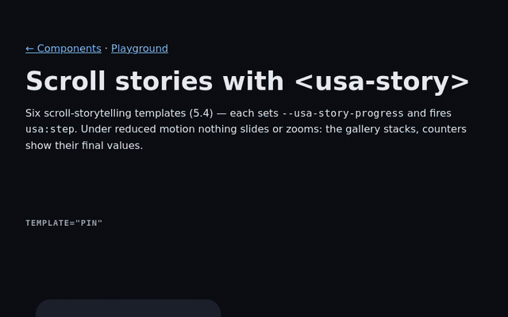

<div align="center">

# Motionary

**Zero dependencies · measured sizes · accessible by default.** Scroll animations and animated Web Components for the web.

_Formerly **use-scroll-animate**. The old npm package is still published as an alias of the same build._

[](https://www.npmjs.com/package/motionary) [](https://github.com/HarrisonCN/Motionary/actions/workflows/ci.yml) [](https://bundlejs.com/?q=motionary/core) [](./LICENSE) [](https://scorecard.dev/viewer/?uri=github.com/HarrisonCN/Motionary)

**English** | [简体中文](./README_zh.md) | [日本語](./README_ja.md)

**[Animation Store](https://harrisoncn.github.io/Motionary/showcase/)** · **[Components](https://harrisoncn.github.io/Motionary/showcase/components.html)** · **[Component playground](https://harrisoncn.github.io/Motionary/showcase/run.html)** · **[Timeline playground](https://harrisoncn.github.io/Motionary/showcase/playground.html)** · **[Scroll story](https://harrisoncn.github.io/Motionary/showcase/story.html)**

</div>

<p align="center"></p>

```bash
npm i motionary
```
```html
<h2 data-sa data-sa-animation="fade-in-up">Hello</h2>
<script type="module">import ScrollAnimate from 'motionary'; ScrollAnimate.init();</script>
```

Motionary reveals content as it scrolls into view and gives you <!--fact:public-->416<!--/fact--> animated `<mo-*>` custom elements:
buttons, cards, forms, loaders, page blocks, physics, page transitions, generative backgrounds, Lottie, WebGL and more.
It works in plain HTML, React, Vue, Svelte, Solid and Angular, and in desktop web views (Electron, Tauri, WebView2).
There are no runtime dependencies, every entry point is tree-shakeable with its gzip size measured in CI, and every
animation respects `prefers-reduced-motion`.

What changed in each version: [CHANGELOG.md](./CHANGELOG.md) · Supply chain: [docs/supply-chain.md](./docs/supply-chain.md) ·
CDN with SRI hashes: [docs/cdn-sri.md](./docs/cdn-sri.md) · Compared with AOS, GSAP, Lenis and Motion: [docs/compare](./docs/compare/README.md) ·
Try it online: [StackBlitz examples](./examples/stackblitz/README.md).

## Contents

[What's inside](#whats-inside) · [Install](#install) · [Quick start](#quick-start) · [Demos](#demos-and-playgrounds) ·
[Components](#components) · [Style variants](#style-variants) · [Runtime](#runtime-and-tiers) ·
[AI workflow](#ai-workflow) · [CLI](#cli) · [Figma plugin](#figma-plugin) · [Accessibility](#accessibility) ·
[Performance](#performance-and-size) · [Versions](#versions-and-upgrading) · [Docs](#documentation) ·
[Contributing](#contributing) · [License](#license) · [Reference](#reference)

## What's inside

| Area | What you get | Start here |
|---|---|---|
| **Scroll reveal** | 214 presets in 14 families: 33 in the core and 181 more in `motionary/presets/extended` (fades, zooms, 3D flips, clip-path shapes, blur and mask, bounce, glitch, scroll-linked `scrub-*`). Plus `timeline()`, `staggerChildren()` and `parallax()` | [Presets](./docs/presets.md) · [API](./docs/API.md) |
| **Core components** | <!--fact:core-->91<!--/fact--> elements in `motionary/components`, imported by category: text, buttons, cards, backgrounds, transitions, gestures, SVG, WebGL and more | [Components](#components) |
| **Widgets** | <!--fact:widgets-->325<!--/fact--> elements, each with its own entry point `motionary/widgets/<name>`: page blocks, interface parts, forms, data and media, depth surfaces, loaders, tactile controls, live activity cards and 3D instruments | [Collections](#collections) |
| **Effects** | <!--fact:effects-->159<!--/fact--> effects, each with its own entry point `motionary/effects/<name>`, or on any element through `<mo-fx>` | [Animation Store](https://harrisoncn.github.io/Motionary/showcase/) |
| **Style variants and looks** | Six built-in variants (`minimal`, `neon`, `glass`, `brutalist`, `fluent`, `material`) set through shared design tokens, plus 2040 looks for the kit widgets: 40 palettes × 17 treatments × 3 families | [Style variants](#style-variants) · [Looks](#looks) |
| **Motion Core and runtime** | `createMotion()` from `motionary/core` (about 2.5 KB gzip), and `motionary/runtime` with <!--fact:runtimeModules-->21<!--/fact--> modules in three tiers: scroll scenes, smooth scrolling, text splitting, SVG, sprites, GIF / APNG / WebP, Lottie, WebGL2, glTF / OBJ, 2D physics | [Runtime](#runtime-and-tiers) |
| **Frameworks** | `motionary/react`, `motionary/vue`, `motionary/svelte`, `motionary/solid`, `motionary/angular`, plus element wrappers. Importing on the server does nothing | [Frameworks](#frameworks) |
| **AI workflow** | Copy as AI prompt in every playground, an Agent Skill, a read-only MCP server and a local text-to-motion parser | [AI workflow](#ai-workflow) |
| **Tooling** | A CLI (doctor, export to CSS / mini program WXSS / HarmonyOS ArkTS, motion tokens, codemods), a Figma plugin and Motion Studio | [CLI](#cli) · [Figma plugin](#figma-plugin) |

[How components are counted](./docs/components.md#how-components-are-counted).

## Install

```bash
npm i motionary
```

No build step? Use the CDN. The URLs pin the major version (`@<!--ver:major-->17<!--/ver-->`); for production, pin the exact version with SRI ([docs/cdn-sri.md](./docs/cdn-sri.md)):

```html
<script src="https://unpkg.com/motionary@17/dist/index.umd.js"></script>            <!-- scroll API: window.ScrollAnimate -->
<script src="https://unpkg.com/motionary@17/dist/presets-extended.umd.js"></script> <!-- +181 presets -->
<script src="https://unpkg.com/motionary@17/dist/components.umd.js"></script>       <!-- the motionary/components elements: window.UsaComponents -->
<script src="https://unpkg.com/motionary@17/dist/widgets.umd.js"></script>          <!-- the widgets: window.UsaWidgets -->
<mo-reveal effect="fade-up"><h2>Hello</h2></mo-reveal>
```

jsDelivr works too: `https://cdn.jsdelivr.net/npm/motionary@17/dist/…`.

**Element names.** Since 17.3 `<mo-*>` is the default name. The CDN bundles, `defineComponents()`, `defineWidgets()` and
the 17.3+ widgets register it themselves. When you import single components or categories as ES modules, call
`defineMoAliases()` from `motionary/components/mo` first. The older `<usa-*>` names still work as deprecated aliases, and
`npx -p motionary mo-codemod tags --write` renames them in your code. `usa:*` events and `--usa-*` CSS properties work
with both names ([v17 migration guide](./docs/migrating-to-v17.md)).

**Coming from `use-scroll-animate`?** It keeps working at the same versions. To switch, replace the name in imports and
URLs ([details](./docs/versions.md)).

## Quick start

### HTML: data attributes

```html
<h2 data-sa data-sa-animation="fade-in-up">Hello</h2>
<div data-sa data-sa-animation="bounce-in-up" data-sa-delay="150">Card</div>

<script type="module">
  import ScrollAnimate from 'motionary';
  import 'motionary/presets/extended'; // optional: +181 presets (bounce-in-up, clip-diamond, …)
  ScrollAnimate.init();                // picks up every [data-sa]
</script>
```

Every option has a `data-sa-*` attribute ([API reference](./docs/API.md)).

### JavaScript

```js
import ScrollAnimate, { staggerChildren, parallax } from 'motionary';

ScrollAnimate.observe('.card', { animation: 'zoom-in-up', duration: 800, easing: 'spring' });
staggerChildren(document.querySelector('.grid'), { animation: 'stagger-pop', stagger: 60 });
parallax('.hero-bg', { speed: 0.3 });
// native scroll timeline, off the main thread where the browser supports it
ScrollAnimate.observe('.logo', { animation: 'scrub-spin', engine: 'css', viewRange: ['cover 0%', 'cover 100%'] });
```

### Web Components

```html
<script type="module">
  import { defineComponents } from 'motionary/components';
  defineComponents(); // or lazyDefine() from 'motionary/components/lazy': loads only the tags on the page
</script>

<mo-card effect="holo">…</mo-card>
<mo-button deform="gooey">Buy</mo-button>
<mo-fx effect="confetti" trigger="click"><button>Celebrate</button></mo-fx>
```

### Motion Core (`motionary/core`)

```js
import { createMotion } from 'motionary/core';
import { retro, cinema } from 'motionary/plugins';

const motion = createMotion().use(retro, cinema);
motion.reveal('.card', 'fade-up', { stagger: 80 });       // scroll-in entrances
motion.bind(button, 'vhs-glitch', { trigger: 'click' });  // an effect on a trigger
await motion.play(hero, 'dolly-in', { duration: 900 });   // play once and wait for it
```

More: [docs/core.md](./docs/core.md).

### Frameworks

Each adapter is its own entry point and cleans up on unmount.

```jsx
// React
import React from 'react';
import { createReactHooks } from 'motionary/react';
const { useScrollAnimate } = createReactHooks(React);

export function Card() {
  const ref = useScrollAnimate({ animation: 'fade-in-up' });
  return <div ref={ref}>Hello</div>;
}
```

```vue
<!-- Vue 3 -->
<script setup>
import { ref, onMounted, onUnmounted } from 'vue';
import { createVueComposables } from 'motionary/vue';
const { useScrollAnimate } = createVueComposables({ ref, onMounted, onUnmounted });
const { animateRef } = useScrollAnimate({ animation: 'zoom-in' });
</script>
<template><div ref="animateRef">Hello</div></template>
```

```svelte
<!-- Svelte 3–5 -->
<script>
  import { scrollAnimate } from 'motionary/svelte';
</script>
<div use:scrollAnimate={{ animation: 'flip-up' }}>Hello</div>
```

```jsx
// Solid
import { scrollAnimate } from 'motionary/solid';
scrollAnimate; // keeps the directive import (TypeScript)
export const Card = () => <div use:scrollAnimate={{ animation: 'blur-in-up' }}>Hello</div>;
```

```ts
// Angular (standalone): the <mo-*> elements (and the legacy <usa-*> names)
import { APP_INITIALIZER, CUSTOM_ELEMENTS_SCHEMA, Component } from '@angular/core';
import { provideUsa, usaDetail } from 'motionary/angular';
// app.config.ts: providers: [provideUsa(APP_INITIALIZER, ['click', 'ui'])]   (the categories to register)
// usa:* events: `(usa:change)` does not compile in Angular 17+ — use the 6-line `[usaOn]` directive from docs/frameworks-ssr.md
@Component({ standalone: true, imports: [UsaOn], schemas: [CUSTOM_ELEMENTS_SCHEMA],
  template: `<mo-checkbox label="Motion" [checked]="on" [usaOn]="{ change: onChange }"></mo-checkbox>` })
export class Settings { on = false; onChange = (e: Event) => (this.on = usaDetail(e).checked); }
```

Element wrappers live in `motionary/components/react` · `vue` · `svelte` · `solid`. SSR, Next.js, Nuxt and SvelteKit:
[docs/frameworks-ssr.md](./docs/frameworks-ssr.md) (React 19 + SSR: bind `usa:*` events with a ref and `bindUsa`, because
React 19 does not attach `onusa:*` props to hydrated elements). Tested versions:
[docs/frameworks-matrix.md](https://github.com/HarrisonCN/Motionary/blob/main/docs/frameworks-matrix.md). Every public
subpath by layer: [docs/public-api.md](./docs/public-api.md).

## Demos and playgrounds

Everything runs in the browser with no install. The site is built from [`showcase/`](./showcase/).

| Page | What it does |
|---|---|
| [Animation Store](https://harrisoncn.github.io/Motionary/showcase/) | Preview, tweak and copy every preset and effect at desktop and phone sizes |
| [Components](https://harrisoncn.github.io/Motionary/showcase/components.html) | The gallery: every `<mo-*>` element with its attributes, prerequisites and tier |
| [Component playground](https://harrisoncn.github.io/Motionary/showcase/run.html) | Each component as a complete runnable page: edit, **Run**, **Copy** or **Download**, all from exactly what is in the editor. HTML (CDN) or npm + bundler through an import map. Missing prerequisites show with the line that fixes them. Deep links work, like `run.html#usa-tilt` |
| [Timeline playground](https://harrisoncn.github.io/Motionary/showcase/playground.html) | Visual keyframe editor; exports JSON for `<mo-player>` |
| [Scroll story](https://harrisoncn.github.io/Motionary/showcase/story.html) | `<mo-story>` scroll-storytelling templates |
| [Style compare](https://harrisoncn.github.io/Motionary/showcase/styles.html) | One component in all six style variants, each with its own copy button |
| [Looks](https://harrisoncn.github.io/Motionary/showcase/looks.html) | All 2040 looks; pick one and the live widgets above switch to it |
| [Cross-platform previewer](https://harrisoncn.github.io/Motionary/showcase/xplat.html) | One preset on the web, in a mini program and in HarmonyOS ArkUI |
| [demo/index.html](./demo/index.html) | Every preset, no build step (open it locally) |

The themed collections each have a lab page too; see [Collections](#collections).

## Components

Pick the import that fits:

| Import | What it registers |
|---|---|
| `motionary/components` | Every core element (`defineComponents()`), or `lazyDefine()` from `motionary/components/lazy` for only the tags on the page |
| `motionary/components/<category>` | One category, e.g. `motionary/components/cards` |
| `motionary/components/lite` | Every core element with CSS loaded on demand |
| `motionary/widgets/<name>` | One widget, e.g. `motionary/widgets/toast-stack` |
| `motionary/components/widgets` | Every widget (`defineWidgets()`, or `defineWidgets('17.9')` for one release) |
| `motionary/effects/<name>` | One effect |

Every element: [docs/components.md](./docs/components.md) · one page per element in [docs/components/](./docs/components/README.md) ·
every entry point in [docs/entry-points.md](./docs/entry-points.md). Some widgets need a runtime module first; the gallery
shows a **Requires:** badge and the [Reference](#reference) lists them.

<details>
<summary><b>The <!--fact:core-->91<!--/fact--> core elements in <code>motionary/components</code></b></summary>

<!-- core-table:start -->
| Category | Entry | Elements |
|---|---|---|
| **Scroll reveal** | `motionary/components/reveal` | `<mo-reveal>` · `<mo-scroll-progress>` · `<mo-scrolly>` · `<mo-stagger>` |
| **Text** | `motionary/components/text` | `<mo-counter>` · `<mo-glitch>` · `<mo-gradient-text>` · `<mo-handwriting>` · `<mo-scramble>` · `<mo-scroll-highlight>` · `<mo-shimmer-text>` · `<mo-split-text>` · `<mo-text-rotate>` · `<mo-typewriter>` · `<mo-wave-text>` |
| **Interaction** | `motionary/components/interaction` | `<mo-magnetic>` · `<mo-press>` · `<mo-ripple>` · `<mo-spotlight>` · `<mo-tilt>` |
| **Feedback** | `motionary/components/feedback` | `<mo-check>` · `<mo-progress>` · `<mo-skeleton>` · `<mo-spinner>` · `<mo-toaster>` |
| **Backgrounds** | `motionary/components/background` | `<mo-acrylic>` · `<mo-aurora>` · `<mo-blobs>` · `<mo-dot-network>` · `<mo-grain>` · `<mo-grid-glow>` · `<mo-marquee>` · `<mo-particles>` · `<mo-water-ripple>` |
| **Transitions** | `motionary/components/transitions` | `<mo-accordion>` · `<mo-dialog>` · `<mo-view-switch>` |
| **Spring & physics** | `motionary/components/physics` | `<mo-draggable>` · `<mo-overscroll>` · `<mo-spring>` |
| **Cards** | `motionary/components/cards` | `<mo-card>` · `<mo-card-stack>` · `<mo-carousel-3d>` · `<mo-sticky-stack>` |
| **Click & buttons** | `motionary/components/click` | `<mo-button>` · `<mo-checkbox>` · `<mo-click>` · `<mo-double-tap>` · `<mo-hold>` · `<mo-icon-morph>` · `<mo-like>` |
| **UI kit** | `motionary/components/ui` | `<mo-avatar-stack>` · `<mo-badge>` · `<mo-bottom-sheet>` · `<mo-drawer>` · `<mo-fab>` · `<mo-navbar>` · `<mo-popover>` · `<mo-pull-refresh>` · `<mo-slider>` · `<mo-tabs>` |
| **Page-wide** | `motionary/components/page` | `<mo-ambient>` · `<mo-auto-skeleton>` · `<mo-back-to-top>` · `<mo-cursor>` · `<mo-fullpage>` · `<mo-loading-bar>` · `<mo-motion-switch>` · `<mo-splash>` |
| **Timeline** | `motionary/components/timeline` | `<mo-timeline>` |
| **Gestures** | `motionary/components/gesture` | `<mo-pinch-zoom>` · `<mo-swipeable>` |
| **SVG** | `motionary/components/svg` | `<mo-anim-icon>` · `<mo-draw>` · `<mo-mask-reveal>` · `<mo-morph>` |
| **WebGL** | `motionary/components/webgl` | `<mo-distort>` · `<mo-liquid>` · `<mo-post-fx>` · `<mo-shader>` |
| **3D depth** | `motionary/components/depth` | `<mo-cube>` · `<mo-depth>` |
| **Layout** | `motionary/components/layout` | `<mo-auto-animate>` · `<mo-masonry>` |
| **Packs** | `motionary/components/packs` | `<mo-pack>` |
| **Effect registry** | `motionary/components/fx` | `<mo-fx>` |
| **Effect packs** | `motionary/components/effects` | `<mo-audio>` · `<mo-gesture-fx>` · `<mo-motion-theme>` · `<mo-player>` · `<mo-story>` |
<!-- core-table:end -->

</details>

### Collections

Recent releases add widgets in themed sets. Each set has a lab page and an API page, and since 17.12 the [home page](https://harrisoncn.github.io/Motionary/showcase/#collections) shows every set running in one tabbed Collections section:

| Collection | What is in it | Lab · Docs |
|---|---|---|
| Damped parts (17.18) | 6 widgets with a damped, physical slide: a collapsible panel, read-more text, a bottom sheet with snap points, a pager with rubber-band ends, an elastic scroll area and a card pile that unrolls. Plus `springExpand()` for any box or `<details>`. Keyboard and screen-reader ready, still under reduced motion | [Demo](https://harrisoncn.github.io/Motionary/showcase/damped.html) · [Docs](./docs/damped-motion-17-18.md) |
| Spring parts (17.17) | 10 widgets on the spring core: a like button that bursts, a star rating, a copy button, a tag input, one-time-code boxes, a drag-and-keyboard reorder list, a swipe row with actions, a toast pile, an accordion and a rolling counter. Interruptible, keyboard and screen-reader ready, still under reduced motion; styled by the [2040 looks](#looks) | [Demo](https://harrisoncn.github.io/Motionary/showcase/springs.html) · [Docs](./docs/spring-parts-17-17.md) |
| Micro-interactions (17.16) | 8 widgets on a new spring core: an exact spring solver with 16 tuned springs and 7 feels, `micro()` for press, hover, lift, magnetic, tilt, glow, squish, drag with inertia and focus on any element, feedback impulses (shake, nod, pop …), and spring controls (switch, checkbox, input, state button, slider, segmented control, stepper). Interruptible, velocity-aware and still under reduced motion; styled by the [2040 looks](#looks) | [Lab](https://harrisoncn.github.io/Motionary/showcase/micro.html) · [Docs](./docs/micro-17-16.md) |
| Toolkit: UI Parts & Charts (17.15) | 12 widgets: everyday UI parts (radial menu, hover card, toggle group, time picker, colour swatches, calendar strip, comparison table) and data charts (radial bars, bar chart race, bullet chart, slope chart, dot plot). Styled by the [2040 looks](#looks) | [Lab](https://harrisoncn.github.io/Motionary/showcase/toolkit.html) · [Docs](./docs/toolkit-17-15.md) |
| Icons (17.14–17.17) | 753 icons: original line icons in 34 categories (arrows, interface, media, files, communication, devices, weather, commerce, editor, maps and travel, people, nature, shapes, time, plus development, security, health, food and drink, household, sports, education, finance, charts and data, and tools from 17.15, and animals, music, games, transport, office, science, buildings, celebration, clothing and gestures from 17.17), drawn on one 24px grid in the text colour. `mo-icon` plays one of 12 motions (spin, pulse, beat, bounce, wiggle, shake, ring, float, flip, draw, pop, blink) on loop, hover, click or view; `mo-icon-picker` searches them in English or Chinese and copies a name, tag or SVG | [Lab](https://harrisoncn.github.io/Motionary/showcase/icons.html) · [Docs](./docs/icons-17-14.md) |
| Studio: Collaboration, Charts & Playful Motion (17.13) | 20 widgets: collaboration and input (product tour, signature pad, wheel picker, mention input, emoji picker, comment thread, diff viewer), data charts (line, funnel, treemap, Gantt, waffle) and playful motion (split-flap, scratch card, page flip, circular text, pixel transition, magnet lines, text pressure, shuffle grid). Styled by the [2040 looks](#looks) | [Lab](https://harrisoncn.github.io/Motionary/showcase/studio.html) · [Docs](./docs/studio-17-13.md) |
| Parts & Home Collections (17.12) | 18 widgets: UI parts (progress tabs, code tabs, helpful vote, share button, inline edit, tag cloud), data and interaction (heatmap, donut chart, sortable list, zoom lens, rating bars, checklist) and motion surfaces (meteors, connect beam, retro grid, orbit rings, letter swap, ripple grid) | [Lab](https://harrisoncn.github.io/Motionary/showcase/parts.html) · [Docs](./docs/parts-17-12.md) |
| Blocks, Parts & Depth (17.11) | 20 widgets: page blocks (search bar, subscribe, download button, reveal footer, shape divider), interface parts (virtual list, infinite scroll, context menu, split pane, desktop windows, morph card) and depth surfaces (scroll zoom, image tunnel, orbit gallery, border beam). Styled by the [2040 looks](#looks) | [Lab](https://harrisoncn.github.io/Motionary/showcase/blocks.html) · [Docs](./docs/blocks-17-11.md) |
| UI, Components & Motion (17.10) | 21 widgets: page blocks (sidebar, scrollspy, pricing, bento, sticky CTA), data and media (lightbox, data table, JSON viewer, hotspots) and motion surfaces (horizontal scroll, image trail, liquid glass, path motion) | [Lab](https://harrisoncn.github.io/Motionary/showcase/kit.html) · [Docs](./docs/kit-17-10.md) |
| Moments & Tactile (17.9) | 34 widgets: micro-interactions, squishy tactile controls, pure-CSS loaders, form moments (chip input, plan picker, elastic slider, strength meter) | [Lab](https://harrisoncn.github.io/Motionary/showcase/moments.html) · [Docs](./docs/moments-tactile.md) |
| Spatial Instruments (17.8) | 3 drag-to-explore 3D cards and 3 effects, on an opt-in Three.js renderer | [Lab](https://harrisoncn.github.io/Motionary/showcase/instruments.html) · [Docs](./docs/runtime/spatial-instruments.md) |
| Form Atelier (17.7) | 12 form widgets (select, combobox, multi-select, password, range slider, form stepper) and 4 SVG feedback effects | [Lab](https://harrisoncn.github.io/Motionary/showcase/forms.html) · [Docs](./docs/form-atelier.md) |
| Matter & Motion (17.6) | 13 interactive fields, fluid type and curve labs, and 6 effects | [Lab](https://harrisoncn.github.io/Motionary/showcase/matter.html) · [Docs](./docs/matter-motion.md) |
| Live activities (17.5) | 15 compact activity cards (flight status, delivery tracker, workout player) and a drifting card wall | [Lab](https://harrisoncn.github.io/Motionary/showcase/activity.html) · [Docs](./docs/live-activities.md) |
| Luminous controls (17.4) | 6 glowing controls: day/night switch, particle icon and button, halo slider, orbit progress | [Lab](https://harrisoncn.github.io/Motionary/showcase/luminous.html) · [Docs](./docs/luminous-controls.md) |

Older widgets (file tree, download menu, film titles and more): [docs/gallery-components.md](./docs/gallery-components.md).

## Style variants

Every element reads the same design tokens (`--usa-accent`, `--usa-surface`, `--usa-text`, `--usa-radius`, `--usa-font`
and a few more). A variant sets them all at once: put `variant="glass"` on an element, `data-usa-variant="glass"` on any
ancestor, or switch the whole page:

```js
import { setVariant } from 'motionary/components/ui';
setVariant('glass'); // minimal · neon · glass · brutalist · fluent · material
```

You can also set the tokens yourself. See them side by side on the
[style compare page](https://harrisoncn.github.io/Motionary/showcase/styles.html) and in
[docs/components.md](./docs/components.md).

### Looks

The kit widgets also come with 2040 ready-made looks: 40 palettes × 17 treatments in each of three families (UI,
components, motion), 680 each (17.14 added eight palettes and eight treatments per family; 17.15 and 17.17 ten more palettes each). A treatment changes borders, radius, shadows, glow, frosted glass, type, picture filters,
frames and loop speed, not only colors, and every look passes WCAG AA text contrast. Looks set the `--mo-kit-*` tokens,
so any widget that reads them can wear any look. Since 17.17 each look also sets `--mo-feel`, so the spring parts and `micro()` move the way the look looks: brutal lands heavy, clay plays, terminal snaps.

```js
import { adoptLooks, applyLook } from 'motionary/components/widgets';

adoptLooks();                 // every look, or adoptLooks('ui') for one family
// <mo-subscribe look="neon-ocean"></mo-subscribe>, or data-mo-look="neon-ocean" on any ancestor
applyLook(document.querySelector('mo-split-pane'), 'frosted-grape');
```

Browse them on the [looks page](https://harrisoncn.github.io/Motionary/showcase/looks.html); names, tokens and the helper
functions are in [docs/looks-17-11.md](./docs/looks-17-11.md).

## Runtime and tiers

`motionary/runtime` is Motionary's own animation runtime: a shared ticker, tween and timeline engine, plus one module per
feature or file format (`motionary/runtime/<module>`). Register what you use with `use()`. Each module belongs to a tier
and depends only on its own tier or lower ones, so a basic page never downloads WebGL, 3D or physics code.

| Tier | Modules | Bundle (gzip, 13.0) | Historical reference |
|---|---|---:|---:|
| **Basic** | core (ticker, tween, timeline), `scroll`, `text`, `format-css`, `format-motion` | 10.83 KB | 12 KB |
| **Standard** | basic + `smooth`, `drag-snap`, `format-svg`, `format-sprite`, `format-gif`, `format-apng`, `format-webp`, `vector` (Lottie / dotLottie), `lottie-state`; official Rive runtime | 33.74 KB | 37 KB |
| **Advanced** | standard + `gl` (WebGL2), `format-gltf`, `format-obj`, `gltf-anim`, `gltf-decoders` (Draco / KTX2), `physics`, `format-scene` | 54.55 KB | 60 KB |

```js
import { use } from 'motionary/runtime';
import { scroll } from 'motionary/runtime/scroll';
import { defineScrollScene } from 'motionary/components/widgets';

use(scroll);          // register the module first (this also registers the core)
defineScrollScene();  // then the component that needs it
```

A component that needs a missing module throws a clear error that names the install, import and CDN fix. Details:
[docs/runtime-tiers.md](./docs/runtime-tiers.md), one page per module in [docs/runtime/](./docs/runtime/), and the
[module and prerequisite tables](#reference) at the end of this README.

## AI workflow

**Copy as AI prompt.** The Animation Store's effect detail, the timeline playground and the component playground each
have a **Copy as AI prompt** button. It copies the code with every value you tuned, ready to paste into a coding assistant.

**Agent Skill.** [`skills/motionary/SKILL.md`](./skills/motionary/SKILL.md) teaches Claude Code, Codex and other agents
that read Agent Skills how to install, register and pick Motionary components, and which rules to keep. Add it with
`npx skills add HarrisonCN/Motionary`, or copy the folder into `.claude/skills/`.

**MCP server.** `motionary-mcp` is a read-only [Model Context Protocol](https://modelcontextprotocol.io) server. Claude,
Cursor, VS Code, Windsurf, Zed and other MCP clients can look up the component catalog and get snippets that already
install, import and register every prerequisite in the right order.

```json
{ "mcpServers": { "motionary": { "command": "npx", "args": ["-y", "-p", "motionary", "motionary-mcp"] } } }
```

Claude Code: `claude mcp add motionary -- npx -y -p motionary motionary-mcp`.

- Tools: `list_components`, `search_components`, `get_component`, `get_example`, `scaffold_snippet`, `suggest_motion`,
  `validate_snippet`, `check_compat`.
- `validate_snippet { mount: true }` mounts the markup in jsdom (an optional peer: `npm i -D jsdom`) with the real bundles
  and checks it against the component contract. The snippet's own scripts never run.
- Answers match the version installed in your project; `check_compat` lists what that version is missing or does differently.
- Full guide: [docs/mcp.md](./docs/mcp.md).

**Motion from text.** `motionary/tooling/ai` turns a description like "fade the cards up slowly, one after another" into
an effect, keyframes, CSS and matching components. The default parser is local and deterministic (English and Chinese).
To use your own LLM, pass a provider to `suggestMotion()`. Motionary bundles no vendor SDK and makes no network request
unless you pass one. Answers are checked against a JSON Schema, and the local result is used if they fail.

```ts
import { suggestMotion } from 'motionary/tooling/ai';
const { intent, source } = await suggestMotion('cards cascade in like falling dominoes', { provider }); // provider is optional
el.animate(intent.keyframes, intent.options);
```

More: [AGENTS.md](./AGENTS.md) · [docs/ai-provider.md](./docs/ai-provider.md) · [prompt guide](./docs/ai-prompt-guide.md) ·
the site serves [`components.json`](https://harrisoncn.github.io/Motionary/components.json) and
[`llms.txt`](https://harrisoncn.github.io/Motionary/llms.txt).

## CLI

Everything ships in the `motionary` package and runs with `npx`:

| Command | What it does |
|---|---|
| `npx motionary doctor [paths…] [--json]` | Lists removed import paths and legacy event names in your project. Exits with code 1 when it finds any, so you can use it in CI |
| `npx motionary export --target css\|wxss\|arkts [--presets a,b] [--rpx] [--out file]` | Exports presets and motion tokens to CSS, mini program WXSS or HarmonyOS ArkTS ([docs/cross-platform.md](./docs/cross-platform.md)) |
| `npx motionary compat <version> [--json]` | What a project on that version can use, and what changed after it ([docs/version-compat.md](./docs/version-compat.md)) |
| `npx motionary tokens import-figma\|export-figma\|validate\|css …` | Motion Tokens 2.0: Figma Variables JSON ↔ W3C design tokens / CSS, and token-file validation; no network calls ([docs/motion-tokens.md](./docs/motion-tokens.md)) |
| `npx -p motionary mo-codemod tags --write` | Renames `<usa-*>` tags to `<mo-*>` in your code |
| `npx usa-codemod-13 [--write] [paths…]` | Rewrites the paths removed in 13.0 and CDN URLs pinned to `@10` / `@11` / `@12`. A dry run unless you pass `--write`; `usa-codemod-11` and `usa-codemod-12` cover the earlier majors |
| `npx create-motionary-plugin <name>` | Scaffolds an effect plugin with tests and a signing script |
| `npx -y -p motionary motionary-mcp` | Starts the MCP server ([AI workflow](#ai-workflow)) |

## Figma plugin

[figma-plugin/](./figma-plugin/README.md) (also in `node_modules/motionary/figma-plugin/`) exports the current selection
as a **complete HTML page** (tokens, prerequisite scripts in order, one element per layer), **CSS tokens** and
**motion.tokens.json** (W3C design tokens). A layer named after a component (`usa-tilt`) becomes that element, and Figma
variables `motion/duration/*` and `motion/easing/*` override the default tokens. The plugin has no network access and
never edits the document. For the full Motion Tokens 2.0 set as Figma Variables, use
`npx motionary tokens export-figma` / `import-figma`. See [figma-plugin/README.md](./figma-plugin/README.md) and
[docs/motion-tokens.md](./docs/motion-tokens.md).

## Accessibility

- With `prefers-reduced-motion: reduce`, scroll reveals show content right away (no entrance, parallax or scrub), and
  components switch to calm states (`staticAlternative()`, `adaptKeyframes()`).
- `motionary/components/a11y`: `setMotionSensitivity()` lets users turn off flashes, loops or parallax. It also has
  `announce()` for live regions, `auditMotionA11y()` and `baselineReport()`. `<mo-motion-switch>` is a ready-made motion
  toggle for users.
- Every element follows one [component contract](./docs/component-contract.md) (keyboard, focus, events, lifecycle,
  reduced motion), and `npm run check:contract` enforces it in CI.
- More: [docs/accessibility.md](./docs/accessibility.md).

## Performance and size

Component count and artifact size have no caps. [`size-budget.json`](./size-budget.json) keeps historical references, and
CI reports the measured sizes; going over a reference does not fail CI ([size policy](./docs/size-policy.md)).

<!-- size-table:start -->
Measured on the 17.17.0 build (minified + gzip), generated by `scripts/size.mjs --report`:

| What you import | gzip | Historical reference |
|---|---:|---:|
| `motionary/core` (`createMotion`) | 2.53 KB | 10.00 KB |
| `import ScrollAnimate from 'motionary'` (default instance) | 5.49 KB | 6.00 KB |
| Everything from `motionary` | 8.89 KB | 9.75 KB |
| `dist/index.umd.js` (CDN) | 9.03 KB | 9.75 KB |
| `parallax()` alone | 0.94 KB | 2.00 KB |
| `motionary/presets/extended` (181 presets) | 4.69 KB | 5.25 KB |
| `motionary/runtime` (runtime core) | 5.43 KB | 5.50 KB |
| `motionary/components/reveal` | 4.47 KB | 5.00 KB |
| `motionary/components/lite` (every element, CSS on demand) | 79.51 KB | 79.00 KB |
| `motionary/components` (every element + CSS) | 96.42 KB | 93.75 KB |
| `dist/components.umd.js` (CDN, everything) | 120.08 KB | 115.75 KB |
<!-- size-table:end -->

- No scroll listeners by default (IntersectionObserver instead), and animations stay on the compositor (`transform`,
  `opacity`, `filter`, `clip-path`).
- Imports have no side effects ([docs/tree-shaking.md](./docs/tree-shaking.md)).
- Every PR measures first-screen transfer, script time, GPU resources and frame stability in headless Chrome
  ([docs/perf-ci.md](./docs/perf-ci.md)).
- Source maps are not shipped to npm. They live in the tagged git tree (each file's `sourceMappingURL` points there) and,
  from 16.3, also as a `sourcemaps` archive on each GitHub release ([docs/source-maps.md](./docs/source-maps.md)).
- More: [docs/performance.md](./docs/performance.md).

**Browsers:** evergreen browsers since 2023 (Chrome / Edge ≥ 111, Safari ≥ 16.4, Firefox ≥ 115, WebView2, Electron ≥ 24).
Motionary uses View Transitions and scroll-driven animations where the browser has them and falls back to JavaScript
where it does not. `baselineReport()` checks a given browser.

## Versions and upgrading

- **npm dist-tags:** `latest` is the newest release of the current major (<!--ver:version-->17.17.0<!--/ver-->; minors move it since 14.1). Each minor also
  gets its own tag `v<major>-<minor>` (for example `v15-0`), `v15-line` follows the 15.x line and `v14-lts` is 14.9.x.
  `motionary` and `use-scroll-animate` are published together at the same versions.
- **CDN:** URLs pin a major (`motionary@<!--ver:major-->17<!--/ver-->`). Exact pins (`motionary@12.4.0`) keep working.
- **Semver:** breaking changes come only in majors, each with a guide and a codemod. Deprecations stay until the next
  major, with `@deprecated` types and no runtime warning.
- **Stable and experimental:** the scroll API, `motionary/core`, presets, `motionary/motion`, `motionary/scene`,
  `motionary/runtime/*`, the `<mo-*>` components and widgets, the framework adapters and the CLI are stable. Motion
  Studio (`motionary/studio/*`), the AI assistant and provider, the MCP server, the Figma plugin and the cross-platform
  exporters are experimental and may change in a minor ([docs/stability.md](./docs/stability.md)).
- **What each version has:** `since` / `changed` for every component and runtime module
  ([docs/version-compat.md](./docs/version-compat.md)), feature-by-feature support ([docs/compat-matrix.md](./docs/compat-matrix.md)).
  Details: [docs/versions.md](./docs/versions.md) · [CHANGELOG.md](./CHANGELOG.md).

Migration guides: [17](./docs/migrating-to-v17.md) · [16](./docs/migrating-to-v16.md) · [15](./docs/migrating-to-v15.md) ·
[14](./docs/migrating-to-v14.md) · [13](./docs/upgrading-13.md) · [12](./docs/upgrading-12.md) · [11](./docs/upgrading-11.md) ·
[10](./docs/upgrading-10.md) · [9](./docs/upgrading-9.md) · [8](./docs/upgrading-8.md) · [7](./docs/upgrading-7.md) ·
[6](./docs/upgrading-6.md) · [5](./docs/upgrading-5.md) · [4](./docs/upgrading-4.md) · [3](./docs/upgrading-3.md) ·
[2](./docs/deprecations.md). From another library: [AOS](./docs/migration-from-aos.md) ·
[GSAP ScrollTrigger](./docs/migration-from-gsap-scrolltrigger.md). `npx motionary doctor` finds what still needs to change.

## Documentation

| Topic | Docs |
|---|---|
| Reference | [API](./docs/API.md) · [Presets](./docs/presets.md) (all 214) · [Components](./docs/components.md) · [Looks](./docs/looks-17-11.md) · [Entry points](./docs/entry-points.md) · [Public API by layer](./docs/public-api.md) · [Motion Core](./docs/core.md) · [Timeline editor model](./docs/timeline-editor.md) |
| Runtime | [Runtime tiers](./docs/runtime-tiers.md) · [Modules](./docs/runtime/) · [Compatibility matrix](./docs/compat-matrix.md) |
| Platforms | [Frameworks & SSR](./docs/frameworks-ssr.md) · [Framework matrix](https://github.com/HarrisonCN/Motionary/blob/main/docs/frameworks-matrix.md) · [Windows apps](./docs/windows-apps.md) · [Hybrid apps (MAUI, Flutter, Electron, Tauri)](./docs/hybrid-apps.md) · [Cross-platform export](./docs/cross-platform.md) · [Examples](./examples/) |
| Design & AI | [Motion Studio 2.0 app](./docs/studio-app.md) · [Motion Studio](./docs/studio.md) · [Studio export](./docs/studio-export.md) · [Studio templates](./docs/studio-templates.md) · [Studio AI assistant](./docs/studio-ai.md) · [Studio assets](./docs/studio-assets.md) · [Studio canvas](./docs/studio-canvas.md) · [Layout motion 2.0](./docs/layout-motion.md) · [Motion tokens 2.0](./docs/motion-tokens.md) · [Figma plugin](./figma-plugin/README.md) · [MCP server](./docs/mcp.md) · [AI provider](./docs/ai-provider.md) · [Prompt guide](./docs/ai-prompt-guide.md) |
| Quality | [Accessibility](./docs/accessibility.md) · [Component contract](./docs/component-contract.md) · [Performance](./docs/performance.md) · [Perf CI](./docs/perf-ci.md) · [Scheduling](./docs/scheduling.md) · [Tree-shaking](./docs/tree-shaking.md) · [Source maps](./docs/source-maps.md) |
| Project | [Architecture](./docs/architecture.md) · [Roadmap](./docs/ROADMAP.md) · [Versions](./docs/versions.md) · [Changelog](./CHANGELOG.md) |

The architecture has four layers (Motion Core, Runtime, Components and Tooling) with the framework entries on top;
`test/architecture.test.ts` enforces the import rules between them ([docs/architecture.md](./docs/architecture.md)).
The docs in `docs/` are in English, except the roadmap, which is in Chinese.

## Contributing

Issues and pull requests are welcome; see [CONTRIBUTING.md](./CONTRIBUTING.md). Before you open a PR, run `npm test`,
`npm run build`, `npm run check:docs`, `npm run check:contract`, `npm run check:peer-docs` and `npm run size:check`.
When you change behaviour, update this README together with [README_zh.md](./README_zh.md) and [README_ja.md](./README_ja.md).
Counts, versions and the tables marked as generated come from scripts (`node scripts/facts.mjs`,
`node scripts/readme-sync.mjs`, `node scripts/gen-runtime-docs.mjs`); do not edit them by hand.

## License

MIT © HarrisonCN. See [LICENSE](./LICENSE).

## Reference

`node scripts/gen-runtime-docs.mjs` generates the tables below from the tested module data. Do not edit them by hand.

<details>
<summary><b>Runtime modules and component prerequisites</b></summary>

<!-- runtime:start -->
## Runtime (`motionary/runtime`) & prerequisites

Motionary ships its own zero-dependency animation runtime — shared ticker, tween + timeline engine, and one tree-shakable module per feature / format (`motionary/runtime/<module>`). `npm i motionary` installs all of it; you pay only for the modules you import. Components that need a module say so with a **Requires:** badge in the gallery and the Store, and throw a clear error (install / import / CDN) when it is missing.

| Module | Import | CDN (IIFE) | Register | historical gzip reference |
|---|---|---|---|---|
| [Three.js instrument scenes](docs/runtime/spatial-instruments.md) | `motionary/runtime/spatial-instruments` | `https://cdn.jsdelivr.net/npm/motionary@17/dist/runtime/spatial-instruments.iife.js` | `use(spatialInstruments);` | 160.0 KB |
| [Runtime core](docs/runtime/core.md) | `motionary/runtime` | `https://cdn.jsdelivr.net/npm/motionary@17/dist/runtime.iife.js` | `use();` | 5.5 KB |
| [CSS @keyframes & WAAPI keyframes loader](docs/runtime/format-css.md) | `motionary/runtime/format-css` | `https://cdn.jsdelivr.net/npm/motionary@17/dist/runtime/format-css.iife.js` | `use(formatCss);` | 2.5 KB |
| [Motion / Framer keyframe JSON loader](docs/runtime/format-motion.md) | `motionary/runtime/format-motion` | `https://cdn.jsdelivr.net/npm/motionary@17/dist/runtime/format-motion.iife.js` | `use(formatMotion);` | 2.5 KB |
| [Scroll scenes](docs/runtime/scroll.md) | `motionary/runtime/scroll` | `https://cdn.jsdelivr.net/npm/motionary@17/dist/runtime/scroll.iife.js` | `use(scroll);` | 4.5 KB |
| [SVG loader: SMIL playback + path morphing](docs/runtime/format-svg.md) | `motionary/runtime/format-svg` | `https://cdn.jsdelivr.net/npm/motionary@17/dist/runtime/format-svg.iife.js` | `use(formatSvg);` | 5.0 KB |
| [Text splitting](docs/runtime/text.md) | `motionary/runtime/text` | `https://cdn.jsdelivr.net/npm/motionary@17/dist/runtime/text.iife.js` | `use(text);` | 2.5 KB |
| [Sprite sheets & image sequences](docs/runtime/format-sprite.md) | `motionary/runtime/format-sprite` | `https://cdn.jsdelivr.net/npm/motionary@17/dist/runtime/format-sprite.iife.js` | `use(formatSprite);` | 3.0 KB |
| [Smooth scrolling](docs/runtime/smooth.md) | `motionary/runtime/smooth` | `https://cdn.jsdelivr.net/npm/motionary@17/dist/runtime/smooth.iife.js` | `use(smooth);` | 3.5 KB |
| [GIF decoder](docs/runtime/format-gif.md) | `motionary/runtime/format-gif` | `https://cdn.jsdelivr.net/npm/motionary@17/dist/runtime/format-gif.iife.js` | `use(formatGif);` | 3.0 KB |
| [APNG loader](docs/runtime/format-apng.md) | `motionary/runtime/format-apng` | `https://cdn.jsdelivr.net/npm/motionary@17/dist/runtime/format-apng.iife.js` | `use(formatApng);` | 3.0 KB |
| [Animated WebP loader](docs/runtime/format-webp.md) | `motionary/runtime/format-webp` | `https://cdn.jsdelivr.net/npm/motionary@17/dist/runtime/format-webp.iife.js` | `use(formatWebp);` | 3.0 KB |
| [WebGL2 scene renderer](docs/runtime/gl.md) | `motionary/runtime/gl` | `https://cdn.jsdelivr.net/npm/motionary@17/dist/runtime/gl.iife.js` | `use(gl);` | 9.0 KB |
| [glTF 2.0 / GLB loader](docs/runtime/format-gltf.md) | `motionary/runtime/format-gltf` | `https://cdn.jsdelivr.net/npm/motionary@17/dist/runtime/format-gltf.iife.js` | `use(formatGltf);` | 6.0 KB |
| [OBJ / MTL loader](docs/runtime/format-obj.md) | `motionary/runtime/format-obj` | `https://cdn.jsdelivr.net/npm/motionary@17/dist/runtime/format-obj.iife.js` | `use(formatObj);` | 3.0 KB |
| [Lottie + dotLottie player](docs/runtime/vector.md) | `motionary/runtime/vector` | `https://cdn.jsdelivr.net/npm/motionary@17/dist/runtime/vector.iife.js` | `use(vector);` | 12.0 KB |
| [Official Rive runtime](docs/runtime/rive.md) | `@rive-app/canvas` | `https://unpkg.com/@rive-app/canvas@2.44.1/rive.js` | `provideRiveRuntime(() => import('@rive-app/canvas')); // lazy: fetched when the first <usa-rive> mounts` | official runtime (not bundled) |
| [2D rigid-body physics](docs/runtime/physics.md) | `motionary/runtime/physics` | `https://cdn.jsdelivr.net/npm/motionary@17/dist/runtime/physics.iife.js` | `use(physics);` | 10.0 KB |
| [Scene JSON (motionary-scene@1)](docs/runtime/format-scene.md) | `motionary/runtime/format-scene` | `https://cdn.jsdelivr.net/npm/motionary@17/dist/runtime/format-scene.iife.js` | `use(formatScene);` | 3.0 KB |
| [Drag, inertia and snap points](docs/runtime/drag-snap.md) | `motionary/runtime/drag-snap` | `https://cdn.jsdelivr.net/npm/motionary@17/dist/runtime/drag-snap.iife.js` | `use(dragSnap);` | 4.0 KB |
| [glTF animation, skinning and morph targets](docs/runtime/gltf-anim.md) | `motionary/runtime/gltf-anim` | `https://cdn.jsdelivr.net/npm/motionary@17/dist/runtime/gltf-anim.iife.js` | `use(gltfAnim);` | 4.5 KB |
| [dotLottie themes + state machines](docs/runtime/lottie-state.md) | `motionary/runtime/lottie-state` | `https://cdn.jsdelivr.net/npm/motionary@17/dist/runtime/lottie-state.iife.js` | `use(lottieState);` | 3.5 KB |
| [glTF decoder hooks (Draco, KTX2)](docs/runtime/gltf-decoders.md) | `motionary/runtime/gltf-decoders` | `https://cdn.jsdelivr.net/npm/motionary@17/dist/runtime/gltf-decoders.iife.js` | `use(gltfDecoders);` | 3.0 KB |
| [Official Draco decoder (Google)](docs/runtime/draco3d.md) | `draco3d` | `https://www.gstatic.com/draco/versioned/decoders/1.5.7/draco_decoder.js` | `provideGltfDecoder('draco', () => import('draco3d')); // lazy: fetched when the first Draco-compressed model loads` | official runtime (not bundled) |
| [Official Basis Universal transcoder (Binomial)](docs/runtime/basis-transcoder.md) | `basis_transcoder.js` | `https://cdn.jsdelivr.net/gh/BinomialLLC/basis_universal@1.16.4/webgl/transcoder/build/basis_transcoder.js` | `provideGltfDecoder('ktx2', () => import('/vendor/basis_transcoder.js').then((m) => m.default || window.BASIS)); // lazy: fetched with the first KTX2 texture` | official runtime (not bundled) |

Install once: `npm i motionary`. Plain HTML: load `runtime.iife.js` first, then the module files (each registers itself).

#### `<usa-plugin-card>` — Requires: motionary/runtime

- **Install:** `npm i motionary`
- **Import order & registration:** Import motionary/runtime and call use() once at start-up, before any runtime-powered component mounts. CDN: the IIFE registers itself (window.MotionaryRuntime).

```js
import { use } from 'motionary/runtime';
import { definePluginCard } from 'motionary/components/widgets';

use();
definePluginCard(); // registers <usa-plugin-card> — after the prerequisites
```

- **CDN:**

```html
<script src="https://cdn.jsdelivr.net/npm/motionary@17/dist/runtime.iife.js"></script>
<!-- then the component bundles -->
<script src="https://unpkg.com/motionary@17/dist/components.umd.js"></script>
<script src="https://unpkg.com/motionary@17/dist/widgets.umd.js"></script>
```

- **Minimal example:**

```html
<usa-plugin-card name="retro" title="Retro" version="1.2.0" author="Motionary" engine="^10.0.0" downloads="12400">
  <p>Pixel, CRT, VHS and Y2K effects.</p>
</usa-plugin-card>
```

#### `<usa-scroll-scene>` — Requires: motionary/runtime/scroll

- **Install:** `npm i motionary`
- **Import order & registration:** Register the core first, then the module: use(scroll) also registers the core. CDN: load runtime.iife.js, then runtime/scroll.iife.js (it registers itself).

```js
import { use } from 'motionary/runtime';
import { scroll } from 'motionary/runtime/scroll';
import { defineScrollScene } from 'motionary/components/widgets';

use(scroll);
defineScrollScene(); // registers <usa-scroll-scene> — after the prerequisites
```

- **CDN:**

```html
<script src="https://cdn.jsdelivr.net/npm/motionary@17/dist/runtime.iife.js"></script>
<script src="https://cdn.jsdelivr.net/npm/motionary@17/dist/runtime/scroll.iife.js"></script>
<!-- then the component bundles -->
<script src="https://unpkg.com/motionary@17/dist/components.umd.js"></script>
<script src="https://unpkg.com/motionary@17/dist/widgets.umd.js"></script>
```

- **Minimal example:**

```html
<usa-scroll-scene start="top 80%" end="bottom 20%" scrub="120" stagger="120">
  <h2 data-scrub="x: -80 -> 0; opacity: 0 -> 1">Scroll</h2>
  <p data-scrub="y: 40 -> 0; opacity: 0 -> 1">and it follows.</p>
</usa-scroll-scene>
```

#### `<usa-text-splitter>` — Requires: motionary/runtime/text

- **Install:** `npm i motionary`
- **Import order & registration:** Register the core first, then the module: use(text) also registers the core. CDN: load runtime.iife.js, then runtime/text.iife.js (it registers itself).

```js
import { use } from 'motionary/runtime';
import { text } from 'motionary/runtime/text';
import { defineTextSplitter } from 'motionary/components/widgets';

use(text);
defineTextSplitter(); // registers <usa-text-splitter> — after the prerequisites
```

- **CDN:**

```html
<script src="https://cdn.jsdelivr.net/npm/motionary@17/dist/runtime.iife.js"></script>
<script src="https://cdn.jsdelivr.net/npm/motionary@17/dist/runtime/text.iife.js"></script>
<!-- then the component bundles -->
<script src="https://unpkg.com/motionary@17/dist/components.umd.js"></script>
<script src="https://unpkg.com/motionary@17/dist/widgets.umd.js"></script>
```

- **Minimal example:**

```html
<usa-text-splitter split="chars" effect="rise" stagger="30">Motion, made simple.</usa-text-splitter>
```

#### `<usa-smooth-scroll>` — Requires: motionary/runtime/smooth

- **Install:** `npm i motionary`
- **Import order & registration:** Register the core first, then the module: use(smooth) also registers the core. CDN: load runtime.iife.js, then runtime/smooth.iife.js (it registers itself).

```js
import { use } from 'motionary/runtime';
import { smooth } from 'motionary/runtime/smooth';
import { defineSmoothScroll } from 'motionary/components/widgets';

use(smooth);
defineSmoothScroll(); // registers <usa-smooth-scroll> — after the prerequisites
```

- **CDN:**

```html
<script src="https://cdn.jsdelivr.net/npm/motionary@17/dist/runtime.iife.js"></script>
<script src="https://cdn.jsdelivr.net/npm/motionary@17/dist/runtime/smooth.iife.js"></script>
<!-- then the component bundles -->
<script src="https://unpkg.com/motionary@17/dist/components.umd.js"></script>
<script src="https://unpkg.com/motionary@17/dist/widgets.umd.js"></script>
```

- **Minimal example:**

```html
<usa-smooth-scroll lerp="0.1" offset="64"></usa-smooth-scroll>
```

#### `<usa-gl-scene>` — Requires: motionary/runtime/gl + motionary/runtime/format-gltf + motionary/runtime/format-obj + motionary/runtime/gltf-anim

- **Install:** `npm i motionary`
- **Import order & registration:** Register the core first, then the module: use(gl) also registers the core. CDN: load runtime.iife.js, then runtime/gl.iife.js (it registers itself). Register the core first, then the module: use(formatGltf) also registers the core. CDN: load runtime.iife.js, then runtime/format-gltf.iife.js (it registers itself). Register the core first, then the module: use(formatObj) also registers the core. CDN: load runtime.iife.js, then runtime/format-obj.iife.js (it registers itself). Register the core first, then the module: use(gltfAnim) also registers the core. CDN: load runtime.iife.js, then runtime/gltf-anim.iife.js (it registers itself).

```js
import { use } from 'motionary/runtime';
import { gl } from 'motionary/runtime/gl';
import { formatGltf } from 'motionary/runtime/format-gltf';
import { formatObj } from 'motionary/runtime/format-obj';
import { gltfAnim } from 'motionary/runtime/gltf-anim';
import { defineGlScene } from 'motionary/components/widgets';

use(gl, formatGltf, formatObj, gltfAnim);
defineGlScene(); // registers <usa-gl-scene> — after the prerequisites
```

- **CDN:**

```html
<script src="https://cdn.jsdelivr.net/npm/motionary@17/dist/runtime.iife.js"></script>
<script src="https://cdn.jsdelivr.net/npm/motionary@17/dist/runtime/gl.iife.js"></script>
<script src="https://cdn.jsdelivr.net/npm/motionary@17/dist/runtime/format-gltf.iife.js"></script>
<script src="https://cdn.jsdelivr.net/npm/motionary@17/dist/runtime/format-obj.iife.js"></script>
<script src="https://cdn.jsdelivr.net/npm/motionary@17/dist/runtime/gltf-anim.iife.js"></script>
<!-- then the component bundles -->
<script src="https://unpkg.com/motionary@17/dist/components.umd.js"></script>
<script src="https://unpkg.com/motionary@17/dist/widgets.umd.js"></script>
```

- **Minimal example:**

```html
<usa-gl-scene src="/models/chair.glb" controls auto-rotate="20" label="Chair"></usa-gl-scene>
```

#### `<usa-lottie-player>` — Requires: motionary/runtime/vector

- **Install:** `npm i motionary`
- **Import order & registration:** Register the core first, then the module: use(vector) also registers the core. CDN: load runtime.iife.js, then runtime/vector.iife.js (it registers itself).

```js
import { use } from 'motionary/runtime';
import { vector } from 'motionary/runtime/vector';
import { defineLottiePlayer } from 'motionary/components/widgets';

use(vector);
defineLottiePlayer(); // registers <usa-lottie-player> — after the prerequisites
```

- **CDN:**

```html
<script src="https://cdn.jsdelivr.net/npm/motionary@17/dist/runtime.iife.js"></script>
<script src="https://cdn.jsdelivr.net/npm/motionary@17/dist/runtime/vector.iife.js"></script>
<!-- then the component bundles -->
<script src="https://unpkg.com/motionary@17/dist/components.umd.js"></script>
<script src="https://unpkg.com/motionary@17/dist/widgets.umd.js"></script>
```

- **Minimal example:**

```html
<usa-lottie-player src="/anim/hero.lottie" autoplay loop label="Hero animation"></usa-lottie-player>
```

#### `<usa-rive>` — Requires: @rive-app/canvas

- **Install:** `npm i @rive-app/canvas`
- **Import order & registration:** Install the official runtime next to motionary, then hand <usa-rive> a lazy loader with provideRiveRuntime(() => import('@rive-app/canvas')) before the element mounts — your bundler splits the runtime into its own chunk, fetched only when the first <usa-rive> appears. Without a bundler: load the official rive.js from a CDN before the component bundles (window.rive), use an import map, or set runtime-src on the element. Missing → a clear message in place + usa:runtime-missing.

```js
import { provideRiveRuntime } from 'motionary/components/widgets';
import { defineRive } from 'motionary/components/widgets';

provideRiveRuntime(() => import('@rive-app/canvas')); // lazy: fetched when the first <usa-rive> mounts
defineRive(); // registers <usa-rive> — after the prerequisites
```

- **CDN:**

```html
<script src="https://unpkg.com/@rive-app/canvas@2.44.1/rive.js"></script>
<!-- then the component bundles -->
<script src="https://unpkg.com/motionary@17/dist/components.umd.js"></script>
<script src="https://unpkg.com/motionary@17/dist/widgets.umd.js"></script>
```

- **Minimal example:**

```html
<usa-rive src="/anim/icon.riv" state-machine="State Machine 1" autoplay label="Icon"></usa-rive>
```

#### `<usa-physics-playground>` — Requires: motionary/runtime/physics + motionary/runtime/format-scene

- **Install:** `npm i motionary`
- **Import order & registration:** Register the core first, then the module: use(physics) also registers the core. CDN: load runtime.iife.js, then runtime/physics.iife.js (it registers itself). Register the core first, then the module: use(formatScene) also registers the core. CDN: load runtime.iife.js, then runtime/format-scene.iife.js (it registers itself).

```js
import { use } from 'motionary/runtime';
import { physics } from 'motionary/runtime/physics';
import { formatScene } from 'motionary/runtime/format-scene';
import { definePhysicsPlayground } from 'motionary/components/widgets';

use(physics, formatScene);
definePhysicsPlayground(); // registers <usa-physics-playground> — after the prerequisites
```

- **CDN:**

```html
<script src="https://cdn.jsdelivr.net/npm/motionary@17/dist/runtime.iife.js"></script>
<script src="https://cdn.jsdelivr.net/npm/motionary@17/dist/runtime/physics.iife.js"></script>
<script src="https://cdn.jsdelivr.net/npm/motionary@17/dist/runtime/format-scene.iife.js"></script>
<!-- then the component bundles -->
<script src="https://unpkg.com/motionary@17/dist/components.umd.js"></script>
<script src="https://unpkg.com/motionary@17/dist/widgets.umd.js"></script>
```

- **Minimal example:**

```html
<usa-physics-playground preset="pyramid" spawn label="Knock the pyramid over"></usa-physics-playground>
```

#### `<usa-snap-carousel>` — Requires: motionary/runtime/drag-snap

- **Install:** `npm i motionary`
- **Import order & registration:** Register the core first, then the module: use(dragSnap) also registers the core. CDN: load runtime.iife.js, then runtime/drag-snap.iife.js (it registers itself).

```js
import { use } from 'motionary/runtime';
import { dragSnap } from 'motionary/runtime/drag-snap';
import { defineSnapCarousel } from 'motionary/components/snap-carousel';

use(dragSnap);
defineSnapCarousel(); // registers <usa-snap-carousel> — after the prerequisites
```

- **CDN:**

```html
<script src="https://cdn.jsdelivr.net/npm/motionary@17/dist/runtime.iife.js"></script>
<script src="https://cdn.jsdelivr.net/npm/motionary@17/dist/runtime/drag-snap.iife.js"></script>
<!-- then the component bundles -->
<script src="https://unpkg.com/motionary@17/dist/components.umd.js"></script>
<script src="https://unpkg.com/motionary@17/dist/widgets.umd.js"></script>
```

- **Minimal example:**

```html
<usa-snap-carousel align="center" gap="16" label="Featured">
  <article>…</article>
  <article>…</article>
  <article>…</article>
</usa-snap-carousel>
```

#### `<usa-dotlottie>` — Requires: motionary/runtime/vector + motionary/runtime/lottie-state

- **Install:** `npm i motionary`
- **Import order & registration:** Register the core first, then the module: use(vector) also registers the core. CDN: load runtime.iife.js, then runtime/vector.iife.js (it registers itself). Register the core first, then the module: use(lottieState) also registers the core. CDN: load runtime.iife.js, then runtime/lottie-state.iife.js (it registers itself).

```js
import { use } from 'motionary/runtime';
import { vector } from 'motionary/runtime/vector';
import { lottieState } from 'motionary/runtime/lottie-state';
import { defineDotLottie } from 'motionary/components/dotlottie';

use(vector, lottieState);
defineDotLottie(); // registers <usa-dotlottie> — after the prerequisites
```

- **CDN:**

```html
<script src="https://cdn.jsdelivr.net/npm/motionary@17/dist/runtime.iife.js"></script>
<script src="https://cdn.jsdelivr.net/npm/motionary@17/dist/runtime/vector.iife.js"></script>
<script src="https://cdn.jsdelivr.net/npm/motionary@17/dist/runtime/lottie-state.iife.js"></script>
<!-- then the component bundles -->
<script src="https://unpkg.com/motionary@17/dist/components.umd.js"></script>
<script src="https://unpkg.com/motionary@17/dist/widgets.umd.js"></script>
```

- **Minimal example:**

```html
<usa-dotlottie src="/anim/button.lottie" state-machine="toggle" theme="dark" label="Like button"></usa-dotlottie>
```

#### `<usa-gl-model>` — Requires: motionary/runtime/gl + motionary/runtime/format-gltf + motionary/runtime/gltf-decoders + draco3d + basis_transcoder.js

- **Install:** `npm i motionary && npm i draco3d && curl -LO https://cdn.jsdelivr.net/gh/BinomialLLC/basis_universal@1.16.4/webgl/transcoder/build/basis_transcoder.js -LO https://cdn.jsdelivr.net/gh/BinomialLLC/basis_universal@1.16.4/webgl/transcoder/build/basis_transcoder.wasm`
- **Import order & registration:** Register the core first, then the module: use(gl) also registers the core. CDN: load runtime.iife.js, then runtime/gl.iife.js (it registers itself). Register the core first, then the module: use(formatGltf) also registers the core. CDN: load runtime.iife.js, then runtime/format-gltf.iife.js (it registers itself). Register the core first, then the module: use(gltfDecoders) also registers the core. CDN: load runtime.iife.js, then runtime/gltf-decoders.iife.js (it registers itself). Install draco3d next to motionary, then register the lazy loader with provideGltfDecoder('draco', () => import('draco3d')) before a compressed model loads. Without a bundler: load Google’s draco_decoder.js from gstatic (window.DracoDecoderModule) and provideGltfDecoder('draco', () => window.DracoDecoderModule). Missing → a clear error naming the extension and this line. The transcoder is not published on npm by Binomial: copy basis_transcoder.js + basis_transcoder.wasm (same folder) into your static files, then provideGltfDecoder('ktx2', …) before a KTX2 model loads; or load it from the CDN (window.BASIS) and provideGltfDecoder('ktx2', () => window.BASIS). Missing → a clear error naming the extension and this line.

```js
import { use } from 'motionary/runtime';
import { gl } from 'motionary/runtime/gl';
import { formatGltf } from 'motionary/runtime/format-gltf';
import { gltfDecoders } from 'motionary/runtime/gltf-decoders';
import { provideGltfDecoder } from 'motionary/runtime/gltf-decoders';
import { defineGlModel } from 'motionary/components/gl-model';

use(gl, formatGltf, gltfDecoders);
provideGltfDecoder('draco', () => import('draco3d')); // lazy: fetched when the first Draco-compressed model loads
provideGltfDecoder('ktx2', () => import('/vendor/basis_transcoder.js').then((m) => m.default || window.BASIS)); // lazy: fetched with the first KTX2 texture
defineGlModel(); // registers <usa-gl-model> — after the prerequisites
```

- **CDN:**

```html
<script src="https://cdn.jsdelivr.net/npm/motionary@17/dist/runtime.iife.js"></script>
<script src="https://cdn.jsdelivr.net/npm/motionary@17/dist/runtime/gl.iife.js"></script>
<script src="https://cdn.jsdelivr.net/npm/motionary@17/dist/runtime/format-gltf.iife.js"></script>
<script src="https://cdn.jsdelivr.net/npm/motionary@17/dist/runtime/gltf-decoders.iife.js"></script>
<script src="https://www.gstatic.com/draco/versioned/decoders/1.5.7/draco_decoder.js"></script>
<script src="https://cdn.jsdelivr.net/gh/BinomialLLC/basis_universal@1.16.4/webgl/transcoder/build/basis_transcoder.js"></script>
<!-- then the component bundles -->
<script src="https://unpkg.com/motionary@17/dist/components.umd.js"></script>
<script src="https://unpkg.com/motionary@17/dist/widgets.umd.js"></script>
```

- **Minimal example:**

```html
<usa-gl-model src="/models/robot-draco.glb" controls label="Robot"></usa-gl-model>
```

#### `<usa-lens-stack>` — Requires: motionary/runtime/spatial-instruments

- **Install:** `npm i motionary`
- **Import order & registration:** Register the core first, then the module: use(spatialInstruments) also registers the core. CDN: load runtime.iife.js, then runtime/spatial-instruments.iife.js (it registers itself).

```js
import { use } from 'motionary/runtime';
import { spatialInstruments } from 'motionary/runtime/spatial-instruments';
import { defineLensStack } from 'motionary/components/widgets';

use(spatialInstruments);
defineLensStack(); // registers <usa-lens-stack> — after the prerequisites
```

- **CDN:**

```html
<script src="https://cdn.jsdelivr.net/npm/motionary@17/dist/runtime.iife.js"></script>
<script src="https://cdn.jsdelivr.net/npm/motionary@17/dist/runtime/spatial-instruments.iife.js"></script>
<!-- then the component bundles -->
<script src="https://unpkg.com/motionary@17/dist/components.umd.js"></script>
<script src="https://unpkg.com/motionary@17/dist/widgets.umd.js"></script>
```

- **Minimal example:**

```html
<mo-lens-stack value="42"></mo-lens-stack>
```

#### `<usa-iris-diaphragm>` — Requires: motionary/runtime/spatial-instruments

- **Install:** `npm i motionary`
- **Import order & registration:** Register the core first, then the module: use(spatialInstruments) also registers the core. CDN: load runtime.iife.js, then runtime/spatial-instruments.iife.js (it registers itself).

```js
import { use } from 'motionary/runtime';
import { spatialInstruments } from 'motionary/runtime/spatial-instruments';
import { defineIrisDiaphragm } from 'motionary/components/widgets';

use(spatialInstruments);
defineIrisDiaphragm(); // registers <usa-iris-diaphragm> — after the prerequisites
```

- **CDN:**

```html
<script src="https://cdn.jsdelivr.net/npm/motionary@17/dist/runtime.iife.js"></script>
<script src="https://cdn.jsdelivr.net/npm/motionary@17/dist/runtime/spatial-instruments.iife.js"></script>
<!-- then the component bundles -->
<script src="https://unpkg.com/motionary@17/dist/components.umd.js"></script>
<script src="https://unpkg.com/motionary@17/dist/widgets.umd.js"></script>
```

- **Minimal example:**

```html
<mo-iris-diaphragm value="45"></mo-iris-diaphragm>
```

#### `<usa-contour-relief>` — Requires: motionary/runtime/spatial-instruments

- **Install:** `npm i motionary`
- **Import order & registration:** Register the core first, then the module: use(spatialInstruments) also registers the core. CDN: load runtime.iife.js, then runtime/spatial-instruments.iife.js (it registers itself).

```js
import { use } from 'motionary/runtime';
import { spatialInstruments } from 'motionary/runtime/spatial-instruments';
import { defineContourRelief } from 'motionary/components/widgets';

use(spatialInstruments);
defineContourRelief(); // registers <usa-contour-relief> — after the prerequisites
```

- **CDN:**

```html
<script src="https://cdn.jsdelivr.net/npm/motionary@17/dist/runtime.iife.js"></script>
<script src="https://cdn.jsdelivr.net/npm/motionary@17/dist/runtime/spatial-instruments.iife.js"></script>
<!-- then the component bundles -->
<script src="https://unpkg.com/motionary@17/dist/components.umd.js"></script>
<script src="https://unpkg.com/motionary@17/dist/widgets.umd.js"></script>
```

- **Minimal example:**

```html
<mo-contour-relief value="35"></mo-contour-relief>
```

<!-- runtime:end -->

</details>

<details>
<summary><b>Stable API and compatibility matrix (frozen in 11.0)</b></summary>

<!-- stable:start -->
## Stable API (11.x) & compatibility matrix

From 11.0 these are stable and follow semver until 12.0 (additions only in minors; see [docs/upgrading-11.md](./docs/upgrading-11.md)):

- `motionary/runtime` and every `motionary/runtime/<module>` export and module id;
- the AI manifest **schema v2** (`components.json`, `motionary/tooling/manifest.json`, `stability: "stable"`) and the `motionary-scene@1` format;
- `motionary-mcp` **2.x** tool names and result shapes;
- the individual entry points (`motionary/widgets/<name>`, `motionary/effects/<name>`, `motionary/components/<name>`) and their measured gzip sizes;
- the compatibility matrix below — a ✅ row is not removed before 12.0.

| Module | ✅ | ◐ | ✕ |
|---|---|---|---|
| [Three.js instrument scenes](docs/runtime/spatial-instruments.md) | 3 | 0 | 0 |
| [Runtime core](docs/runtime/core.md) | 7 | 0 | 0 |
| [CSS @keyframes & WAAPI keyframes loader](docs/runtime/format-css.md) | 5 | 1 | 2 |
| [Motion / Framer keyframe JSON loader](docs/runtime/format-motion.md) | 5 | 0 | 1 |
| [Scroll scenes](docs/runtime/scroll.md) | 8 | 0 | 2 |
| [SVG loader: SMIL playback + path morphing](docs/runtime/format-svg.md) | 8 | 0 | 1 |
| [Text splitting](docs/runtime/text.md) | 6 | 2 | 0 |
| [Sprite sheets & image sequences](docs/runtime/format-sprite.md) | 5 | 1 | 2 |
| [Smooth scrolling](docs/runtime/smooth.md) | 7 | 2 | 0 |
| [GIF decoder](docs/runtime/format-gif.md) | 6 | 1 | 1 |
| [APNG loader](docs/runtime/format-apng.md) | 7 | 1 | 0 |
| [Animated WebP loader](docs/runtime/format-webp.md) | 4 | 1 | 2 |
| [WebGL2 scene renderer](docs/runtime/gl.md) | 6 | 1 | 2 |
| [glTF 2.0 / GLB loader](docs/runtime/format-gltf.md) | 8 | 1 | 2 |
| [OBJ / MTL loader](docs/runtime/format-obj.md) | 4 | 1 | 2 |
| [Lottie + dotLottie player](docs/runtime/vector.md) | 14 | 1 | 2 |
| [Official Rive runtime](docs/runtime/rive.md) | 6 | 1 | 0 |
| [2D rigid-body physics](docs/runtime/physics.md) | 8 | 0 | 0 |
| [Scene JSON (motionary-scene@1)](docs/runtime/format-scene.md) | 7 | 0 | 0 |
| [Drag, inertia and snap points](docs/runtime/drag-snap.md) | 6 | 1 | 1 |
| [glTF animation, skinning and morph targets](docs/runtime/gltf-anim.md) | 7 | 0 | 1 |
| [dotLottie themes + state machines](docs/runtime/lottie-state.md) | 7 | 0 | 1 |
| [glTF decoder hooks (Draco, KTX2)](docs/runtime/gltf-decoders.md) | 4 | 1 | 1 |
| [Official Draco decoder (Google)](docs/runtime/draco3d.md) | 1 | 0 | 1 |
| [Official Basis Universal transcoder (Binomial)](docs/runtime/basis-transcoder.md) | 1 | 0 | 1 |

Feature by feature: [docs/compat-matrix.md](./docs/compat-matrix.md).
<!-- stable:end -->

</details>
