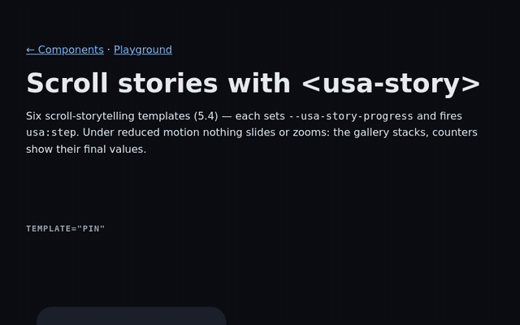

<div align="center">

# Motionary

**Zero dependencies · measured sizes · accessible by default.** Scroll animations and animated Web Components for the web.

_Formerly **use-scroll-animate**. The old npm package is still published as an alias of the same build._

[](https://www.npmjs.com/package/motionary) [](https://github.com/HarrisonCN/Motionary/actions/workflows/ci.yml) [](https://bundlejs.com/?q=motionary/core) [](./LICENSE) [](https://scorecard.dev/viewer/?uri=github.com/HarrisonCN/Motionary)

**English** | [简体中文](./README_zh.md) | [日本語](./README_ja.md)

**[Animation Store](https://harrisoncn.github.io/Motionary/showcase/)** · **[Components](https://harrisoncn.github.io/Motionary/showcase/components.html)** · **[Component playground](https://harrisoncn.github.io/Motionary/showcase/run.html)** · **[Timeline playground](https://harrisoncn.github.io/Motionary/showcase/playground.html)** · **[Scroll story](https://harrisoncn.github.io/Motionary/showcase/story.html)**

</div>

<p align="center"></p>

```bash
npm i motionary
```
```html
<h2 data-sa data-sa-animation="fade-in-up">Hello</h2>
<script type="module">import ScrollAnimate from 'motionary'; ScrollAnimate.init();</script>
```

Motionary reveals content as it scrolls into view and gives you <!--fact:public-->250<!--/fact--> animated `<mo-*>` custom elements: cards, buttons,
physics, page transitions, generative backgrounds, Lottie, WebGL and more. It runs in plain HTML, in React, Vue, Svelte,
Solid and Angular, and in desktop web views (Electron, Tauri, WebView2). It has no runtime dependencies, every entry point
is tree-shakeable and has its gzip size reported in CI, and every animation respects `prefers-reduced-motion`.

Release notes for every version are in [CHANGELOG.md](./CHANGELOG.md).

Supply chain: [docs/supply-chain.md](./docs/supply-chain.md) · CDN with SRI hashes: [docs/cdn-sri.md](./docs/cdn-sri.md) · Compared with AOS, GSAP, Lenis and Motion: [docs/compare](./docs/compare/README.md) · Try it online: [StackBlitz examples](./examples/stackblitz/README.md).

## Contents

[Features](#features) · [Install](#install) · [Quick start](#quick-start) · [Runtime tiers](#runtime-and-tiers) ·
[Components](#components-gallery-and-playground) · [CLI](#cli) · [MCP server and AI](#mcp-server-and-ai) ·
[Figma plugin](#figma-plugin) · [Accessibility](#accessibility) · [Size budgets](#size-budgets) ·
[Upgrading to 14](#upgrading-to-14) · [Versions](#versions-and-compatibility) · [Docs](#documentation) ·
[Contributing](#contributing) · [Reference](#reference)

## Features

- **214 scroll-reveal presets** in 14 families (33 in the core, 181 more in `motionary/presets/extended`): fades, zooms,
  3D flips, clip-path shapes, blur and mask, bounce, depth, glitch, and scroll-linked `scrub-*`. Also `timeline()`,
  `staggerChildren()` and `parallax()`.
- **<!--fact:public-->250<!--/fact--> `<mo-*>` Web Components**: <!--fact:core-->91<!--/fact--> core components in `motionary/components` (by category) and <!--fact:widgets-->159<!--/fact--> widgets, one entry point
  each (`motionary/widgets/<name>`). Plus <!--fact:effects-->152<!--/fact--> effects with their own entry points (`motionary/effects/<name>`).
  [How components are counted](./docs/components.md#how-components-are-counted).
- **Motion Core**: `createMotion()` from `motionary/core`, a plugin-based engine at about 2.5 KB gzip (historical reference 10 KB).
- **A runtime of its own**: `motionary/runtime` (ticker, tween, timeline) plus <!--fact:runtimeModules-->20<!--/fact--> modules: scroll scenes, smooth scrolling,
  text splitting, SVG morphing, sprites, GIF / APNG / WebP, Lottie and dotLottie, WebGL2, glTF / OBJ, 2D physics. They are
  grouped in three tiers, and you pay only for the modules you import.
- **Any framework**: `motionary/react`, `motionary/vue`, `motionary/svelte`, `motionary/solid` and `motionary/angular`, plus
  element wrappers in `motionary/components/react` · `vue` · `svelte` · `solid`. Importing on the server does nothing.
- **Tooling**: an MCP server for AI assistants, a local motion parser with an optional LLM provider, a Figma plugin, a
  CLI that exports to CSS / mini program WXSS / HarmonyOS ArkTS, and codemods for every major.
- **Accessible by default**: reduced motion everywhere, user-facing motion controls, and one component contract
  (attributes, events, keyboard, lifecycle) checked in CI.

## Install

```bash
npm i motionary
```

No build step? Use the CDN. URLs pin the major version (`@<!--ver:major-->17<!--/ver-->`). For production, pin the exact version with SRI ([docs/cdn-sri.md](./docs/cdn-sri.md)):

```html
<script src="https://unpkg.com/motionary@17/dist/index.umd.js"></script>            <!-- scroll API: window.ScrollAnimate -->
<script src="https://unpkg.com/motionary@17/dist/presets-extended.umd.js"></script> <!-- +181 presets -->
<script src="https://unpkg.com/motionary@17/dist/components.umd.js"></script>       <!-- the motionary/components elements: window.UsaComponents -->
<script src="https://unpkg.com/motionary@17/dist/widgets.umd.js"></script>          <!-- the widgets: window.UsaWidgets -->
<mo-reveal effect="fade-up"><h2>Hello</h2></mo-reveal>
```

17.6 adds thirteen Matter & Motion widgets and six standalone effects: interactive fields, fluid type, curve labs and deliberate controls. [Interactive lab](./showcase/matter.html) · [API and inspiration](./docs/matter-motion.md).

17.5 adds fifteen live-activity components and a video-inspired drifting card wall. [Interactive lab](./showcase/activity.html) · [API and data](./docs/live-activities.md). Component count and artifact size have no enforced caps.

17.4 adds six luminous controls: a glass day/night switch, particle icon and button, halo segmented control and slider, and an orbit progress dial. [Interactive lab](./showcase/luminous.html) · [API and imports](./docs/luminous-controls.md).

17.3.1 adds a file tree, download menu and film title sequence. [Examples and individual imports](./docs/gallery-components.md).

Since 17.3 `<mo-*>` is the default element name. The CDN bundles, `defineComponents()` and `defineWidgets()` register it, and so do the 17.3+ widgets by themselves; when you import single components or categories as ES modules, call `defineMoAliases()` from `motionary/components/mo` first (it stays out of the per-component entries so their measured sizes hold). The `<usa-*>` names keep working as deprecated aliases (removal not before a future major); `npx -p motionary mo-codemod tags --write` renames them in your code. The `usa:*` event names and `--usa-*` CSS properties work with both tag names. [v17 migration guide](./docs/migrating-to-v17.md)

jsDelivr works too: `https://cdn.jsdelivr.net/npm/motionary@17/dist/…`. Already on `use-scroll-animate`? It keeps
working, at the same versions. To switch, replace the name in imports and URLs ([details](./docs/versions.md)).

## Quick start

### HTML: data attributes

```html
<h2 data-sa data-sa-animation="fade-in-up">Hello</h2>
<div data-sa data-sa-animation="bounce-in-up" data-sa-delay="150">Card</div>

<script type="module">
  import ScrollAnimate from 'motionary';
  import 'motionary/presets/extended'; // optional: +181 presets (bounce-in-up, clip-diamond, …)
  ScrollAnimate.init();                // picks up every [data-sa]
</script>
```

Every option has a `data-sa-*` attribute ([API reference](./docs/API.md)).

### JavaScript

```js
import ScrollAnimate, { staggerChildren, parallax } from 'motionary';

ScrollAnimate.observe('.card', { animation: 'zoom-in-up', duration: 800, easing: 'spring' });
staggerChildren(document.querySelector('.grid'), { animation: 'stagger-pop', stagger: 60 });
parallax('.hero-bg', { speed: 0.3 });
// native scroll timeline, off the main thread where the browser supports it
ScrollAnimate.observe('.logo', { animation: 'scrub-spin', engine: 'css', viewRange: ['cover 0%', 'cover 100%'] });
```

### Motion Core (`motionary/core`)

```js
import { createMotion } from 'motionary/core';
import { retro, cinema } from 'motionary/plugins';

const motion = createMotion().use(retro, cinema);
motion.reveal('.card', 'fade-up', { stagger: 80 });       // scroll-in entrances
motion.bind(button, 'vhs-glitch', { trigger: 'click' });  // an effect on a trigger
await motion.play(hero, 'dolly-in', { duration: 900 });   // play once and wait for it
```

More: [docs/core.md](./docs/core.md).

### Web Components

```html
<script type="module">
  import { defineComponents } from 'motionary/components';
  defineComponents(); // or lazyDefine() from 'motionary/components/lazy': loads only the tags on the page
</script>

<mo-card effect="holo">…</mo-card>
<mo-button deform="gooey">Buy</mo-button>
<mo-fx effect="confetti" trigger="click"><button>Celebrate</button></mo-fx>
```

### Frameworks

Each adapter is its own entry point and cleans up on unmount.

```jsx
// React
import React from 'react';
import { createReactHooks } from 'motionary/react';
const { useScrollAnimate } = createReactHooks(React);

export function Card() {
  const ref = useScrollAnimate({ animation: 'fade-in-up' });
  return <div ref={ref}>Hello</div>;
}
```

```vue
<!-- Vue 3 -->
<script setup>
import { ref, onMounted, onUnmounted } from 'vue';
import { createVueComposables } from 'motionary/vue';
const { useScrollAnimate } = createVueComposables({ ref, onMounted, onUnmounted });
const { animateRef } = useScrollAnimate({ animation: 'zoom-in' });
</script>
<template><div ref="animateRef">Hello</div></template>
```

```svelte
<!-- Svelte 3–5 -->
<script>
  import { scrollAnimate } from 'motionary/svelte';
</script>
<div use:scrollAnimate={{ animation: 'flip-up' }}>Hello</div>
```

```jsx
// Solid
import { scrollAnimate } from 'motionary/solid';
scrollAnimate; // keeps the directive import (TypeScript)
export const Card = () => <div use:scrollAnimate={{ animation: 'blur-in-up' }}>Hello</div>;
```

```ts
// Angular (standalone): the <mo-*> elements (and the legacy <usa-*> names)
import { APP_INITIALIZER, CUSTOM_ELEMENTS_SCHEMA, Component } from '@angular/core';
import { provideUsa, usaDetail } from 'motionary/angular';
// app.config.ts: providers: [provideUsa(APP_INITIALIZER, ['click', 'ui'])]   (the categories to register)
// usa:* events: `(usa:change)` does not compile in Angular 17+ — use the 6-line `[usaOn]` directive from docs/frameworks-ssr.md
@Component({ standalone: true, imports: [UsaOn], schemas: [CUSTOM_ELEMENTS_SCHEMA],
  template: `<mo-checkbox label="Motion" [checked]="on" [usaOn]="{ change: onChange }"></mo-checkbox>` })
export class Settings { on = false; onChange = (e: Event) => (this.on = usaDetail(e).checked); }
```

SSR, Next.js, Nuxt and SvelteKit: [docs/frameworks-ssr.md](./docs/frameworks-ssr.md) (React 19 + SSR: bind `usa:*` events with a ref +
`bindUsa` — React 19 does not attach `onusa:*` props to hydrated elements). Tested framework versions:
[docs/frameworks-matrix.md](https://github.com/HarrisonCN/Motionary/blob/main/docs/frameworks-matrix.md). Every public subpath by layer:
[docs/public-api.md](./docs/public-api.md).

## Runtime and tiers

`motionary/runtime` is Motionary's own animation runtime: a shared ticker, tween and timeline engine, and one module per
feature or file format (`motionary/runtime/<module>`). Register what you use with `use()`. Each module belongs to a tier,
and a module only depends on its own tier or lower ones, so a basic page never downloads WebGL, 3D or physics code.

| Tier | Modules | Bundle (gzip, 13.0) | Historical reference |
|---|---|---:|---:|
| **Basic** | core (ticker, tween, timeline), `scroll`, `text`, `format-css`, `format-motion` | 10.83 KB | 12 KB |
| **Standard** | basic + `smooth`, `drag-snap`, `format-svg`, `format-sprite`, `format-gif`, `format-apng`, `format-webp`, `vector` (Lottie / dotLottie), `lottie-state`; official Rive runtime | 33.74 KB | 37 KB |
| **Advanced** | standard + `gl` (WebGL2), `format-gltf`, `format-obj`, `gltf-anim`, `gltf-decoders` (Draco / KTX2), `physics`, `format-scene` | 54.55 KB | 60 KB |

```js
import { use } from 'motionary/runtime';
import { scroll } from 'motionary/runtime/scroll';
import { defineScrollScene } from 'motionary/components/widgets';

use(scroll);          // register the module first (this also registers the core)
defineScrollScene();  // then the component that needs it
```

A component that needs a module shows a **Requires:** badge in the gallery, and it throws a clear error (install, import,
CDN) when the module is missing. Details: [docs/runtime-tiers.md](./docs/runtime-tiers.md), one page per module in
[docs/runtime/](./docs/runtime/), and the [module and prerequisite tables](#reference) at the end of this README.

## Components, gallery and playground

| Page | What it does |
|---|---|
| [Animation Store](https://harrisoncn.github.io/Motionary/showcase/) | Preview, tweak and copy every preset and effect at desktop and phone sizes |
| [Components](https://harrisoncn.github.io/Motionary/showcase/components.html) | The gallery: every `<mo-*>` element with its attributes, prerequisites and tier |
| [Component playground](https://harrisoncn.github.io/Motionary/showcase/run.html) | Each component as a complete runnable page: edit, **Run**, **Copy** or **Download** — all three use exactly what is in the editor (the download runs on its own). HTML (CDN) runs the whole page; npm + bundler runs the module through an import map. Missing prerequisites and errors show with the line that fixes them; deep links like `run.html#usa-tilt` |
| [Timeline playground](https://harrisoncn.github.io/Motionary/showcase/playground.html) | Visual keyframe editor; exports JSON for `<mo-player>` |
| [Scroll story](https://harrisoncn.github.io/Motionary/showcase/story.html) | `<mo-story>` scroll-storytelling templates |
| [Cross-platform previewer](https://harrisoncn.github.io/Motionary/showcase/xplat.html) | One preset on the web, in a mini program and in HarmonyOS ArkUI |
| [demo/index.html](./demo/index.html) | Every preset, no build step (open it locally) |

Import one category (`motionary/components/cards`), everything (`motionary/components`), the CSS-on-demand build
(`motionary/components/lite`), or one widget (`motionary/widgets/<name>`, e.g. `motionary/widgets/toast-stack`).
Every element: [docs/components.md](./docs/components.md), one page per element in
[docs/components/](./docs/components/README.md), every entry point in [docs/entry-points.md](./docs/entry-points.md).

<details>
<summary><b>The <!--fact:core-->91<!--/fact--> core elements in <code>motionary/components</code></b></summary>

<!-- core-table:start -->
| Category | Entry | Elements |
|---|---|---|
| **Scroll reveal** | `motionary/components/reveal` | `<mo-reveal>` · `<mo-scroll-progress>` · `<mo-scrolly>` · `<mo-stagger>` |
| **Text** | `motionary/components/text` | `<mo-counter>` · `<mo-glitch>` · `<mo-gradient-text>` · `<mo-handwriting>` · `<mo-scramble>` · `<mo-scroll-highlight>` · `<mo-shimmer-text>` · `<mo-split-text>` · `<mo-text-rotate>` · `<mo-typewriter>` · `<mo-wave-text>` |
| **Interaction** | `motionary/components/interaction` | `<mo-magnetic>` · `<mo-press>` · `<mo-ripple>` · `<mo-spotlight>` · `<mo-tilt>` |
| **Feedback** | `motionary/components/feedback` | `<mo-check>` · `<mo-progress>` · `<mo-skeleton>` · `<mo-spinner>` · `<mo-toaster>` |
| **Backgrounds** | `motionary/components/background` | `<mo-acrylic>` · `<mo-aurora>` · `<mo-blobs>` · `<mo-dot-network>` · `<mo-grain>` · `<mo-grid-glow>` · `<mo-marquee>` · `<mo-particles>` · `<mo-water-ripple>` |
| **Transitions** | `motionary/components/transitions` | `<mo-accordion>` · `<mo-dialog>` · `<mo-view-switch>` |
| **Spring & physics** | `motionary/components/physics` | `<mo-draggable>` · `<mo-overscroll>` · `<mo-spring>` |
| **Cards** | `motionary/components/cards` | `<mo-card>` · `<mo-card-stack>` · `<mo-carousel-3d>` · `<mo-sticky-stack>` |
| **Click & buttons** | `motionary/components/click` | `<mo-button>` · `<mo-checkbox>` · `<mo-click>` · `<mo-double-tap>` · `<mo-hold>` · `<mo-icon-morph>` · `<mo-like>` |
| **UI kit** | `motionary/components/ui` | `<mo-avatar-stack>` · `<mo-badge>` · `<mo-bottom-sheet>` · `<mo-drawer>` · `<mo-fab>` · `<mo-navbar>` · `<mo-popover>` · `<mo-pull-refresh>` · `<mo-slider>` · `<mo-tabs>` |
| **Page-wide** | `motionary/components/page` | `<mo-ambient>` · `<mo-auto-skeleton>` · `<mo-back-to-top>` · `<mo-cursor>` · `<mo-fullpage>` · `<mo-loading-bar>` · `<mo-motion-switch>` · `<mo-splash>` |
| **Timeline** | `motionary/components/timeline` | `<mo-timeline>` |
| **Gestures** | `motionary/components/gesture` | `<mo-pinch-zoom>` · `<mo-swipeable>` |
| **SVG** | `motionary/components/svg` | `<mo-anim-icon>` · `<mo-draw>` · `<mo-mask-reveal>` · `<mo-morph>` |
| **WebGL** | `motionary/components/webgl` | `<mo-distort>` · `<mo-liquid>` · `<mo-post-fx>` · `<mo-shader>` |
| **3D depth** | `motionary/components/depth` | `<mo-cube>` · `<mo-depth>` |
| **Layout** | `motionary/components/layout` | `<mo-auto-animate>` · `<mo-masonry>` |
| **Packs** | `motionary/components/packs` | `<mo-pack>` |
| **Effect registry** | `motionary/components/fx` | `<mo-fx>` |
| **Effect packs** | `motionary/components/effects` | `<mo-audio>` · `<mo-gesture-fx>` · `<mo-motion-theme>` · `<mo-player>` · `<mo-story>` |
<!-- core-table:end -->

</details>

## CLI

Everything ships in the `motionary` package and runs with `npx`:

| Command | What it does |
|---|---|
| `npx motionary doctor [paths…] [--json]` | Lists removed import paths and legacy event names in your project. Exits with code 1 when it finds any, so you can use it in CI |
| `npx motionary export --target css\|wxss\|arkts [--presets a,b] [--rpx] [--out file]` | Exports presets and motion tokens to CSS, mini program WXSS or HarmonyOS ArkTS ([docs/cross-platform.md](./docs/cross-platform.md)) |
| `npx motionary compat <version> [--json]` | What a project on that version can use, and what changed after it ([docs/version-compat.md](./docs/version-compat.md)) |
| `npx motionary tokens import-figma\|export-figma\|validate\|css …` | Motion Tokens 2.0: Figma Variables JSON ↔ W3C design tokens / CSS, and token-file validation; it makes no network calls ([docs/motion-tokens.md](./docs/motion-tokens.md)) |
| `npx usa-codemod-13 [--write] [paths…]` | Rewrites the paths removed in 13.0 and CDN URLs pinned to `@10` / `@11` / `@12`. It is a dry run unless you pass `--write`. `usa-codemod-5` … `usa-codemod-12` cover the earlier majors |
| `npx create-motionary-plugin <name>` | Scaffolds an effect plugin with tests and a signing script |
| `npx -y -p motionary motionary-mcp` | Starts the MCP server (next section) |

## MCP server and AI

`motionary-mcp` is a read-only [Model Context Protocol](https://modelcontextprotocol.io) server. It lets Claude, Cursor,
VS Code, Windsurf, Zed and other MCP clients look up the component catalog and get snippets that already install, import
and register every prerequisite in the right order.

```json
{ "mcpServers": { "motionary": { "command": "npx", "args": ["-y", "-p", "motionary", "motionary-mcp"] } } }
```

Claude Code: `claude mcp add motionary -- npx -y -p motionary motionary-mcp`.

- Tools: `list_components`, `search_components`, `get_component`, `get_example`, `scaffold_snippet`, `suggest_motion`,
  `validate_snippet`, `check_compat`.
- `validate_snippet { mount: true }` mounts the markup in jsdom (an optional peer: `npm i -D jsdom`) with the real bundles
  and checks it against the component contract. The snippet's own scripts never run.
- Answers match the version installed in your project. `check_compat` lists what that version is missing or does differently.
- Full guide: [docs/mcp.md](./docs/mcp.md).

**Motion from text.** `motionary/tooling/ai` turns a description like "fade the cards up slowly, one after another" into
an effect, keyframes, CSS and matching components. The default parser is local and deterministic (English and
Chinese). To use your own LLM, pass a provider to `suggestMotion()`. Motionary bundles no vendor SDK and makes no
network request unless you pass a provider. Answers are checked against a JSON Schema, and the local result is used if
they fail.

```ts
import { suggestMotion } from 'motionary/tooling/ai';
const { intent, source } = await suggestMotion('cards cascade in like falling dominoes', { provider }); // provider is optional
el.animate(intent.keyframes, intent.options);
```

More: [docs/ai-provider.md](./docs/ai-provider.md) · [prompt guide](./docs/ai-prompt-guide.md) · [AGENTS.md](./AGENTS.md) ·
the site serves [`components.json`](https://harrisoncn.github.io/Motionary/components.json) and
[`llms.txt`](https://harrisoncn.github.io/Motionary/llms.txt).

## Figma plugin

[figma-plugin/](./figma-plugin/README.md) (also in `node_modules/motionary/figma-plugin/`) exports the current selection
as a **complete HTML page** (tokens, prerequisite scripts in order, one element per layer), **CSS tokens** and
**motion.tokens.json** (W3C design tokens). A layer named after a component (`usa-tilt`) becomes that element. Figma
variables `motion/duration/*` and `motion/easing/*` override the default tokens. The plugin has no network access and
never edits the document. For the full Motion Tokens 2.0 set (distances, semantics, modes) as Figma Variables, use
`npx motionary tokens export-figma` / `import-figma`. See [figma-plugin/README.md](./figma-plugin/README.md) and [docs/motion-tokens.md](./docs/motion-tokens.md).

## Stable core and experimental surfaces

Motionary's focus is **zero dependencies, measured sizes and accessible motion**. The stable core is the scroll API
(`motionary`), `motionary/core`, `motionary/presets/*`, `motionary/motion`, `motionary/scene`, `motionary/runtime/*`,
the `<mo-*>` components and widgets, the framework adapters and the CLI. 17.x minors add components and effects
(zero dependencies, individual size measurements, the same accessibility contract) and improve what exists; no new major is planned.

**Experimental** (may change in a minor release, not covered by the stability promise):
Motion Studio (`motionary/studio/*`, including the 16.2 plugin API and the 16.3 performance budget), the AI assistant
and provider (`motionary/studio/ai`, `motionary/ai*`), the MCP server (`motionary-mcp`), the Figma plugin and the
cross-platform exporters (`npx motionary export`). See [docs/stability.md](./docs/stability.md).

## Accessibility

- With `prefers-reduced-motion: reduce`, scroll reveals show content right away (no entrance, parallax or scrub), and
  components switch to calm states (`staticAlternative()`, `adaptKeyframes()`).
- `motionary/components/a11y`: `setMotionSensitivity()` lets users turn off flashes, loops or parallax. It also has `announce()`
  for live regions, `auditMotionA11y()` and `baselineReport()`. `<mo-motion-switch>` is a ready-made motion toggle for users.
- Every element follows one [component contract](./docs/component-contract.md) (keyboard, focus, events, lifecycle,
  reduced motion), and `npm run check:contract` enforces it in CI.
- More: [docs/accessibility.md](./docs/accessibility.md).

## Size budgets

Component count and artifact size have no caps. [`size-budget.json`](./size-budget.json) retains historical references;
CI reports measurements and checks output/document consistency. Exceeding a reference does not fail CI. See [size policy](./docs/size-policy.md). 

<!-- size-table:start -->
Measured on the 17.6.0 build (minified + gzip), generated by `scripts/size.mjs --report`:

| What you import | gzip | Historical reference |
|---|---:|---:|
| `motionary/core` (`createMotion`) | 2.53 KB | 10.00 KB |
| `import ScrollAnimate from 'motionary'` (default instance) | 5.49 KB | 6.00 KB |
| Everything from `motionary` | 8.89 KB | 9.75 KB |
| `dist/index.umd.js` (CDN) | 9.03 KB | 9.75 KB |
| `parallax()` alone | 0.94 KB | 2.00 KB |
| `motionary/presets/extended` (181 presets) | 4.69 KB | 5.25 KB |
| `motionary/runtime` (runtime core) | 5.42 KB | 5.50 KB |
| `motionary/components/reveal` | 4.47 KB | 5.00 KB |
| `motionary/components/lite` (every element, CSS on demand) | 71.46 KB | 79.00 KB |
| `motionary/components` (every element + CSS) | 87.90 KB | 93.75 KB |
| `dist/components.umd.js` (CDN, everything) | 111.37 KB | 115.75 KB |
<!-- size-table:end -->

By default there are no scroll listeners (IntersectionObserver is used instead). Animations stay on the compositor
(`transform`, `opacity`, `filter`, `clip-path`). Imports have no side effects
([docs/tree-shaking.md](./docs/tree-shaking.md)). Every PR also measures first-screen transfer, script time, GPU resources
and frame stability in headless Chrome ([docs/perf-ci.md](./docs/perf-ci.md)). Source maps are not shipped to npm. They live in
the tagged git tree (each file's `sourceMappingURL` points there) and, from 16.3, also as a `sourcemaps` archive on each
GitHub release ([docs/source-maps.md](./docs/source-maps.md)). More: [docs/performance.md](./docs/performance.md).

**Browsers:** evergreen browsers since 2023 (Chrome / Edge ≥ 111, Safari ≥ 16.4, Firefox ≥ 115, WebView2, Electron ≥ 24).
Motionary uses View Transitions and scroll-driven animations where the browser has them, and falls back to JavaScript
where it does not. `baselineReport()` checks a given browser.

## Upgrading to 14

14.0 adds Motion Engine v2 and makes Scene Format v2 official. It removes four interfaces deprecated in 13.9 from the
main entries and keeps each of them behind **`motionary/compat-v13`**, so nothing has to be migrated on day one.
Tags, attributes, events, presets, tokens and visuals do not change; lite stays ≤ 70 KB gzip.

```bash
npx motionary migrate --code           # dry run: normalizeAnimation → compat-v13, scene-v2 → motionary/scene, CDN → @14
npx motionary migrate --code --write   # apply
npx motionary migrate src/motion/*.json --write   # optional: motion JSON → scene v2
```

| Removed from the main entries | Keep it (compat) | Move to |
|---|---|---|
| playground documents / animation JSON without `format` in `<mo-player>` | `installCompatV13()` from `motionary/compat-v13` | scene v2 (`npx motionary migrate`) |
| `normalizeAnimation()` (`motionary/components/effects`) | `motionary/compat-v13` | `validateSceneV2()` / `migrateToSceneV2()` (`motionary/scene`) |
| `usa-codemod-5` … `usa-codemod-10` bins | `npx motionary codemod <n>` | — |

Full guide: [docs/migrating-to-v14.md](./docs/migrating-to-v14.md). 13.x: `npm i motionary@v13-lts` (13.9.0).

Earlier majors: [13](./docs/upgrading-13.md) · [12](./docs/upgrading-12.md) · [11](./docs/upgrading-11.md) · [10](./docs/upgrading-10.md) ·
[9](./docs/upgrading-9.md) · [8](./docs/upgrading-8.md) · [7](./docs/upgrading-7.md) · [6](./docs/upgrading-6.md) ·
[5](./docs/upgrading-5.md) · [4](./docs/upgrading-4.md) · [3](./docs/upgrading-3.md) · [2](./docs/deprecations.md).
Coming from another library: [AOS](./docs/migration-from-aos.md) · [GSAP ScrollTrigger](./docs/migration-from-gsap-scrolltrigger.md).

## Versions and compatibility

- **npm dist-tags:** `latest` is the newest release of the current major (<!--ver:version-->17.6.0<!--/ver-->; minors move it since 14.1). Each minor release also gets its own tag `v<major>-<minor>`
  (for example `v15-0`), `v15-line` follows the 15.x line and `v14-lts` is 14.9.x. `motionary` and `use-scroll-animate` are published together at the same versions.
- **CDN:** URLs pin a major (`motionary@<!--ver:major-->17<!--/ver-->`). Exact pins (`motionary@12.4.0`) keep working.
- **Semver:** breaking changes come only in majors, each with a guide and a codemod. Deprecations stay in place until the
  next major, with `@deprecated` types and no runtime warning.
- **What each version has:** `since` / `changed` for every component and runtime module ([docs/version-compat.md](./docs/version-compat.md)),
  feature-by-feature support ([docs/compat-matrix.md](./docs/compat-matrix.md)).
- Details: [docs/versions.md](./docs/versions.md) · [CHANGELOG.md](./CHANGELOG.md).

## Documentation

| Topic | Docs |
|---|---|
| Reference | [API](./docs/API.md) · [Presets](./docs/presets.md) (all 214) · [Components](./docs/components.md) · [Entry points](./docs/entry-points.md) · [Public API by layer](./docs/public-api.md) · [Motion Core](./docs/core.md) · [Timeline editor model](./docs/timeline-editor.md) |
| Runtime | [Runtime tiers](./docs/runtime-tiers.md) · [Modules](./docs/runtime/) · [Compatibility matrix](./docs/compat-matrix.md) |
| Platforms | [Frameworks & SSR](./docs/frameworks-ssr.md) · [Framework matrix](https://github.com/HarrisonCN/Motionary/blob/main/docs/frameworks-matrix.md) · [Windows apps](./docs/windows-apps.md) · [Hybrid apps (MAUI, Flutter, Electron, Tauri)](./docs/hybrid-apps.md) · [Cross-platform export](./docs/cross-platform.md) · [Examples](./examples/) |
| Design & AI | [Motion Studio 2.0 app](./docs/studio-app.md) · [Motion Studio](./docs/studio.md) · [Studio export](./docs/studio-export.md) · [Studio templates](./docs/studio-templates.md) · [Studio AI assistant](./docs/studio-ai.md) · [Studio assets](./docs/studio-assets.md) · [Studio canvas](./docs/studio-canvas.md) · [Layout motion 2.0](./docs/layout-motion.md) · [Motion tokens 2.0](./docs/motion-tokens.md) · [Figma plugin](./figma-plugin/README.md) · [MCP server](./docs/mcp.md) · [AI provider](./docs/ai-provider.md) · [Prompt guide](./docs/ai-prompt-guide.md) |
| Quality | [Accessibility](./docs/accessibility.md) · [Component contract](./docs/component-contract.md) · [Performance](./docs/performance.md) · [Perf CI](./docs/perf-ci.md) · [Scheduling](./docs/scheduling.md) · [Tree-shaking](./docs/tree-shaking.md) · [Source maps](./docs/source-maps.md) |
| Project | [Architecture](./docs/architecture.md) · [Roadmap](./docs/ROADMAP.md) · [Versions](./docs/versions.md) · [Changelog](./CHANGELOG.md) |

The architecture has four layers: Motion Core, Runtime, Components, and Tooling, with the framework entries on top.
`test/architecture.test.ts` enforces the import rules between layers ([docs/architecture.md](./docs/architecture.md)).

The docs in `docs/` are in English, except the roadmap, which is in Chinese.

## Contributing

Issues and pull requests are welcome. See [CONTRIBUTING.md](./CONTRIBUTING.md). Before you open a PR, run `npm test`,
`npm run build`, `npm run check:contract`, `npm run check:peer-docs` and `npm run size:check`. When you change behaviour,
update this README together with [README_zh.md](./README_zh.md) and [README_ja.md](./README_ja.md).

## License

MIT © HarrisonCN. See [LICENSE](./LICENSE).

## Reference

`node scripts/gen-runtime-docs.mjs` generates the tables below from the tested module data. Do not edit them by hand.

<details>
<summary><b>Runtime modules and component prerequisites</b></summary>

<!-- runtime:start -->
## Runtime (`motionary/runtime`) & prerequisites

Motionary ships its own zero-dependency animation runtime — shared ticker, tween + timeline engine, and one tree-shakable module per feature / format (`motionary/runtime/<module>`). `npm i motionary` installs all of it; you pay only for the modules you import. Components that need a module say so with a **Requires:** badge in the gallery and the Store, and throw a clear error (install / import / CDN) when it is missing.

| Module | Import | CDN (IIFE) | Register | historical gzip reference |
|---|---|---|---|---|
| [Runtime core](docs/runtime/core.md) | `motionary/runtime` | `https://cdn.jsdelivr.net/npm/motionary@17/dist/runtime.iife.js` | `use();` | 5.5 KB |
| [CSS @keyframes & WAAPI keyframes loader](docs/runtime/format-css.md) | `motionary/runtime/format-css` | `https://cdn.jsdelivr.net/npm/motionary@17/dist/runtime/format-css.iife.js` | `use(formatCss);` | 2.5 KB |
| [Motion / Framer keyframe JSON loader](docs/runtime/format-motion.md) | `motionary/runtime/format-motion` | `https://cdn.jsdelivr.net/npm/motionary@17/dist/runtime/format-motion.iife.js` | `use(formatMotion);` | 2.5 KB |
| [Scroll scenes](docs/runtime/scroll.md) | `motionary/runtime/scroll` | `https://cdn.jsdelivr.net/npm/motionary@17/dist/runtime/scroll.iife.js` | `use(scroll);` | 4.5 KB |
| [SVG loader: SMIL playback + path morphing](docs/runtime/format-svg.md) | `motionary/runtime/format-svg` | `https://cdn.jsdelivr.net/npm/motionary@17/dist/runtime/format-svg.iife.js` | `use(formatSvg);` | 5.0 KB |
| [Text splitting](docs/runtime/text.md) | `motionary/runtime/text` | `https://cdn.jsdelivr.net/npm/motionary@17/dist/runtime/text.iife.js` | `use(text);` | 2.5 KB |
| [Sprite sheets & image sequences](docs/runtime/format-sprite.md) | `motionary/runtime/format-sprite` | `https://cdn.jsdelivr.net/npm/motionary@17/dist/runtime/format-sprite.iife.js` | `use(formatSprite);` | 3.0 KB |
| [Smooth scrolling](docs/runtime/smooth.md) | `motionary/runtime/smooth` | `https://cdn.jsdelivr.net/npm/motionary@17/dist/runtime/smooth.iife.js` | `use(smooth);` | 3.5 KB |
| [GIF decoder](docs/runtime/format-gif.md) | `motionary/runtime/format-gif` | `https://cdn.jsdelivr.net/npm/motionary@17/dist/runtime/format-gif.iife.js` | `use(formatGif);` | 3.0 KB |
| [APNG loader](docs/runtime/format-apng.md) | `motionary/runtime/format-apng` | `https://cdn.jsdelivr.net/npm/motionary@17/dist/runtime/format-apng.iife.js` | `use(formatApng);` | 3.0 KB |
| [Animated WebP loader](docs/runtime/format-webp.md) | `motionary/runtime/format-webp` | `https://cdn.jsdelivr.net/npm/motionary@17/dist/runtime/format-webp.iife.js` | `use(formatWebp);` | 3.0 KB |
| [WebGL2 scene renderer](docs/runtime/gl.md) | `motionary/runtime/gl` | `https://cdn.jsdelivr.net/npm/motionary@17/dist/runtime/gl.iife.js` | `use(gl);` | 9.0 KB |
| [glTF 2.0 / GLB loader](docs/runtime/format-gltf.md) | `motionary/runtime/format-gltf` | `https://cdn.jsdelivr.net/npm/motionary@17/dist/runtime/format-gltf.iife.js` | `use(formatGltf);` | 6.0 KB |
| [OBJ / MTL loader](docs/runtime/format-obj.md) | `motionary/runtime/format-obj` | `https://cdn.jsdelivr.net/npm/motionary@17/dist/runtime/format-obj.iife.js` | `use(formatObj);` | 3.0 KB |
| [Lottie + dotLottie player](docs/runtime/vector.md) | `motionary/runtime/vector` | `https://cdn.jsdelivr.net/npm/motionary@17/dist/runtime/vector.iife.js` | `use(vector);` | 12.0 KB |
| [Official Rive runtime](docs/runtime/rive.md) | `@rive-app/canvas` | `https://unpkg.com/@rive-app/canvas@2.44.1/rive.js` | `provideRiveRuntime(() => import('@rive-app/canvas')); // lazy: fetched when the first <usa-rive> mounts` | official runtime (not bundled) |
| [2D rigid-body physics](docs/runtime/physics.md) | `motionary/runtime/physics` | `https://cdn.jsdelivr.net/npm/motionary@17/dist/runtime/physics.iife.js` | `use(physics);` | 10.0 KB |
| [Scene JSON (motionary-scene@1)](docs/runtime/format-scene.md) | `motionary/runtime/format-scene` | `https://cdn.jsdelivr.net/npm/motionary@17/dist/runtime/format-scene.iife.js` | `use(formatScene);` | 3.0 KB |
| [Drag, inertia and snap points](docs/runtime/drag-snap.md) | `motionary/runtime/drag-snap` | `https://cdn.jsdelivr.net/npm/motionary@17/dist/runtime/drag-snap.iife.js` | `use(dragSnap);` | 4.0 KB |
| [glTF animation, skinning and morph targets](docs/runtime/gltf-anim.md) | `motionary/runtime/gltf-anim` | `https://cdn.jsdelivr.net/npm/motionary@17/dist/runtime/gltf-anim.iife.js` | `use(gltfAnim);` | 4.5 KB |
| [dotLottie themes + state machines](docs/runtime/lottie-state.md) | `motionary/runtime/lottie-state` | `https://cdn.jsdelivr.net/npm/motionary@17/dist/runtime/lottie-state.iife.js` | `use(lottieState);` | 3.5 KB |
| [glTF decoder hooks (Draco, KTX2)](docs/runtime/gltf-decoders.md) | `motionary/runtime/gltf-decoders` | `https://cdn.jsdelivr.net/npm/motionary@17/dist/runtime/gltf-decoders.iife.js` | `use(gltfDecoders);` | 3.0 KB |
| [Official Draco decoder (Google)](docs/runtime/draco3d.md) | `draco3d` | `https://www.gstatic.com/draco/versioned/decoders/1.5.7/draco_decoder.js` | `provideGltfDecoder('draco', () => import('draco3d')); // lazy: fetched when the first Draco-compressed model loads` | official runtime (not bundled) |
| [Official Basis Universal transcoder (Binomial)](docs/runtime/basis-transcoder.md) | `basis_transcoder.js` | `https://cdn.jsdelivr.net/gh/BinomialLLC/basis_universal@1.16.4/webgl/transcoder/build/basis_transcoder.js` | `provideGltfDecoder('ktx2', () => import('/vendor/basis_transcoder.js').then((m) => m.default || window.BASIS)); // lazy: fetched with the first KTX2 texture` | official runtime (not bundled) |

Install once: `npm i motionary`. Plain HTML: load `runtime.iife.js` first, then the module files (each registers itself).

#### `<usa-plugin-card>` — Requires: motionary/runtime

- **Install:** `npm i motionary`
- **Import order & registration:** Import motionary/runtime and call use() once at start-up, before any runtime-powered component mounts. CDN: the IIFE registers itself (window.MotionaryRuntime).

```js
import { use } from 'motionary/runtime';
import { definePluginCard } from 'motionary/components/widgets';

use();
definePluginCard(); // registers <usa-plugin-card> — after the prerequisites
```

- **CDN:**

```html
<script src="https://cdn.jsdelivr.net/npm/motionary@17/dist/runtime.iife.js"></script>
<!-- then the component bundles -->
<script src="https://unpkg.com/motionary@17/dist/components.umd.js"></script>
<script src="https://unpkg.com/motionary@17/dist/widgets.umd.js"></script>
```

- **Minimal example:**

```html
<usa-plugin-card name="retro" title="Retro" version="1.2.0" author="Motionary" engine="^10.0.0" downloads="12400">
  <p>Pixel, CRT, VHS and Y2K effects.</p>
</usa-plugin-card>
```

#### `<usa-scroll-scene>` — Requires: motionary/runtime/scroll

- **Install:** `npm i motionary`
- **Import order & registration:** Register the core first, then the module: use(scroll) also registers the core. CDN: load runtime.iife.js, then runtime/scroll.iife.js (it registers itself).

```js
import { use } from 'motionary/runtime';
import { scroll } from 'motionary/runtime/scroll';
import { defineScrollScene } from 'motionary/components/widgets';

use(scroll);
defineScrollScene(); // registers <usa-scroll-scene> — after the prerequisites
```

- **CDN:**

```html
<script src="https://cdn.jsdelivr.net/npm/motionary@17/dist/runtime.iife.js"></script>
<script src="https://cdn.jsdelivr.net/npm/motionary@17/dist/runtime/scroll.iife.js"></script>
<!-- then the component bundles -->
<script src="https://unpkg.com/motionary@17/dist/components.umd.js"></script>
<script src="https://unpkg.com/motionary@17/dist/widgets.umd.js"></script>
```

- **Minimal example:**

```html
<usa-scroll-scene start="top 80%" end="bottom 20%" scrub="120" stagger="120">
  <h2 data-scrub="x: -80 -> 0; opacity: 0 -> 1">Scroll</h2>
  <p data-scrub="y: 40 -> 0; opacity: 0 -> 1">and it follows.</p>
</usa-scroll-scene>
```

#### `<usa-text-splitter>` — Requires: motionary/runtime/text

- **Install:** `npm i motionary`
- **Import order & registration:** Register the core first, then the module: use(text) also registers the core. CDN: load runtime.iife.js, then runtime/text.iife.js (it registers itself).

```js
import { use } from 'motionary/runtime';
import { text } from 'motionary/runtime/text';
import { defineTextSplitter } from 'motionary/components/widgets';

use(text);
defineTextSplitter(); // registers <usa-text-splitter> — after the prerequisites
```

- **CDN:**

```html
<script src="https://cdn.jsdelivr.net/npm/motionary@17/dist/runtime.iife.js"></script>
<script src="https://cdn.jsdelivr.net/npm/motionary@17/dist/runtime/text.iife.js"></script>
<!-- then the component bundles -->
<script src="https://unpkg.com/motionary@17/dist/components.umd.js"></script>
<script src="https://unpkg.com/motionary@17/dist/widgets.umd.js"></script>
```

- **Minimal example:**

```html
<usa-text-splitter split="chars" effect="rise" stagger="30">Motion, made simple.</usa-text-splitter>
```

#### `<usa-smooth-scroll>` — Requires: motionary/runtime/smooth

- **Install:** `npm i motionary`
- **Import order & registration:** Register the core first, then the module: use(smooth) also registers the core. CDN: load runtime.iife.js, then runtime/smooth.iife.js (it registers itself).

```js
import { use } from 'motionary/runtime';
import { smooth } from 'motionary/runtime/smooth';
import { defineSmoothScroll } from 'motionary/components/widgets';

use(smooth);
defineSmoothScroll(); // registers <usa-smooth-scroll> — after the prerequisites
```

- **CDN:**

```html
<script src="https://cdn.jsdelivr.net/npm/motionary@17/dist/runtime.iife.js"></script>
<script src="https://cdn.jsdelivr.net/npm/motionary@17/dist/runtime/smooth.iife.js"></script>
<!-- then the component bundles -->
<script src="https://unpkg.com/motionary@17/dist/components.umd.js"></script>
<script src="https://unpkg.com/motionary@17/dist/widgets.umd.js"></script>
```

- **Minimal example:**

```html
<usa-smooth-scroll lerp="0.1" offset="64"></usa-smooth-scroll>
```

#### `<usa-gl-scene>` — Requires: motionary/runtime/gl + motionary/runtime/format-gltf + motionary/runtime/format-obj + motionary/runtime/gltf-anim

- **Install:** `npm i motionary`
- **Import order & registration:** Register the core first, then the module: use(gl) also registers the core. CDN: load runtime.iife.js, then runtime/gl.iife.js (it registers itself). Register the core first, then the module: use(formatGltf) also registers the core. CDN: load runtime.iife.js, then runtime/format-gltf.iife.js (it registers itself). Register the core first, then the module: use(formatObj) also registers the core. CDN: load runtime.iife.js, then runtime/format-obj.iife.js (it registers itself). Register the core first, then the module: use(gltfAnim) also registers the core. CDN: load runtime.iife.js, then runtime/gltf-anim.iife.js (it registers itself).

```js
import { use } from 'motionary/runtime';
import { gl } from 'motionary/runtime/gl';
import { formatGltf } from 'motionary/runtime/format-gltf';
import { formatObj } from 'motionary/runtime/format-obj';
import { gltfAnim } from 'motionary/runtime/gltf-anim';
import { defineGlScene } from 'motionary/components/widgets';

use(gl, formatGltf, formatObj, gltfAnim);
defineGlScene(); // registers <usa-gl-scene> — after the prerequisites
```

- **CDN:**

```html
<script src="https://cdn.jsdelivr.net/npm/motionary@17/dist/runtime.iife.js"></script>
<script src="https://cdn.jsdelivr.net/npm/motionary@17/dist/runtime/gl.iife.js"></script>
<script src="https://cdn.jsdelivr.net/npm/motionary@17/dist/runtime/format-gltf.iife.js"></script>
<script src="https://cdn.jsdelivr.net/npm/motionary@17/dist/runtime/format-obj.iife.js"></script>
<script src="https://cdn.jsdelivr.net/npm/motionary@17/dist/runtime/gltf-anim.iife.js"></script>
<!-- then the component bundles -->
<script src="https://unpkg.com/motionary@17/dist/components.umd.js"></script>
<script src="https://unpkg.com/motionary@17/dist/widgets.umd.js"></script>
```

- **Minimal example:**

```html
<usa-gl-scene src="/models/chair.glb" controls auto-rotate="20" label="Chair"></usa-gl-scene>
```

#### `<usa-lottie-player>` — Requires: motionary/runtime/vector

- **Install:** `npm i motionary`
- **Import order & registration:** Register the core first, then the module: use(vector) also registers the core. CDN: load runtime.iife.js, then runtime/vector.iife.js (it registers itself).

```js
import { use } from 'motionary/runtime';
import { vector } from 'motionary/runtime/vector';
import { defineLottiePlayer } from 'motionary/components/widgets';

use(vector);
defineLottiePlayer(); // registers <usa-lottie-player> — after the prerequisites
```

- **CDN:**

```html
<script src="https://cdn.jsdelivr.net/npm/motionary@17/dist/runtime.iife.js"></script>
<script src="https://cdn.jsdelivr.net/npm/motionary@17/dist/runtime/vector.iife.js"></script>
<!-- then the component bundles -->
<script src="https://unpkg.com/motionary@17/dist/components.umd.js"></script>
<script src="https://unpkg.com/motionary@17/dist/widgets.umd.js"></script>
```

- **Minimal example:**

```html
<usa-lottie-player src="/anim/hero.lottie" autoplay loop label="Hero animation"></usa-lottie-player>
```

#### `<usa-rive>` — Requires: @rive-app/canvas

- **Install:** `npm i @rive-app/canvas`
- **Import order & registration:** Install the official runtime next to motionary, then hand <usa-rive> a lazy loader with provideRiveRuntime(() => import('@rive-app/canvas')) before the element mounts — your bundler splits the runtime into its own chunk, fetched only when the first <usa-rive> appears. Without a bundler: load the official rive.js from a CDN before the component bundles (window.rive), use an import map, or set runtime-src on the element. Missing → a clear message in place + usa:runtime-missing.

```js
import { provideRiveRuntime } from 'motionary/components/widgets';
import { defineRive } from 'motionary/components/widgets';

provideRiveRuntime(() => import('@rive-app/canvas')); // lazy: fetched when the first <usa-rive> mounts
defineRive(); // registers <usa-rive> — after the prerequisites
```

- **CDN:**

```html
<script src="https://unpkg.com/@rive-app/canvas@2.44.1/rive.js"></script>
<!-- then the component bundles -->
<script src="https://unpkg.com/motionary@17/dist/components.umd.js"></script>
<script src="https://unpkg.com/motionary@17/dist/widgets.umd.js"></script>
```

- **Minimal example:**

```html
<usa-rive src="/anim/icon.riv" state-machine="State Machine 1" autoplay label="Icon"></usa-rive>
```

#### `<usa-physics-playground>` — Requires: motionary/runtime/physics + motionary/runtime/format-scene

- **Install:** `npm i motionary`
- **Import order & registration:** Register the core first, then the module: use(physics) also registers the core. CDN: load runtime.iife.js, then runtime/physics.iife.js (it registers itself). Register the core first, then the module: use(formatScene) also registers the core. CDN: load runtime.iife.js, then runtime/format-scene.iife.js (it registers itself).

```js
import { use } from 'motionary/runtime';
import { physics } from 'motionary/runtime/physics';
import { formatScene } from 'motionary/runtime/format-scene';
import { definePhysicsPlayground } from 'motionary/components/widgets';

use(physics, formatScene);
definePhysicsPlayground(); // registers <usa-physics-playground> — after the prerequisites
```

- **CDN:**

```html
<script src="https://cdn.jsdelivr.net/npm/motionary@17/dist/runtime.iife.js"></script>
<script src="https://cdn.jsdelivr.net/npm/motionary@17/dist/runtime/physics.iife.js"></script>
<script src="https://cdn.jsdelivr.net/npm/motionary@17/dist/runtime/format-scene.iife.js"></script>
<!-- then the component bundles -->
<script src="https://unpkg.com/motionary@17/dist/components.umd.js"></script>
<script src="https://unpkg.com/motionary@17/dist/widgets.umd.js"></script>
```

- **Minimal example:**

```html
<usa-physics-playground preset="pyramid" spawn label="Knock the pyramid over"></usa-physics-playground>
```

#### `<usa-snap-carousel>` — Requires: motionary/runtime/drag-snap

- **Install:** `npm i motionary`
- **Import order & registration:** Register the core first, then the module: use(dragSnap) also registers the core. CDN: load runtime.iife.js, then runtime/drag-snap.iife.js (it registers itself).

```js
import { use } from 'motionary/runtime';
import { dragSnap } from 'motionary/runtime/drag-snap';
import { defineSnapCarousel } from 'motionary/components/snap-carousel';

use(dragSnap);
defineSnapCarousel(); // registers <usa-snap-carousel> — after the prerequisites
```

- **CDN:**

```html
<script src="https://cdn.jsdelivr.net/npm/motionary@17/dist/runtime.iife.js"></script>
<script src="https://cdn.jsdelivr.net/npm/motionary@17/dist/runtime/drag-snap.iife.js"></script>
<!-- then the component bundles -->
<script src="https://unpkg.com/motionary@17/dist/components.umd.js"></script>
<script src="https://unpkg.com/motionary@17/dist/widgets.umd.js"></script>
```

- **Minimal example:**

```html
<usa-snap-carousel align="center" gap="16" label="Featured">
  <article>…</article>
  <article>…</article>
  <article>…</article>
</usa-snap-carousel>
```

#### `<usa-dotlottie>` — Requires: motionary/runtime/vector + motionary/runtime/lottie-state

- **Install:** `npm i motionary`
- **Import order & registration:** Register the core first, then the module: use(vector) also registers the core. CDN: load runtime.iife.js, then runtime/vector.iife.js (it registers itself). Register the core first, then the module: use(lottieState) also registers the core. CDN: load runtime.iife.js, then runtime/lottie-state.iife.js (it registers itself).

```js
import { use } from 'motionary/runtime';
import { vector } from 'motionary/runtime/vector';
import { lottieState } from 'motionary/runtime/lottie-state';
import { defineDotLottie } from 'motionary/components/dotlottie';

use(vector, lottieState);
defineDotLottie(); // registers <usa-dotlottie> — after the prerequisites
```

- **CDN:**

```html
<script src="https://cdn.jsdelivr.net/npm/motionary@17/dist/runtime.iife.js"></script>
<script src="https://cdn.jsdelivr.net/npm/motionary@17/dist/runtime/vector.iife.js"></script>
<script src="https://cdn.jsdelivr.net/npm/motionary@17/dist/runtime/lottie-state.iife.js"></script>
<!-- then the component bundles -->
<script src="https://unpkg.com/motionary@17/dist/components.umd.js"></script>
<script src="https://unpkg.com/motionary@17/dist/widgets.umd.js"></script>
```

- **Minimal example:**

```html
<usa-dotlottie src="/anim/button.lottie" state-machine="toggle" theme="dark" label="Like button"></usa-dotlottie>
```

#### `<usa-gl-model>` — Requires: motionary/runtime/gl + motionary/runtime/format-gltf + motionary/runtime/gltf-decoders + draco3d + basis_transcoder.js

- **Install:** `npm i motionary && npm i draco3d && curl -LO https://cdn.jsdelivr.net/gh/BinomialLLC/basis_universal@1.16.4/webgl/transcoder/build/basis_transcoder.js -LO https://cdn.jsdelivr.net/gh/BinomialLLC/basis_universal@1.16.4/webgl/transcoder/build/basis_transcoder.wasm`
- **Import order & registration:** Register the core first, then the module: use(gl) also registers the core. CDN: load runtime.iife.js, then runtime/gl.iife.js (it registers itself). Register the core first, then the module: use(formatGltf) also registers the core. CDN: load runtime.iife.js, then runtime/format-gltf.iife.js (it registers itself). Register the core first, then the module: use(gltfDecoders) also registers the core. CDN: load runtime.iife.js, then runtime/gltf-decoders.iife.js (it registers itself). Install draco3d next to motionary, then register the lazy loader with provideGltfDecoder('draco', () => import('draco3d')) before a compressed model loads. Without a bundler: load Google’s draco_decoder.js from gstatic (window.DracoDecoderModule) and provideGltfDecoder('draco', () => window.DracoDecoderModule). Missing → a clear error naming the extension and this line. The transcoder is not published on npm by Binomial: copy basis_transcoder.js + basis_transcoder.wasm (same folder) into your static files, then provideGltfDecoder('ktx2', …) before a KTX2 model loads; or load it from the CDN (window.BASIS) and provideGltfDecoder('ktx2', () => window.BASIS). Missing → a clear error naming the extension and this line.

```js
import { use } from 'motionary/runtime';
import { gl } from 'motionary/runtime/gl';
import { formatGltf } from 'motionary/runtime/format-gltf';
import { gltfDecoders } from 'motionary/runtime/gltf-decoders';
import { provideGltfDecoder } from 'motionary/runtime/gltf-decoders';
import { defineGlModel } from 'motionary/components/gl-model';

use(gl, formatGltf, gltfDecoders);
provideGltfDecoder('draco', () => import('draco3d')); // lazy: fetched when the first Draco-compressed model loads
provideGltfDecoder('ktx2', () => import('/vendor/basis_transcoder.js').then((m) => m.default || window.BASIS)); // lazy: fetched with the first KTX2 texture
defineGlModel(); // registers <usa-gl-model> — after the prerequisites
```

- **CDN:**

```html
<script src="https://cdn.jsdelivr.net/npm/motionary@17/dist/runtime.iife.js"></script>
<script src="https://cdn.jsdelivr.net/npm/motionary@17/dist/runtime/gl.iife.js"></script>
<script src="https://cdn.jsdelivr.net/npm/motionary@17/dist/runtime/format-gltf.iife.js"></script>
<script src="https://cdn.jsdelivr.net/npm/motionary@17/dist/runtime/gltf-decoders.iife.js"></script>
<script src="https://www.gstatic.com/draco/versioned/decoders/1.5.7/draco_decoder.js"></script>
<script src="https://cdn.jsdelivr.net/gh/BinomialLLC/basis_universal@1.16.4/webgl/transcoder/build/basis_transcoder.js"></script>
<!-- then the component bundles -->
<script src="https://unpkg.com/motionary@17/dist/components.umd.js"></script>
<script src="https://unpkg.com/motionary@17/dist/widgets.umd.js"></script>
```

- **Minimal example:**

```html
<usa-gl-model src="/models/robot-draco.glb" controls label="Robot"></usa-gl-model>
```

<!-- runtime:end -->

</details>

<details>
<summary><b>Stable API and compatibility matrix (frozen in 11.0)</b></summary>

<!-- stable:start -->
## Stable API (11.x) & compatibility matrix

From 11.0 these are stable and follow semver until 12.0 (additions only in minors; see [docs/upgrading-11.md](./docs/upgrading-11.md)):

- `motionary/runtime` and every `motionary/runtime/<module>` export and module id;
- the AI manifest **schema v2** (`components.json`, `motionary/tooling/manifest.json`, `stability: "stable"`) and the `motionary-scene@1` format;
- `motionary-mcp` **2.x** tool names and result shapes;
- the individual entry points (`motionary/widgets/<name>`, `motionary/effects/<name>`, `motionary/components/<name>`) and their measured gzip sizes;
- the compatibility matrix below — a ✅ row is not removed before 12.0.

| Module | ✅ | ◐ | ✕ |
|---|---|---|---|
| [Runtime core](docs/runtime/core.md) | 7 | 0 | 0 |
| [CSS @keyframes & WAAPI keyframes loader](docs/runtime/format-css.md) | 5 | 1 | 2 |
| [Motion / Framer keyframe JSON loader](docs/runtime/format-motion.md) | 5 | 0 | 1 |
| [Scroll scenes](docs/runtime/scroll.md) | 8 | 0 | 2 |
| [SVG loader: SMIL playback + path morphing](docs/runtime/format-svg.md) | 8 | 0 | 1 |
| [Text splitting](docs/runtime/text.md) | 6 | 2 | 0 |
| [Sprite sheets & image sequences](docs/runtime/format-sprite.md) | 5 | 1 | 2 |
| [Smooth scrolling](docs/runtime/smooth.md) | 7 | 2 | 0 |
| [GIF decoder](docs/runtime/format-gif.md) | 6 | 1 | 1 |
| [APNG loader](docs/runtime/format-apng.md) | 7 | 1 | 0 |
| [Animated WebP loader](docs/runtime/format-webp.md) | 4 | 1 | 2 |
| [WebGL2 scene renderer](docs/runtime/gl.md) | 6 | 1 | 2 |
| [glTF 2.0 / GLB loader](docs/runtime/format-gltf.md) | 8 | 1 | 2 |
| [OBJ / MTL loader](docs/runtime/format-obj.md) | 4 | 1 | 2 |
| [Lottie + dotLottie player](docs/runtime/vector.md) | 14 | 1 | 2 |
| [Official Rive runtime](docs/runtime/rive.md) | 6 | 1 | 0 |
| [2D rigid-body physics](docs/runtime/physics.md) | 8 | 0 | 0 |
| [Scene JSON (motionary-scene@1)](docs/runtime/format-scene.md) | 7 | 0 | 0 |
| [Drag, inertia and snap points](docs/runtime/drag-snap.md) | 6 | 1 | 1 |
| [glTF animation, skinning and morph targets](docs/runtime/gltf-anim.md) | 7 | 0 | 1 |
| [dotLottie themes + state machines](docs/runtime/lottie-state.md) | 7 | 0 | 1 |
| [glTF decoder hooks (Draco, KTX2)](docs/runtime/gltf-decoders.md) | 4 | 1 | 1 |
| [Official Draco decoder (Google)](docs/runtime/draco3d.md) | 1 | 0 | 1 |
| [Official Basis Universal transcoder (Binomial)](docs/runtime/basis-transcoder.md) | 1 | 0 | 1 |

Feature by feature: [docs/compat-matrix.md](./docs/compat-matrix.md).
<!-- stable:end -->

</details>
