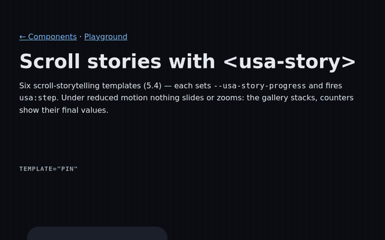

<div align="center">

# Motionary

**依存ゼロ・サイズ実測・標準でアクセシブル。** Web のためのスクロールアニメーションとアニメーション Web Components。

_旧名 **use-scroll-animate**。旧 npm パッケージも、同じビルドのエイリアスとして引き続き公開しています。_

[](https://www.npmjs.com/package/motionary) [](https://github.com/HarrisonCN/Motionary/actions/workflows/ci.yml) [](https://bundlejs.com/?q=motionary/core) [](./LICENSE) [](https://scorecard.dev/viewer/?uri=github.com/HarrisonCN/Motionary)

[English](./README.md) | [简体中文](./README_zh.md) | **日本語**

**[アニメーションストア](https://harrisoncn.github.io/Motionary/showcase/)** · **[コンポーネント](https://harrisoncn.github.io/Motionary/showcase/components.html)** · **[コンポーネントプレイグラウンド](https://harrisoncn.github.io/Motionary/showcase/run.html)** · **[タイムラインエディタ](https://harrisoncn.github.io/Motionary/showcase/playground.html)** · **[スクロールストーリー](https://harrisoncn.github.io/Motionary/showcase/story.html)**

</div>

<p align="center"></p>

```bash
npm i motionary
```
```html
<h2 data-sa data-sa-animation="fade-in-up">Hello</h2>
<script type="module">import ScrollAnimate from 'motionary'; ScrollAnimate.init();</script>
```

Motionary は、スクロールして画面に入ってきたコンテンツをアニメーションで表示し、さらに <!--fact:public-->340<!--/fact--> 個の `<mo-*>` カスタム要素を提供します。ボタン、カード、フォーム、ローダー、ページブロック、物理演算、ページ遷移、ジェネレーティブ背景、Lottie、WebGL などがそろっています。素の HTML でも、React・Vue・Svelte・Solid・Angular でも、Electron・Tauri・WebView2 といったデスクトップの Web ビューでもそのまま動きます。ランタイム依存はゼロ。すべてのエントリポイントは tree-shaking でき、CI で gzip サイズが計測されます。どのアニメーションも `prefers-reduced-motion` を尊重します。

各バージョンの変更点：[CHANGELOG.md](./CHANGELOG.md) · サプライチェーン：[docs/supply-chain.md](./docs/supply-chain.md) · SRI ハッシュ付き CDN：[docs/cdn-sri.md](./docs/cdn-sri.md) · AOS・GSAP・Lenis・Motion との比較：[docs/compare](./docs/compare/README.md) · オンラインで試す：[StackBlitz の例](./examples/stackblitz/README.md)。

## 目次

[含まれるもの](#含まれるもの) · [インストール](#インストール) · [クイックスタート](#クイックスタート) · [デモ](#デモとプレイグラウンド) · [コンポーネント](#コンポーネント) · [スタイルバリアント](#スタイルバリアント) · [ランタイム](#ランタイムと階層) · [AI ワークフロー](#ai-ワークフロー) · [CLI](#cli) · [Figma プラグイン](#figma-プラグイン) · [アクセシビリティ](#アクセシビリティ) · [パフォーマンス](#パフォーマンスとサイズ) · [バージョン](#バージョンとアップグレード) · [ドキュメント](#ドキュメント) · [コントリビュート](#コントリビュート) · [ライセンス](#ライセンス) · [リファレンス](#リファレンス)

## 含まれるもの

| 分野 | 内容 | ここから |
|---|---|---|
| **スクロール表示** | 14 系統・214 個のプリセット：コアに 33 個、`motionary/presets/extended` にさらに 181 個（フェード、ズーム、3D フリップ、clip-path の図形、ブラーとマスク、バウンス、グリッチ、スクロール連動の `scrub-*`）。ほかに `timeline()`、`staggerChildren()`、`parallax()` | [プリセット](./docs/presets.md) · [API](./docs/API.md) |
| **コアコンポーネント** | `motionary/components` の <!--fact:core-->91<!--/fact--> 個の要素。テキスト、ボタン、カード、背景、トランジション、ジェスチャー、SVG、WebGL などのカテゴリ単位でインポート | [コンポーネント](#コンポーネント) |
| **ウィジェット** | <!--fact:widgets-->249<!--/fact--> 個の要素。それぞれ独立したエントリ `motionary/widgets/<name>` を持つ：ページブロック、インターフェース部品、フォーム、データとメディア、奥行きのモーション、ローダー、触感コントロール、ライブアクティビティカード、3D インストゥルメント | [コレクション](#コレクション) |
| **エフェクト** | <!--fact:effects-->159<!--/fact--> 個のエフェクト。それぞれ独立したエントリ `motionary/effects/<name>` を持ち、`<mo-fx>` で任意の要素にも付けられる | [アニメーションストア](https://harrisoncn.github.io/Motionary/showcase/) |
| **スタイルバリアントとスタイルプリセット** | 6 つの組み込みスタイルバリアント（`minimal`、`neon`、`glass`、`brutalist`、`fluent`、`material`）。共通のデザイントークンで切り替え。さらに 17.11 ウィジェット向けの 324 種のスタイルプリセット：12 パレット × 9 トリートメント × 3 ファミリー | [スタイルバリアント](#スタイルバリアント) · [スタイルプリセット](#スタイルプリセット) |
| **Motion Core とランタイム** | `motionary/core` の `createMotion()`（約 2.5 KB gzip）と、`motionary/runtime` および 3 階層の <!--fact:runtimeModules-->21<!--/fact--> モジュール：スクロールシーン、スムーズスクロール、テキスト分割、SVG、スプライト、GIF / APNG / WebP、Lottie、WebGL2、glTF / OBJ、2D 物理 | [ランタイム](#ランタイムと階層) |
| **フレームワーク** | `motionary/react`、`motionary/vue`、`motionary/svelte`、`motionary/solid`、`motionary/angular` と要素ラッパー。サーバーでインポートしても何も起きません | [フレームワーク](#フレームワーク) |
| **AI ワークフロー** | すべてのプレイグラウンドにある「AI プロンプトとしてコピー」、Agent Skill、読み取り専用の MCP サーバー、ローカルで動くテキストからモーションへの変換 | [AI ワークフロー](#ai-ワークフロー) |
| **ツール** | CLI（プロジェクト診断、CSS / ミニプログラム WXSS / HarmonyOS ArkTS への書き出し、モーショントークン、codemod）、Figma プラグイン、Motion Studio | [CLI](#cli) · [Figma プラグイン](#figma-プラグイン) |

数え方は [docs/components.md](./docs/components.md#how-components-are-counted) を参照してください。

## インストール

```bash
npm i motionary
```

ビルドなしで使うなら CDN を。URL はメジャーバージョンに固定されます（`@<!--ver:major-->17<!--/ver-->`）。本番環境では正確なバージョンと SRI で固定してください（[docs/cdn-sri.md](./docs/cdn-sri.md)）：

```html
<script src="https://unpkg.com/motionary@17/dist/index.umd.js"></script>            <!-- スクロール API：window.ScrollAnimate -->
<script src="https://unpkg.com/motionary@17/dist/presets-extended.umd.js"></script> <!-- プリセット +181 -->
<script src="https://unpkg.com/motionary@17/dist/components.umd.js"></script>       <!-- motionary/components の要素：window.UsaComponents -->
<script src="https://unpkg.com/motionary@17/dist/widgets.umd.js"></script>          <!-- ウィジェット：window.UsaWidgets -->
<mo-reveal effect="fade-up"><h2>Hello</h2></mo-reveal>
```

jsDelivr も使えます：`https://cdn.jsdelivr.net/npm/motionary@17/dist/…`。

**要素名。** 17.3 から既定の要素名は `<mo-*>` です。CDN バンドル、`defineComponents()`、`defineWidgets()`、17.3 以降のウィジェットは自分でこの名前を登録します。コンポーネントやカテゴリを ES モジュールで個別にインポートするときは、先に `motionary/components/mo` の `defineMoAliases()` を呼んでください。旧名 `<usa-*>` は非推奨のエイリアスとして引き続き動き、`npx -p motionary mo-codemod tags --write` でコード中の旧名を書き換えられます。`usa:*` イベントと `--usa-*` CSS プロパティはどちらの名前でも有効です（[v17 移行ガイド](./docs/migrating-to-v17.md)）。

**`use-scroll-animate` から移行する場合：** 旧パッケージも同じバージョンで公開され続けます。切り替えるときは、インポートと URL のパッケージ名を置き換えるだけです（[詳細](./docs/versions.md)）。

## クイックスタート

### HTML：data 属性

```html
<h2 data-sa data-sa-animation="fade-in-up">Hello</h2>
<div data-sa data-sa-animation="bounce-in-up" data-sa-delay="150">Card</div>

<script type="module">
  import ScrollAnimate from 'motionary';
  import 'motionary/presets/extended'; // 任意：プリセット +181（bounce-in-up、clip-diamond など）
  ScrollAnimate.init();                // すべての [data-sa] を処理
</script>
```

すべてのオプションに対応する `data-sa-*` 属性があります（[API リファレンス](./docs/API.md)）。

### JavaScript

```js
import ScrollAnimate, { staggerChildren, parallax } from 'motionary';

ScrollAnimate.observe('.card', { animation: 'zoom-in-up', duration: 800, easing: 'spring' });
staggerChildren(document.querySelector('.grid'), { animation: 'stagger-pop', stagger: 60 });
parallax('.hero-bg', { speed: 0.3 });
// ネイティブのスクロールタイムライン：ブラウザが対応していればメインスレッドの外で動く
ScrollAnimate.observe('.logo', { animation: 'scrub-spin', engine: 'css', viewRange: ['cover 0%', 'cover 100%'] });
```

### Web Components

```html
<script type="module">
  import { defineComponents } from 'motionary/components';
  defineComponents(); // または 'motionary/components/lazy' の lazyDefine()：ページにあるタグだけを読み込む
</script>

<mo-card effect="holo">…</mo-card>
<mo-button deform="gooey">Buy</mo-button>
<mo-fx effect="confetti" trigger="click"><button>Celebrate</button></mo-fx>
```

### Motion Core（`motionary/core`）

```js
import { createMotion } from 'motionary/core';
import { retro, cinema } from 'motionary/plugins';

const motion = createMotion().use(retro, cinema);
motion.reveal('.card', 'fade-up', { stagger: 80 });       // スクロールで登場
motion.bind(button, 'vhs-glitch', { trigger: 'click' });  // トリガーにエフェクトを割り当てる
await motion.play(hero, 'dolly-in', { duration: 900 });   // 一度再生して終わりを待つ
```

詳細：[docs/core.md](./docs/core.md)。

### フレームワーク

各アダプターは独立したエントリポイントで、アンマウント時に後片付けをします。

```jsx
// React
import React from 'react';
import { createReactHooks } from 'motionary/react';
const { useScrollAnimate } = createReactHooks(React);

export function Card() {
  const ref = useScrollAnimate({ animation: 'fade-in-up' });
  return <div ref={ref}>Hello</div>;
}
```

```vue
<!-- Vue 3 -->
<script setup>
import { ref, onMounted, onUnmounted } from 'vue';
import { createVueComposables } from 'motionary/vue';
const { useScrollAnimate } = createVueComposables({ ref, onMounted, onUnmounted });
const { animateRef } = useScrollAnimate({ animation: 'zoom-in' });
</script>
<template><div ref="animateRef">Hello</div></template>
```

```svelte
<!-- Svelte 3–5 -->
<script>
  import { scrollAnimate } from 'motionary/svelte';
</script>
<div use:scrollAnimate={{ animation: 'flip-up' }}>Hello</div>
```

```jsx
// Solid
import { scrollAnimate } from 'motionary/solid';
scrollAnimate; // ディレクティブのインポートを残す（TypeScript）
export const Card = () => <div use:scrollAnimate={{ animation: 'blur-in-up' }}>Hello</div>;
```

```ts
// Angular（standalone）：<mo-*> 要素（と旧名の <usa-*>）
import { APP_INITIALIZER, CUSTOM_ELEMENTS_SCHEMA, Component } from '@angular/core';
import { provideUsa, usaDetail } from 'motionary/angular';
// app.config.ts：providers: [provideUsa(APP_INITIALIZER, ['click', 'ui'])]   （登録するカテゴリ）
// usa:* イベント：Angular 17+ では `(usa:change)` がコンパイルできないため、docs/frameworks-ssr.md にある 6 行の `[usaOn]` ディレクティブを使う
@Component({ standalone: true, imports: [UsaOn], schemas: [CUSTOM_ELEMENTS_SCHEMA],
  template: `<mo-checkbox label="Motion" [checked]="on" [usaOn]="{ change: onChange }"></mo-checkbox>` })
export class Settings { on = false; onChange = (e: Event) => (this.on = usaDetail(e).checked); }
```

要素ラッパーは `motionary/components/react` · `vue` · `svelte` · `solid` にあります。SSR、Next.js、Nuxt、SvelteKit は [docs/frameworks-ssr.md](./docs/frameworks-ssr.md) を参照してください（React 19 + SSR では、ハイドレーション後の要素に `onusa:*` props が付かないため、ref と `bindUsa` で `usa:*` イベントを結び付けます）。テスト済みのフレームワークのバージョン：[docs/frameworks-matrix.md](https://github.com/HarrisonCN/Motionary/blob/main/docs/frameworks-matrix.md)。レイヤーごとの公開サブパス一覧：[docs/public-api.md](./docs/public-api.md)。

## デモとプレイグラウンド

すべてブラウザだけで動き、インストールは不要です。サイトは [`showcase/`](./showcase/) からビルドされます。

| ページ | できること |
|---|---|
| [アニメーションストア](https://harrisoncn.github.io/Motionary/showcase/) | すべてのプリセットとエフェクトを、デスクトップとスマホのサイズでプレビュー・調整・コピー |
| [コンポーネント](https://harrisoncn.github.io/Motionary/showcase/components.html) | すべての `<mo-*>` 要素と、その属性・前提条件・階層 |
| [コンポーネントプレイグラウンド](https://harrisoncn.github.io/Motionary/showcase/run.html) | 各コンポーネントを完全な実行可能ページとして表示。編集して **実行**・**コピー**・**ダウンロード**（どれもエディタの内容そのまま）。HTML（CDN）か、import map 経由の npm + バンドラーで動かせます。前提条件が足りないときは、直すための 1 行を表示します。`run.html#usa-tilt` のようなディープリンクにも対応 |
| [タイムラインエディタ](https://harrisoncn.github.io/Motionary/showcase/playground.html) | ビジュアルなキーフレームエディタ。`<mo-player>` 用の JSON を書き出す |
| [スクロールストーリー](https://harrisoncn.github.io/Motionary/showcase/story.html) | `<mo-story>` のスクロールストーリーテンプレート |
| [スタイル比較](https://harrisoncn.github.io/Motionary/showcase/styles.html) | 1 つのコンポーネントを 6 つのスタイルバリアントで並べ、それぞれにコピーボタン付き |
| [スタイルプリセット](https://harrisoncn.github.io/Motionary/showcase/looks.html) | 324 種すべて。1 つ選ぶと、ページ上の実際のウィジェットがその見た目に切り替わる |
| [クロスプラットフォームプレビュー](https://harrisoncn.github.io/Motionary/showcase/xplat.html) | 1 つのプリセットを Web、ミニプログラム、HarmonyOS ArkUI で表示 |
| [demo/index.html](./demo/index.html) | 全プリセット、ビルド不要（ローカルで開く） |

テーマ別のコレクションにもそれぞれラボページがあります。[コレクション](#コレクション)を参照してください。

## コンポーネント

用途に合ったインポートを選んでください：

| インポート | 登録されるもの |
|---|---|
| `motionary/components` | すべてのコア要素（`defineComponents()`）。`motionary/components/lazy` の `lazyDefine()` ならページにあるタグだけ |
| `motionary/components/<category>` | 1 カテゴリ。例：`motionary/components/cards` |
| `motionary/components/lite` | すべてのコア要素。CSS はオンデマンド |
| `motionary/widgets/<name>` | 1 ウィジェット。例：`motionary/widgets/toast-stack` |
| `motionary/components/widgets` | すべてのウィジェット（`defineWidgets()`、または特定リリース分だけの `defineWidgets('17.9')`） |
| `motionary/effects/<name>` | 1 エフェクト |

すべての要素：[docs/components.md](./docs/components.md) · 要素ごとのページ：[docs/components/](./docs/components/README.md) · すべてのエントリポイント：[docs/entry-points.md](./docs/entry-points.md)。一部のウィジェットは先にランタイムモジュールの登録が必要です。ギャラリーには **Requires:** バッジが表示され、一覧は[リファレンス](#リファレンス)にあります。

<details>
<summary><b><code>motionary/components</code> の <!--fact:core-->91<!--/fact--> 個のコア要素</b></summary>

<!-- core-table:start -->
| カテゴリ | エントリ | 要素 |
|---|---|---|
| **スクロール表示** | `motionary/components/reveal` | `<mo-reveal>` · `<mo-scroll-progress>` · `<mo-scrolly>` · `<mo-stagger>` |
| **テキスト** | `motionary/components/text` | `<mo-counter>` · `<mo-glitch>` · `<mo-gradient-text>` · `<mo-handwriting>` · `<mo-scramble>` · `<mo-scroll-highlight>` · `<mo-shimmer-text>` · `<mo-split-text>` · `<mo-text-rotate>` · `<mo-typewriter>` · `<mo-wave-text>` |
| **インタラクション** | `motionary/components/interaction` | `<mo-magnetic>` · `<mo-press>` · `<mo-ripple>` · `<mo-spotlight>` · `<mo-tilt>` |
| **フィードバック** | `motionary/components/feedback` | `<mo-check>` · `<mo-progress>` · `<mo-skeleton>` · `<mo-spinner>` · `<mo-toaster>` |
| **背景** | `motionary/components/background` | `<mo-acrylic>` · `<mo-aurora>` · `<mo-blobs>` · `<mo-dot-network>` · `<mo-grain>` · `<mo-grid-glow>` · `<mo-marquee>` · `<mo-particles>` · `<mo-water-ripple>` |
| **トランジション** | `motionary/components/transitions` | `<mo-accordion>` · `<mo-dialog>` · `<mo-view-switch>` |
| **バネ・物理** | `motionary/components/physics` | `<mo-draggable>` · `<mo-overscroll>` · `<mo-spring>` |
| **カード** | `motionary/components/cards` | `<mo-card>` · `<mo-card-stack>` · `<mo-carousel-3d>` · `<mo-sticky-stack>` |
| **クリック・ボタン** | `motionary/components/click` | `<mo-button>` · `<mo-checkbox>` · `<mo-click>` · `<mo-double-tap>` · `<mo-hold>` · `<mo-icon-morph>` · `<mo-like>` |
| **UI キット** | `motionary/components/ui` | `<mo-avatar-stack>` · `<mo-badge>` · `<mo-bottom-sheet>` · `<mo-drawer>` · `<mo-fab>` · `<mo-navbar>` · `<mo-popover>` · `<mo-pull-refresh>` · `<mo-slider>` · `<mo-tabs>` |
| **ページ全体** | `motionary/components/page` | `<mo-ambient>` · `<mo-auto-skeleton>` · `<mo-back-to-top>` · `<mo-cursor>` · `<mo-fullpage>` · `<mo-loading-bar>` · `<mo-motion-switch>` · `<mo-splash>` |
| **タイムライン** | `motionary/components/timeline` | `<mo-timeline>` |
| **ジェスチャー** | `motionary/components/gesture` | `<mo-pinch-zoom>` · `<mo-swipeable>` |
| **SVG** | `motionary/components/svg` | `<mo-anim-icon>` · `<mo-draw>` · `<mo-mask-reveal>` · `<mo-morph>` |
| **WebGL** | `motionary/components/webgl` | `<mo-distort>` · `<mo-liquid>` · `<mo-post-fx>` · `<mo-shader>` |
| **3D 奥行き** | `motionary/components/depth` | `<mo-cube>` · `<mo-depth>` |
| **レイアウト** | `motionary/components/layout` | `<mo-auto-animate>` · `<mo-masonry>` |
| **パック** | `motionary/components/packs` | `<mo-pack>` |
| **エフェクトレジストリ** | `motionary/components/fx` | `<mo-fx>` |
| **エフェクトパック** | `motionary/components/effects` | `<mo-audio>` · `<mo-gesture-fx>` · `<mo-motion-theme>` · `<mo-player>` · `<mo-story>` |
<!-- core-table:end -->

</details>

### コレクション

最近のリリースでは、ウィジェットをテーマごとにまとめて追加しています。各コレクションにラボページと API ドキュメントがあります：

| コレクション | 内容 | ラボ · ドキュメント |
|---|---|---|
| ブロック・部品・奥行き（17.11） | 20 ウィジェット：ページブロック（検索バー、購読フォーム、ダウンロードボタン、リビールフッター、シェイプディバイダー）、インターフェース部品（仮想リスト、無限スクロール、コンテキストメニュー、分割ペイン、デスクトップウィンドウ、モーフカード）、奥行きのモーション（スクロールズーム、画像トンネル、オービットギャラリー、ボーダービーム）。[324 種のスタイルプリセット](#スタイルプリセット)に対応 | [ラボ](https://harrisoncn.github.io/Motionary/showcase/blocks.html) · [ドキュメント](./docs/blocks-17-11.md) |
| UI・コンポーネント・モーション（17.10） | 21 ウィジェット：ページブロック（サイドバー、スクロールスパイ、料金表、ベントーグリッド、追従 CTA）、データとメディア（ライトボックス、データテーブル、JSON ビューア、ホットスポット）、モーションサーフェス（横スクロール、画像トレイル、リキッドグラス、パスモーション） | [ラボ](https://harrisoncn.github.io/Motionary/showcase/kit.html) · [ドキュメント](./docs/kit-17-10.md) |
| Moments & Tactile（17.9） | 34 ウィジェット：マイクロインタラクション、むにっとした触感コントロール、CSS だけのローダー、フォームの小さな演出（チップ入力、プラン選択、弾むスライダー、強度メーター） | [ラボ](https://harrisoncn.github.io/Motionary/showcase/moments.html) · [ドキュメント](./docs/moments-tactile.md) |
| Spatial Instruments（17.8） | ドラッグで探る 3D カード 3 種とエフェクト 3 種。オプトインの Three.js レンダラーで描画 | [ラボ](https://harrisoncn.github.io/Motionary/showcase/instruments.html) · [ドキュメント](./docs/runtime/spatial-instruments.md) |
| Form Atelier（17.7） | フォームウィジェット 12 種（セレクト、コンボボックス、複数選択、パスワード、範囲スライダー、ステップフォーム）と SVG フィードバックエフェクト 4 種 | [ラボ](https://harrisoncn.github.io/Motionary/showcase/forms.html) · [ドキュメント](./docs/form-atelier.md) |
| Matter & Motion（17.6） | 触れるフィールド、流体タイポグラフィ、カーブラボなど 13 種とエフェクト 6 種 | [ラボ](https://harrisoncn.github.io/Motionary/showcase/matter.html) · [ドキュメント](./docs/matter-motion.md) |
| ライブアクティビティ（17.5） | コンパクトなアクティビティカード 15 種（フライト状況、配達追跡、ワークアウトプレイヤー）と、漂うカードウォール | [ラボ](https://harrisoncn.github.io/Motionary/showcase/activity.html) · [ドキュメント](./docs/live-activities.md) |
| Luminous controls（17.4） | 光るコントロール 6 種：昼夜スイッチ、パーティクルのアイコンとボタン、ハロースライダー、軌道プログレス | [ラボ](https://harrisoncn.github.io/Motionary/showcase/luminous.html) · [ドキュメント](./docs/luminous-controls.md) |

それ以前のウィジェット（ファイルツリー、ダウンロードメニュー、映画のタイトルシーケンスなど）：[docs/gallery-components.md](./docs/gallery-components.md)。

## スタイルバリアント

すべての要素は同じデザイントークン（`--usa-accent`、`--usa-surface`、`--usa-text`、`--usa-radius`、`--usa-font` など）を読みます。バリアントはそれらをまとめて設定します。要素に `variant="glass"`、任意の祖先に `data-usa-variant="glass"` を付けるか、ページ全体を切り替えます：

```js
import { setVariant } from 'motionary/components/ui';
setVariant('glass'); // minimal · neon · glass · brutalist · fluent · material
```

トークンを自分で設定することもできます。並べて比べるには [スタイル比較ページ](https://harrisoncn.github.io/Motionary/showcase/styles.html) と [docs/components.md](./docs/components.md) を参照してください。

### スタイルプリセット

17.11 のウィジェットには、すぐに使えるスタイルプリセットが 324 種あります。12 パレット × 9 トリートメントを UI・コンポーネント・モーションの 3 ファミリーそれぞれに用意し、各 108 種です。トリートメントは色だけでなく、枠線、角丸、影、グロー、すりガラス、書体、画像フィルター、フレーム、ループ速度まで変えます。どのプリセットも文字のコントラストは WCAG AA を満たします。プリセットは `--mo-kit-*` トークンだけを設定するので、このトークンを読むウィジェットならどれでも使えます。

```js
import { adoptLooks, applyLook } from 'motionary/components/widgets';

adoptLooks();                 // すべてのプリセット。adoptLooks('ui') なら 1 つのファミリーだけ
// <mo-subscribe look="neon-ocean"></mo-subscribe>、または任意の祖先に data-mo-look="neon-ocean"
applyLook(document.querySelector('mo-split-pane'), 'frosted-grape');
```

一覧は [スタイルプリセットのページ](https://harrisoncn.github.io/Motionary/showcase/looks.html) で見られます。名前、トークン、ヘルパー関数は [docs/looks-17-11.md](./docs/looks-17-11.md) にあります。

## ランタイムと階層

`motionary/runtime` は Motionary 独自のアニメーションランタイムです。共有の ticker、tween、timeline エンジンと、機能やファイル形式ごとのモジュール（`motionary/runtime/<module>`）で構成されます。使うものを `use()` で登録します。各モジュールはひとつの階層に属し、同じ階層かそれより下にしか依存しないので、基本的なページが WebGL・3D・物理のコードをダウンロードすることはありません。

| 階層 | モジュール | バンドル（gzip、13.0） | 参考値 |
|---|---|---:|---:|
| **Basic** | コア（ticker、tween、timeline）、`scroll`、`text`、`format-css`、`format-motion` | 10.83 KB | 12 KB |
| **Standard** | Basic + `smooth`、`drag-snap`、`format-svg`、`format-sprite`、`format-gif`、`format-apng`、`format-webp`、`vector`（Lottie / dotLottie）、`lottie-state`、公式 Rive ランタイム | 33.74 KB | 37 KB |
| **Advanced** | Standard + `gl`（WebGL2）、`format-gltf`、`format-obj`、`gltf-anim`、`gltf-decoders`（Draco / KTX2）、`physics`、`format-scene` | 54.55 KB | 60 KB |

```js
import { use } from 'motionary/runtime';
import { scroll } from 'motionary/runtime/scroll';
import { defineScrollScene } from 'motionary/components/widgets';

use(scroll);          // 先にモジュールを登録（コアも一緒に登録される）
defineScrollScene();  // 次にそれを必要とするコンポーネント
```

必要なモジュールが足りないコンポーネントは、インストール・インポート・CDN の直し方を示すわかりやすいエラーを投げます。詳細は [docs/runtime-tiers.md](./docs/runtime-tiers.md)、モジュールごとのページ [docs/runtime/](./docs/runtime/)、この README 末尾の[リファレンス](#リファレンス)を参照してください。

## AI ワークフロー

**AI プロンプトとしてコピー。** アニメーションストアのエフェクト詳細、タイムラインエディタ、コンポーネントプレイグラウンドに **Copy as AI prompt** ボタンがあります。調整したすべての値を含むコードをコピーし、そのままコーディングアシスタントに貼り付けられます。

**Agent Skill。** [`skills/motionary/SKILL.md`](./skills/motionary/SKILL.md) は、Claude Code や Codex など Agent Skills を読むエージェントに、Motionary コンポーネントのインストール・登録・選び方と守るべきルールを教えます。`npx skills add HarrisonCN/Motionary` で追加するか、フォルダーを `.claude/skills/` にコピーしてください。

**MCP サーバー。** `motionary-mcp` は読み取り専用の [Model Context Protocol](https://modelcontextprotocol.io) サーバーです。Claude、Cursor、VS Code、Windsurf、Zed などの MCP クライアントからコンポーネントカタログを検索でき、前提条件のインストール・インポート・登録が正しい順序で入ったスニペットを受け取れます。

```json
{ "mcpServers": { "motionary": { "command": "npx", "args": ["-y", "-p", "motionary", "motionary-mcp"] } } }
```

Claude Code：`claude mcp add motionary -- npx -y -p motionary motionary-mcp`。

- ツール：`list_components`、`search_components`、`get_component`、`get_example`、`scaffold_snippet`、`suggest_motion`、`validate_snippet`、`check_compat`。
- `validate_snippet { mount: true }` は、実際のバンドルを使って jsdom（任意の peer 依存：`npm i -D jsdom`）にマークアップをマウントし、コンポーネント契約に照らしてチェックします。スニペット内のスクリプトは実行しません。
- 回答はプロジェクトにインストールされたバージョンに合わせて返ります。`check_compat` はそのバージョンに足りないものや挙動の違いを一覧にします。
- 完全なガイド：[docs/mcp.md](./docs/mcp.md)。

**テキストからモーションへ。** `motionary/tooling/ai` は「カードを一枚ずつゆっくりフェードアップ」のような説明を、エフェクト、キーフレーム、CSS、対応するコンポーネントに変換します。既定のパーサーはローカルで動き、結果は決定的です（英語と中国語に対応）。自前の LLM を使うには `suggestMotion()` に provider を渡します。Motionary はベンダー SDK を同梱せず、provider を渡さない限りネットワークリクエストもしません。回答は JSON Schema で検証され、通らなければローカルの結果を使います。

```ts
import { suggestMotion } from 'motionary/tooling/ai';
const { intent, source } = await suggestMotion('cards cascade in like falling dominoes', { provider }); // provider は省略可
el.animate(intent.keyframes, intent.options);
```

詳細：[AGENTS.md](./AGENTS.md) · [docs/ai-provider.md](./docs/ai-provider.md) · [プロンプトガイド](./docs/ai-prompt-guide.md) · サイトでは [`components.json`](https://harrisoncn.github.io/Motionary/components.json) と [`llms.txt`](https://harrisoncn.github.io/Motionary/llms.txt) を公開しています。

## CLI

すべて `motionary` パッケージに含まれ、`npx` で実行できます：

| コマンド | 内容 |
|---|---|
| `npx motionary doctor [paths…] [--json]` | プロジェクト内の削除済みインポートパスと旧イベント名を一覧にします。見つかると終了コード 1 になるので CI で使えます |
| `npx motionary export --target css\|wxss\|arkts [--presets a,b] [--rpx] [--out file]` | プリセットとモーショントークンを CSS、ミニプログラム WXSS、HarmonyOS ArkTS に書き出します（[docs/cross-platform.md](./docs/cross-platform.md)） |
| `npx motionary compat <version> [--json]` | そのバージョンのプロジェクトで使えるものと、それ以降の変更点（[docs/version-compat.md](./docs/version-compat.md)） |
| `npx motionary tokens import-figma\|export-figma\|validate\|css …` | Motion Tokens 2.0：Figma Variables JSON ↔ W3C デザイントークン / CSS の変換と、トークンファイルの検証。ネットワークは使いません（[docs/motion-tokens.md](./docs/motion-tokens.md)） |
| `npx -p motionary mo-codemod tags --write` | コード中の `<usa-*>` タグを `<mo-*>` に書き換えます |
| `npx usa-codemod-13 [--write] [paths…]` | 13.0 で削除されたパスと、`@10` / `@11` / `@12` に固定された CDN URL を書き換えます。`--write` を付けない限りドライランです。`usa-codemod-11` と `usa-codemod-12` はそれ以前のメジャー用です |
| `npx create-motionary-plugin <name>` | テストと署名スクリプト付きのエフェクトプラグインのひな形を作ります |
| `npx -y -p motionary motionary-mcp` | MCP サーバーを起動します（[AI ワークフロー](#ai-ワークフロー)） |

## Figma プラグイン

[figma-plugin/](./figma-plugin/README.md)（`node_modules/motionary/figma-plugin/` にも同梱）は、現在の選択範囲を **完全な HTML ページ**（トークン、順番どおりの前提スクリプト、レイヤーごとに 1 要素）、**CSS トークン**、**motion.tokens.json**（W3C デザイントークン）として書き出します。コンポーネント名を付けたレイヤー（`usa-tilt`）はその要素になり、Figma 変数 `motion/duration/*` と `motion/easing/*` は既定のトークンを上書きします。プラグインはネットワークにアクセスせず、ドキュメントも編集しません。Motion Tokens 2.0 のフルセットは `npx motionary tokens export-figma` / `import-figma` で Figma Variables とやり取りできます。[figma-plugin/README.md](./figma-plugin/README.md) と [docs/motion-tokens.md](./docs/motion-tokens.md) を参照してください。

## アクセシビリティ

- `prefers-reduced-motion: reduce` では、スクロール表示はすぐにコンテンツを表示し（登場・パララックス・scrub なし）、コンポーネントは落ち着いた状態に切り替わります（`staticAlternative()`、`adaptKeyframes()`）。
- `motionary/components/a11y`：`setMotionSensitivity()` でユーザーが点滅・ループ・パララックスをオフにできます。ライブリージョン用の `announce()`、`auditMotionA11y()`、`baselineReport()` もあります。`<mo-motion-switch>` はユーザー向けのモーション切り替えスイッチです。
- すべての要素はひとつの[コンポーネント契約](./docs/component-contract.md)（キーボード、フォーカス、イベント、ライフサイクル、モーション軽減）に従い、`npm run check:contract` が CI で検査します。
- 詳細：[docs/accessibility.md](./docs/accessibility.md)。

## パフォーマンスとサイズ

コンポーネント数と成果物のサイズに上限はありません。[`size-budget.json`](./size-budget.json) は過去の参考値を残し、CI は実測サイズを報告します。参考値を超えても CI は失敗しません（[サイズポリシー](./docs/size-policy.md)）。

<!-- size-table:start -->
17.9.0 ビルドでの実測値（minify ＋ gzip、`scripts/size.mjs --report` で生成）：

| インポートするもの | gzip | 参考値 |
|---|---:|---:|
| `motionary/core`（`createMotion`） | 2.53 KB | 10.00 KB |
| `import ScrollAnimate from 'motionary'`（デフォルトインスタンス） | 5.49 KB | 6.00 KB |
| `motionary` のすべて | 8.89 KB | 9.75 KB |
| `dist/index.umd.js`（CDN） | 9.03 KB | 9.75 KB |
| `parallax()` のみ | 0.94 KB | 2.00 KB |
| `motionary/presets/extended`（181 プリセット） | 4.69 KB | 5.25 KB |
| `motionary/runtime`（ランタイムのコア） | 5.43 KB | 5.50 KB |
| `motionary/components/reveal` | 4.47 KB | 5.00 KB |
| `motionary/components/lite`（全要素、CSS はオンデマンド） | 72.11 KB | 79.00 KB |
| `motionary/components`（全要素 ＋ CSS） | 88.70 KB | 93.75 KB |
| `dist/components.umd.js`（CDN、すべて） | 112.20 KB | 115.75 KB |
<!-- size-table:end -->

- 既定ではスクロールリスナーを使わず（IntersectionObserver を使用）、アニメーションはコンポジタ上で動くプロパティ（`transform`、`opacity`、`filter`、`clip-path`）だけを使います。
- インポートに副作用はありません（[docs/tree-shaking.md](./docs/tree-shaking.md)）。
- すべての PR で、ヘッドレス Chrome により初回表示の転送量、スクリプト時間、GPU リソース、フレームの安定性を計測します（[docs/perf-ci.md](./docs/perf-ci.md)）。
- ソースマップは npm には含めません。タグ付きの git ツリー（各ファイルの `sourceMappingURL` がそこを指す）にあり、16.3 からは各 GitHub リリースにも `sourcemaps` アーカイブとして添付されます（[docs/source-maps.md](./docs/source-maps.md)）。
- 詳細：[docs/performance.md](./docs/performance.md)。

**ブラウザ：** 2023 年以降のエバーグリーンブラウザ（Chrome / Edge ≥ 111、Safari ≥ 16.4、Firefox ≥ 115、WebView2、Electron ≥ 24）。View Transitions とスクロール駆動アニメーションは対応ブラウザで使い、非対応なら JavaScript にフォールバックします。`baselineReport()` で特定のブラウザを確認できます。

## バージョンとアップグレード

- **npm dist-tags：** `latest` は現在のメジャーの最新リリースです（<!--ver:version-->17.9.0<!--/ver-->。14.1 からはマイナーリリースでも更新されます）。各マイナーには専用のタグ `v<major>-<minor>`（例：`v15-0`）があり、`v15-line` は 15.x 系、`v14-lts` は 14.9.x です。`motionary` と `use-scroll-animate` は常に同じバージョンで公開されます。
- **CDN：** URL はメジャーに固定されます（`motionary@<!--ver:major-->17<!--/ver-->`）。正確なバージョン指定（`motionary@12.4.0`）も引き続き使えます。
- **セマンティックバージョニング：** 破壊的変更はメジャーでのみ行い、移行ガイドと codemod を用意します。非推奨の API は次のメジャーまで残り、`@deprecated` の型が付きますが、実行時の警告は出ません。
- **安定版と実験的機能：** スクロール API、`motionary/core`、プリセット、`motionary/motion`、`motionary/scene`、`motionary/runtime/*`、`<mo-*>` コンポーネントとウィジェット、フレームワークアダプター、CLI は安定版です。Motion Studio（`motionary/studio/*`）、AI アシスタントと provider、MCP サーバー、Figma プラグイン、クロスプラットフォームの書き出しは実験的で、マイナーリリースで変わることがあります（[docs/stability.md](./docs/stability.md)）。
- **各バージョンにあるもの：** 各コンポーネントとランタイムモジュールの `since` / `changed`（[docs/version-compat.md](./docs/version-compat.md)）、機能ごとの対応状況（[docs/compat-matrix.md](./docs/compat-matrix.md)）。詳細：[docs/versions.md](./docs/versions.md) · [CHANGELOG.md](./CHANGELOG.md)。

移行ガイド：[17](./docs/migrating-to-v17.md) · [16](./docs/migrating-to-v16.md) · [15](./docs/migrating-to-v15.md) · [14](./docs/migrating-to-v14.md) · [13](./docs/upgrading-13.md) · [12](./docs/upgrading-12.md) · [11](./docs/upgrading-11.md) · [10](./docs/upgrading-10.md) · [9](./docs/upgrading-9.md) · [8](./docs/upgrading-8.md) · [7](./docs/upgrading-7.md) · [6](./docs/upgrading-6.md) · [5](./docs/upgrading-5.md) · [4](./docs/upgrading-4.md) · [3](./docs/upgrading-3.md) · [2](./docs/deprecations.md)。他のライブラリから：[AOS](./docs/migration-from-aos.md) · [GSAP ScrollTrigger](./docs/migration-from-gsap-scrolltrigger.md)。`npx motionary doctor` でまだ直す必要がある箇所を探せます。

## ドキュメント

| トピック | ドキュメント |
|---|---|
| リファレンス | [API](./docs/API.md) · [プリセット](./docs/presets.md)（全 214 種） · [コンポーネント](./docs/components.md) · [スタイルプリセット](./docs/looks-17-11.md) · [エントリポイント](./docs/entry-points.md) · [レイヤー別の公開 API](./docs/public-api.md) · [Motion Core](./docs/core.md) · [タイムラインエディタのモデル](./docs/timeline-editor.md) |
| ランタイム | [ランタイムの階層](./docs/runtime-tiers.md) · [モジュール](./docs/runtime/) · [互換性マトリクス](./docs/compat-matrix.md) |
| プラットフォーム | [フレームワークと SSR](./docs/frameworks-ssr.md) · [フレームワークマトリクス](https://github.com/HarrisonCN/Motionary/blob/main/docs/frameworks-matrix.md) · [Windows アプリ](./docs/windows-apps.md) · [ハイブリッドアプリ（MAUI、Flutter、Electron、Tauri）](./docs/hybrid-apps.md) · [クロスプラットフォーム書き出し](./docs/cross-platform.md) · [サンプル](./examples/) |
| デザインと AI | [Motion Studio 2.0 アプリ](./docs/studio-app.md) · [Motion Studio](./docs/studio.md) · [Studio の書き出し](./docs/studio-export.md) · [Studio テンプレート](./docs/studio-templates.md) · [Studio AI アシスタント](./docs/studio-ai.md) · [Studio アセット](./docs/studio-assets.md) · [Studio キャンバス](./docs/studio-canvas.md) · [レイアウトモーション 2.0](./docs/layout-motion.md) · [モーショントークン 2.0](./docs/motion-tokens.md) · [Figma プラグイン](./figma-plugin/README.md) · [MCP サーバー](./docs/mcp.md) · [AI provider](./docs/ai-provider.md) · [プロンプトガイド](./docs/ai-prompt-guide.md) |
| 品質 | [アクセシビリティ](./docs/accessibility.md) · [コンポーネント契約](./docs/component-contract.md) · [パフォーマンス](./docs/performance.md) · [パフォーマンス CI](./docs/perf-ci.md) · [スケジューリング](./docs/scheduling.md) · [Tree-shaking](./docs/tree-shaking.md) · [ソースマップ](./docs/source-maps.md) |
| プロジェクト | [アーキテクチャ](./docs/architecture.md) · [ロードマップ](./docs/ROADMAP.md) · [バージョン](./docs/versions.md) · [変更履歴](./CHANGELOG.md) |

アーキテクチャは 4 層（Motion Core、ランタイム、コンポーネント、ツール）で、その上にフレームワーク用エントリがあります。層間のインポート規則は `test/architecture.test.ts` が検査します（[docs/architecture.md](./docs/architecture.md)）。`docs/` のドキュメントは英語で、ロードマップのみ中国語です。

## コントリビュート

Issue と Pull Request を歓迎します。[CONTRIBUTING.md](./CONTRIBUTING.md) を参照してください。PR を出す前に `npm test`、`npm run build`、`npm run check:docs`、`npm run check:contract`、`npm run check:peer-docs`、`npm run size:check` を実行してください。挙動を変えたときは、[README.md](./README.md)、[README_zh.md](./README_zh.md)、このファイルを一緒に更新してください。数値、バージョン、自動生成と記された表はスクリプト（`node scripts/facts.mjs`、`node scripts/readme-sync.mjs`、`node scripts/gen-runtime-docs.mjs`）が書き込むので、手で編集しないでください。

## ライセンス

MIT © HarrisonCN。[LICENSE](./LICENSE) を参照してください。

## リファレンス

ランタイムモジュールの一覧、各コンポーネントの前提条件（インストール、インポートと登録の順序、CDN の読み込み順、最小の例）、11.0 で凍結した互換性マトリクスは、テスト済みのモジュールデータから `node scripts/gen-runtime-docs.mjs` で生成しており、英語版のみです。英語 README の [Reference](./README.md#reference) 節、[docs/runtime/](./docs/runtime/)、[docs/compat-matrix.md](./docs/compat-matrix.md) を参照してください。
