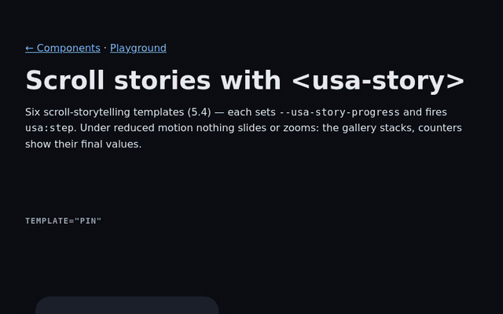

<div align="center">

# Motionary

**零依赖 · 体积实测 · 默认无障碍。** 面向 Web 的滚动动画与动画 Web Components。

_原名 **use-scroll-animate**。旧 npm 包仍会作为别名，与 motionary 同版本、同构建一起发布。_

[](https://www.npmjs.com/package/motionary) [](https://github.com/HarrisonCN/Motionary/actions/workflows/ci.yml) [](https://bundlejs.com/?q=motionary/core) [](./LICENSE) [](https://scorecard.dev/viewer/?uri=github.com/HarrisonCN/Motionary)

[English](./README.md) | **简体中文** | [日本語](./README_ja.md)

**[动画商店](https://harrisoncn.github.io/Motionary/showcase/)** · **[组件库](https://harrisoncn.github.io/Motionary/showcase/components.html)** · **[组件演练场](https://harrisoncn.github.io/Motionary/showcase/run.html)** · **[时间线编辑器](https://harrisoncn.github.io/Motionary/showcase/playground.html)** · **[滚动叙事](https://harrisoncn.github.io/Motionary/showcase/story.html)**

</div>

<p align="center"></p>

```bash
npm i motionary
```
```html
<h2 data-sa data-sa-animation="fade-in-up">Hello</h2>
<script type="module">import ScrollAnimate from 'motionary'; ScrollAnimate.init();</script>
```

Motionary 让内容在滚入视口时自然登场，并提供 <!--fact:public-->410<!--/fact--> 个开箱即用的 `<mo-*>` 动画自定义元素：按钮、卡片、表单、加载动画、页面区块、物理效果、页面转场、生成式背景、Lottie、WebGL 等等。纯 HTML、React、Vue、Svelte、Solid、Angular，以及 Electron、Tauri、WebView2 这类桌面 Web 视图都能直接使用。运行时零依赖，每个入口都可 tree-shaking 并在 CI 中实测 gzip 体积；所有动画都遵循 `prefers-reduced-motion`。

各版本的更新说明：[CHANGELOG.md](./CHANGELOG.md) · 供应链：[docs/supply-chain.md](./docs/supply-chain.md) · 带 SRI 哈希的 CDN 用法：[docs/cdn-sri.md](./docs/cdn-sri.md) · 与 AOS、GSAP、Lenis、Motion 的对比：[docs/compare](./docs/compare/README.md) · 在线试用：[StackBlitz 示例](./examples/stackblitz/README.md)。

## 目录

[包含什么](#包含什么) · [安装](#安装) · [快速上手](#快速上手) · [演示](#演示与演练场) · [组件](#组件) · [风格变体](#风格变体) · [运行时](#运行时与分级) · [AI 工作流](#ai-工作流) · [CLI](#cli) · [Figma 插件](#figma-插件) · [无障碍](#无障碍) · [性能](#性能与体积) · [版本](#版本与升级) · [文档](#文档) · [参与贡献](#参与贡献) · [许可证](#许可证) · [参考](#参考)

## 包含什么

| 方向 | 内容 | 从这里开始 |
|---|---|---|
| **滚动显现** | 14 个系列共 214 个预设：核心 33 个，`motionary/presets/extended` 再提供 181 个（淡入、缩放、3D 翻转、clip-path 形状、模糊与遮罩、弹跳、故障风、随滚动进度变化的 `scrub-*`）。另有 `timeline()`、`staggerChildren()`、`parallax()` | [预设](./docs/presets.md) · [API](./docs/API.md) |
| **核心组件** | `motionary/components` 中的 <!--fact:core-->91<!--/fact--> 个元素，按分类导入：文字、按钮、卡片、背景、过渡、手势、SVG、WebGL 等 | [组件](#组件) |
| **小部件** | <!--fact:widgets-->319<!--/fact--> 个元素，每个都有独立入口 `motionary/widgets/<name>`：页面区块、界面部件、表单、数据与媒体、纵深动效、加载动画、触感控件、实时动态卡片、3D 仪器 | [主题合集](#主题合集) |
| **效果** | <!--fact:effects-->159<!--/fact--> 个效果，每个都有独立入口 `motionary/effects/<name>`，也可以通过 `<mo-fx>` 加到任意元素上 | [动画商店](https://harrisoncn.github.io/Motionary/showcase/) |
| **风格变体与样式预设** | 六种内置风格变体（`minimal`、`neon`、`glass`、`brutalist`、`fluent`、`material`），通过共享的设计令牌切换；另有小部件专用的 1530 种样式预设：30 套配色 × 17 种效果 × 3 类 | [风格变体](#风格变体) · [样式预设](#样式预设) |
| **Motion Core 与运行时** | `motionary/core` 的 `createMotion()`（约 2.5 KB gzip），以及 `motionary/runtime` 和分为三级的 <!--fact:runtimeModules-->21<!--/fact--> 个模块：滚动场景、平滑滚动、文字拆分、SVG、精灵图、GIF / APNG / WebP、Lottie、WebGL2、glTF / OBJ、2D 物理 | [运行时](#运行时与分级) |
| **框架** | `motionary/react`、`motionary/vue`、`motionary/svelte`、`motionary/solid`、`motionary/angular`，以及元素封装。在服务端导入不会产生任何副作用 | [框架](#框架) |
| **AI 工作流** | 每个演练场都有“复制为 AI 提示词”，另有 Agent Skill、只读 MCP 服务器和本地的文字转动效解析器 | [AI 工作流](#ai-工作流) |
| **工具** | CLI（项目体检、导出到 CSS / 小程序 WXSS / 鸿蒙 ArkTS、动效令牌、codemod）、Figma 插件和 Motion Studio | [CLI](#cli) · [Figma 插件](#figma-插件) |

统计口径见 [docs/components.md](./docs/components.md#how-components-are-counted)。

## 安装

```bash
npm i motionary
```

不想引入构建工具？直接用 CDN。URL 固定到大版本（`@<!--ver:major-->17<!--/ver-->`）；生产环境请固定到具体版本并加 SRI（[docs/cdn-sri.md](./docs/cdn-sri.md)）：

```html
<script src="https://unpkg.com/motionary@17/dist/index.umd.js"></script>            <!-- 滚动 API：window.ScrollAnimate -->
<script src="https://unpkg.com/motionary@17/dist/presets-extended.umd.js"></script> <!-- 再加 181 个预设 -->
<script src="https://unpkg.com/motionary@17/dist/components.umd.js"></script>       <!-- motionary/components 的元素：window.UsaComponents -->
<script src="https://unpkg.com/motionary@17/dist/widgets.umd.js"></script>          <!-- 小部件：window.UsaWidgets -->
<mo-reveal effect="fade-up"><h2>Hello</h2></mo-reveal>
```

jsDelivr 同样可用：`https://cdn.jsdelivr.net/npm/motionary@17/dist/…`。

**元素名。** 从 17.3 起默认元素名是 `<mo-*>`。CDN 打包文件、`defineComponents()`、`defineWidgets()` 以及 17.3 之后的小部件都会自己注册它。以 ES 模块方式单独导入组件或分类时，先调用 `motionary/components/mo` 里的 `defineMoAliases()`。旧的 `<usa-*>` 名称仍可用（已弃用），`npx -p motionary mo-codemod tags --write` 可以把代码里的旧名称批量改掉。`usa:*` 事件和 `--usa-*` CSS 属性对两种名称都有效（[v17 迁移指南](./docs/migrating-to-v17.md)）。

**还在用 `use-scroll-animate`？** 它会以相同版本继续发布。想切换时，把导入和 URL 里的包名替换掉即可（[详情](./docs/versions.md)）。

## 快速上手

### HTML：data 属性

```html
<h2 data-sa data-sa-animation="fade-in-up">Hello</h2>
<div data-sa data-sa-animation="bounce-in-up" data-sa-delay="150">Card</div>

<script type="module">
  import ScrollAnimate from 'motionary';
  import 'motionary/presets/extended'; // 可选：再加 181 个预设（bounce-in-up、clip-diamond……）
  ScrollAnimate.init();                // 自动处理所有 [data-sa]
</script>
```

每个选项都有对应的 `data-sa-*` 属性（[API 参考](./docs/API.md)）。

### JavaScript

```js
import ScrollAnimate, { staggerChildren, parallax } from 'motionary';

ScrollAnimate.observe('.card', { animation: 'zoom-in-up', duration: 800, easing: 'spring' });
staggerChildren(document.querySelector('.grid'), { animation: 'stagger-pop', stagger: 60 });
parallax('.hero-bg', { speed: 0.3 });
// 原生滚动时间线：浏览器支持时不占用主线程
ScrollAnimate.observe('.logo', { animation: 'scrub-spin', engine: 'css', viewRange: ['cover 0%', 'cover 100%'] });
```

### Web Components

```html
<script type="module">
  import { defineComponents } from 'motionary/components';
  defineComponents(); // 或用 'motionary/components/lazy' 的 lazyDefine()：只加载页面上出现的标签
</script>

<mo-card effect="holo">…</mo-card>
<mo-button deform="gooey">Buy</mo-button>
<mo-fx effect="confetti" trigger="click"><button>Celebrate</button></mo-fx>
```

### Motion Core（`motionary/core`）

```js
import { createMotion } from 'motionary/core';
import { retro, cinema } from 'motionary/plugins';

const motion = createMotion().use(retro, cinema);
motion.reveal('.card', 'fade-up', { stagger: 80 });       // 滚入时登场
motion.bind(button, 'vhs-glitch', { trigger: 'click' });  // 绑定到触发事件
await motion.play(hero, 'dolly-in', { duration: 900 });   // 播放一次并等待结束
```

更多：[docs/core.md](./docs/core.md)。

### 框架

每个适配器都是独立入口，并在卸载时自动清理。

```jsx
// React
import React from 'react';
import { createReactHooks } from 'motionary/react';
const { useScrollAnimate } = createReactHooks(React);

export function Card() {
  const ref = useScrollAnimate({ animation: 'fade-in-up' });
  return <div ref={ref}>Hello</div>;
}
```

```vue
<!-- Vue 3 -->
<script setup>
import { ref, onMounted, onUnmounted } from 'vue';
import { createVueComposables } from 'motionary/vue';
const { useScrollAnimate } = createVueComposables({ ref, onMounted, onUnmounted });
const { animateRef } = useScrollAnimate({ animation: 'zoom-in' });
</script>
<template><div ref="animateRef">Hello</div></template>
```

```svelte
<!-- Svelte 3–5 -->
<script>
  import { scrollAnimate } from 'motionary/svelte';
</script>
<div use:scrollAnimate={{ animation: 'flip-up' }}>Hello</div>
```

```jsx
// Solid
import { scrollAnimate } from 'motionary/solid';
scrollAnimate; // 保留指令导入（TypeScript）
export const Card = () => <div use:scrollAnimate={{ animation: 'blur-in-up' }}>Hello</div>;
```

```ts
// Angular（standalone）：<mo-*> 元素（以及旧的 <usa-*> 名称）
import { APP_INITIALIZER, CUSTOM_ELEMENTS_SCHEMA, Component } from '@angular/core';
import { provideUsa, usaDetail } from 'motionary/angular';
// app.config.ts：providers: [provideUsa(APP_INITIALIZER, ['click', 'ui'])]   （要注册的分类）
// usa:* 事件：Angular 17+ 无法编译 `(usa:change)`，请使用 docs/frameworks-ssr.md 中 6 行的 `[usaOn]` 指令
@Component({ standalone: true, imports: [UsaOn], schemas: [CUSTOM_ELEMENTS_SCHEMA],
  template: `<mo-checkbox label="Motion" [checked]="on" [usaOn]="{ change: onChange }"></mo-checkbox>` })
export class Settings { on = false; onChange = (e: Event) => (this.on = usaDetail(e).checked); }
```

元素封装位于 `motionary/components/react` · `vue` · `svelte` · `solid`。SSR、Next.js、Nuxt、SvelteKit 见 [docs/frameworks-ssr.md](./docs/frameworks-ssr.md)（React 19 + SSR：请用 ref 加 `bindUsa` 绑定 `usa:*` 事件，因为 React 19 不会把 `onusa:*` 属性挂到水合后的元素上）。测试过的框架版本：[docs/frameworks-matrix.md](https://github.com/HarrisonCN/Motionary/blob/main/docs/frameworks-matrix.md)。按分层列出的全部公开子路径：[docs/public-api.md](./docs/public-api.md)。

## 演示与演练场

全部在浏览器里运行，无需安装。网站由 [`showcase/`](./showcase/) 构建。

| 页面 | 用途 |
|---|---|
| [动画商店](https://harrisoncn.github.io/Motionary/showcase/) | 在桌面和手机尺寸下预览、调整并复制每一个预设与效果 |
| [组件库](https://harrisoncn.github.io/Motionary/showcase/components.html) | 所有 `<mo-*>` 元素及其属性、前置依赖和分级 |
| [组件演练场](https://harrisoncn.github.io/Motionary/showcase/run.html) | 每个组件都是一个可运行的完整页面：编辑后 **运行**、**复制** 或 **下载**，三者都严格使用编辑器里的内容。支持 HTML（CDN）或 npm + 打包器（通过 import map）。缺少前置依赖时会显示修复所需的那一行。支持深链接，如 `run.html#usa-tilt` |
| [时间线编辑器](https://harrisoncn.github.io/Motionary/showcase/playground.html) | 可视化关键帧编辑器，导出给 `<mo-player>` 用的 JSON |
| [滚动叙事](https://harrisoncn.github.io/Motionary/showcase/story.html) | `<mo-story>` 滚动叙事模板 |
| [风格对照](https://harrisoncn.github.io/Motionary/showcase/styles.html) | 同一个组件的六种风格变体，每种都有自己的复制按钮 |
| [样式预设](https://harrisoncn.github.io/Motionary/showcase/looks.html) | 全部 1530 种样式预设，点一种，页面上的真实组件就换上它 |
| [跨平台预览](https://harrisoncn.github.io/Motionary/showcase/xplat.html) | 同一个预设分别在 Web、小程序和鸿蒙 ArkUI 中的效果 |
| [demo/index.html](./demo/index.html) | 全部预设，无需构建（本地直接打开） |

各个主题合集也有自己的实验页，见 [主题合集](#主题合集)。

## 组件

按需选择导入方式：

| 导入 | 注册的内容 |
|---|---|
| `motionary/components` | 全部核心元素（`defineComponents()`）；或用 `motionary/components/lazy` 的 `lazyDefine()` 只注册页面上出现的标签 |
| `motionary/components/<category>` | 单个分类，如 `motionary/components/cards` |
| `motionary/components/lite` | 全部核心元素，CSS 按需加载 |
| `motionary/widgets/<name>` | 单个小部件，如 `motionary/widgets/toast-stack` |
| `motionary/components/widgets` | 全部小部件（`defineWidgets()`，或用 `defineWidgets('17.9')` 只注册某个版本新增的） |
| `motionary/effects/<name>` | 单个效果 |

全部元素：[docs/components.md](./docs/components.md) · 每个元素一页：[docs/components/](./docs/components/README.md) · 全部入口：[docs/entry-points.md](./docs/entry-points.md)。部分小部件需要先注册运行时模块；组件库里会显示 **Requires:** 标记，完整列表见 [参考](#参考)。

<details>
<summary><b><code>motionary/components</code> 中的 <!--fact:core-->91<!--/fact--> 个核心元素</b></summary>

<!-- core-table:start -->
| 分类 | 入口 | 元素 |
|---|---|---|
| **滚动显现** | `motionary/components/reveal` | `<mo-reveal>` · `<mo-scroll-progress>` · `<mo-scrolly>` · `<mo-stagger>` |
| **文字** | `motionary/components/text` | `<mo-counter>` · `<mo-glitch>` · `<mo-gradient-text>` · `<mo-handwriting>` · `<mo-scramble>` · `<mo-scroll-highlight>` · `<mo-shimmer-text>` · `<mo-split-text>` · `<mo-text-rotate>` · `<mo-typewriter>` · `<mo-wave-text>` |
| **交互** | `motionary/components/interaction` | `<mo-magnetic>` · `<mo-press>` · `<mo-ripple>` · `<mo-spotlight>` · `<mo-tilt>` |
| **反馈** | `motionary/components/feedback` | `<mo-check>` · `<mo-progress>` · `<mo-skeleton>` · `<mo-spinner>` · `<mo-toaster>` |
| **背景** | `motionary/components/background` | `<mo-acrylic>` · `<mo-aurora>` · `<mo-blobs>` · `<mo-dot-network>` · `<mo-grain>` · `<mo-grid-glow>` · `<mo-marquee>` · `<mo-particles>` · `<mo-water-ripple>` |
| **过渡** | `motionary/components/transitions` | `<mo-accordion>` · `<mo-dialog>` · `<mo-view-switch>` |
| **弹簧与物理** | `motionary/components/physics` | `<mo-draggable>` · `<mo-overscroll>` · `<mo-spring>` |
| **卡片** | `motionary/components/cards` | `<mo-card>` · `<mo-card-stack>` · `<mo-carousel-3d>` · `<mo-sticky-stack>` |
| **点击与按钮** | `motionary/components/click` | `<mo-button>` · `<mo-checkbox>` · `<mo-click>` · `<mo-double-tap>` · `<mo-hold>` · `<mo-icon-morph>` · `<mo-like>` |
| **UI 套件** | `motionary/components/ui` | `<mo-avatar-stack>` · `<mo-badge>` · `<mo-bottom-sheet>` · `<mo-drawer>` · `<mo-fab>` · `<mo-navbar>` · `<mo-popover>` · `<mo-pull-refresh>` · `<mo-slider>` · `<mo-tabs>` |
| **整页** | `motionary/components/page` | `<mo-ambient>` · `<mo-auto-skeleton>` · `<mo-back-to-top>` · `<mo-cursor>` · `<mo-fullpage>` · `<mo-loading-bar>` · `<mo-motion-switch>` · `<mo-splash>` |
| **时间线** | `motionary/components/timeline` | `<mo-timeline>` |
| **手势** | `motionary/components/gesture` | `<mo-pinch-zoom>` · `<mo-swipeable>` |
| **SVG** | `motionary/components/svg` | `<mo-anim-icon>` · `<mo-draw>` · `<mo-mask-reveal>` · `<mo-morph>` |
| **WebGL** | `motionary/components/webgl` | `<mo-distort>` · `<mo-liquid>` · `<mo-post-fx>` · `<mo-shader>` |
| **3D 景深** | `motionary/components/depth` | `<mo-cube>` · `<mo-depth>` |
| **布局** | `motionary/components/layout` | `<mo-auto-animate>` · `<mo-masonry>` |
| **效果包** | `motionary/components/packs` | `<mo-pack>` |
| **效果注册表** | `motionary/components/fx` | `<mo-fx>` |
| **效果包元素** | `motionary/components/effects` | `<mo-audio>` · `<mo-gesture-fx>` · `<mo-motion-theme>` · `<mo-player>` · `<mo-story>` |
<!-- core-table:end -->

</details>

### 主题合集

最近几个版本按主题成组新增小部件。每组都有实验页和 API 文档；从 17.12 起，[首页](https://harrisoncn.github.io/Motionary/showcase/#collections)的“合集”区用标签页直接展示每一组的实时演示：

| 合集 | 内容 | 实验页 · 文档 |
|---|---|---|
| 弹簧部件（17.17） | 10 个基于弹簧核心的小部件：会炸开的点赞、星级评分、复制按钮、标签输入、验证码格子、可拖拽也可键盘操作的排序列表、侧滑操作行、通知栈、手风琴和滚动数字。可打断，支持键盘和读屏，减少动态效果时保持静止。可用 1530 种样式预设 | [演示](https://harrisoncn.github.io/Motionary/showcase/springs.html) · [文档](./docs/spring-parts-17-17.md) |
| 微交互（17.16） | 8 个小部件，基于新的弹簧核心：精确弹簧求解、16 个调好的弹簧和 7 种手感；`micro()` 让任意元素获得按压、悬停、抬升、磁吸、倾斜、光晕、挤压、带惯性的拖拽和聚焦反馈；反馈冲量（摇头、点头、弹出等）；以及弹簧控件（开关、复选框、输入框、状态按钮、滑块、分段控件、步进器）。可打断、保留速度，减少动态效果时保持静止。可用 1530 种样式预设 | [实验页](https://harrisoncn.github.io/Motionary/showcase/micro.html) · [文档](./docs/micro-17-16.md) |
| 工具箱：界面部件与图表（17.15） | 12 个小部件：常用界面部件（环形菜单、悬停卡片、切换按钮组、时间选择器、色板选择、日期横条、对比表）和数据图表（环形进度条、排名赛跑图、子弹图、斜率图、点图）。可用 1530 种样式预设 | [实验页](https://harrisoncn.github.io/Motionary/showcase/toolkit.html) · [文档](./docs/toolkit-17-15.md) |
| 图标（17.14–17.15） | 503 个图标：24 类原创线条图标（箭头、界面、媒体、文件、沟通、设备、天气、商业、编辑、地图出行、人物、自然、形状、时间，以及 17.15 新增的开发、安全、健康、餐饮、家居、运动、教育、金融、图表、工具），统一 24px 网格，颜色随文字。`mo-icon` 可在循环、悬停、点击或进入视口时播放 12 种动效之一（旋转、脉冲、心跳、弹跳、摇摆、抖动、铃响、漂浮、翻转、描线、弹出、闪烁）；`mo-icon-picker` 支持中英文搜索，可复制名称、标签或 SVG | [实验页](https://harrisoncn.github.io/Motionary/showcase/icons.html) · [文档](./docs/icons-17-14.md) |
| 工作室：协作、图表与趣味动效（17.13） | 20 个小部件：协作与输入（产品导览、签名板、滚轮选择器、@提及输入框、表情选择器、评论串、代码差异）、数据图表（折线图、漏斗图、矩形树图、甘特图、华夫图）和趣味动效（翻牌显示屏、刮刮卡、翻页书、环形文字、像素切换、磁力线、文字压感、洗牌网格）。可用 1530 种样式预设 | [实验页](https://harrisoncn.github.io/Motionary/showcase/studio.html) · [文档](./docs/studio-17-13.md) |
| 部件与首页合集（17.12） | 18 个小部件：界面部件（进度标签页、代码标签页、有用投票、分享按钮、行内编辑、标签云）、数据与交互（热力图、环形图、可排序列表、放大镜、评分条、待办清单）和动效（流星、连接光束、复古网格、环绕轨道、字母翻转、波纹网格） | [实验页](https://harrisoncn.github.io/Motionary/showcase/parts.html) · [文档](./docs/parts-17-12.md) |
| 页面块、组件与纵深动效（17.11） | 20 个小部件：页面区块（搜索栏、订阅框、下载按钮、揭示式页脚、形状分隔线）、界面部件（虚拟列表、无限滚动、右键菜单、分栏、桌面窗口、变形卡片）和纵深动效（滚动缩放、图片隧道、环绕画廊、边框光束）。可配合 [1530 种样式预设](#样式预设) | [实验页](https://harrisoncn.github.io/Motionary/showcase/blocks.html) · [文档](./docs/blocks-17-11.md) |
| 界面、组件与动效（17.10） | 21 个小部件：页面区块（侧边栏、目录跟随、价格表、便当格布局、吸底按钮）、数据与媒体（灯箱、数据表、JSON 查看器、热点图）和动效界面（横向滚动、图片拖尾、液态玻璃、路径动画） | [实验页](https://harrisoncn.github.io/Motionary/showcase/kit.html) · [文档](./docs/kit-17-10.md) |
| 微交互与触感（17.9） | 34 个小部件：微交互、Q 弹的触感控件、纯 CSS 加载动画、表单细节（标签输入、套餐选择、弹性滑块、密码强度） | [实验页](https://harrisoncn.github.io/Motionary/showcase/moments.html) · [文档](./docs/moments-tactile.md) |
| 空间仪器（17.8） | 3 个可拖动探索的 3D 卡片和 3 个效果，基于可选的 Three.js 渲染器 | [实验页](https://harrisoncn.github.io/Motionary/showcase/instruments.html) · [文档](./docs/runtime/spatial-instruments.md) |
| Form Atelier（17.7） | 12 个表单小部件（下拉选择、组合框、多选、密码、区间滑块、分步表单）和 4 个 SVG 反馈效果 | [实验页](https://harrisoncn.github.io/Motionary/showcase/forms.html) · [文档](./docs/form-atelier.md) |
| Matter & Motion（17.6） | 13 个可交互的物理场、流体文字和曲线实验，以及 6 个效果 | [实验页](https://harrisoncn.github.io/Motionary/showcase/matter.html) · [文档](./docs/matter-motion.md) |
| 实时动态（17.5） | 15 个紧凑的动态卡片（航班状态、快递追踪、运动播放器）和一面漂移的卡片墙 | [实验页](https://harrisoncn.github.io/Motionary/showcase/activity.html) · [文档](./docs/live-activities.md) |
| 发光控件（17.4） | 6 个发光控件：昼夜开关、粒子图标与按钮、光晕滑块、环形进度 | [实验页](https://harrisoncn.github.io/Motionary/showcase/luminous.html) · [文档](./docs/luminous-controls.md) |

更早的小部件（文件树、下载菜单、电影片头等）：[docs/gallery-components.md](./docs/gallery-components.md)。

## 风格变体

所有元素都读取同一组设计令牌（`--usa-accent`、`--usa-surface`、`--usa-text`、`--usa-radius`、`--usa-font` 等）。一个变体会一次性设置全部令牌：给元素加 `variant="glass"`，给任意祖先加 `data-usa-variant="glass"`，或者切换整个页面：

```js
import { setVariant } from 'motionary/components/ui';
setVariant('glass'); // minimal · neon · glass · brutalist · fluent · material
```

令牌也可以自己设置。并排对比见 [风格对照页](https://harrisoncn.github.io/Motionary/showcase/styles.html) 和 [docs/components.md](./docs/components.md)。

### 样式预设

小部件另有 1530 种现成的样式预设：30 套配色 × 17 种效果，分界面、组件、动效三类，每类 510 种（17.14 新增 8 套配色，每类新增 8 种效果；17.15 再加 10 套配色）。效果改的不只是颜色，还有边框、圆角、阴影、发光、毛玻璃、字体、图片滤镜、相框和循环速度；每种预设的文字对比度都达到 WCAG AA。预设只设置 `--mo-kit-*` 令牌，所以任何读取这些令牌的小部件都能用任意一种。

```js
import { adoptLooks, applyLook } from 'motionary/components/widgets';

adoptLooks();                 // 加载全部预设，或 adoptLooks('ui') 只加载一类
// <mo-subscribe look="neon-ocean"></mo-subscribe>，或在任意祖先元素上写 data-mo-look="neon-ocean"
applyLook(document.querySelector('mo-split-pane'), 'frosted-grape');
```

在 [样式预设页](https://harrisoncn.github.io/Motionary/showcase/looks.html) 浏览全部预设；名称、令牌和辅助函数见 [docs/looks-17-11.md](./docs/looks-17-11.md)。

## 运行时与分级

`motionary/runtime` 是 Motionary 自研的动画运行时：共享的 ticker、tween 与 timeline 引擎，外加按功能或文件格式划分的模块（`motionary/runtime/<module>`）。用 `use()` 注册你需要的模块。每个模块属于一个等级，只依赖同级或更低等级，所以基础页面永远不会下载 WebGL、3D 或物理相关代码。

| 等级 | 模块 | 打包体积（gzip，13.0） | 历史参考 |
|---|---|---:|---:|
| **基础** | 核心（ticker、tween、timeline）、`scroll`、`text`、`format-css`、`format-motion` | 10.83 KB | 12 KB |
| **标准** | 基础 + `smooth`、`drag-snap`、`format-svg`、`format-sprite`、`format-gif`、`format-apng`、`format-webp`、`vector`（Lottie / dotLottie）、`lottie-state`；官方 Rive 运行时 | 33.74 KB | 37 KB |
| **高级** | 标准 + `gl`（WebGL2）、`format-gltf`、`format-obj`、`gltf-anim`、`gltf-decoders`（Draco / KTX2）、`physics`、`format-scene` | 54.55 KB | 60 KB |

```js
import { use } from 'motionary/runtime';
import { scroll } from 'motionary/runtime/scroll';
import { defineScrollScene } from 'motionary/components/widgets';

use(scroll);          // 先注册模块（同时会注册核心）
defineScrollScene();  // 再定义依赖它的组件
```

组件缺少所需模块时会抛出明确的错误，并给出安装、导入和 CDN 的修复方法。详见 [docs/runtime-tiers.md](./docs/runtime-tiers.md)、[docs/runtime/](./docs/runtime/) 中每个模块的单独页面，以及本文末尾的 [参考](#参考)。

## AI 工作流

**复制为 AI 提示词。** 动画商店的效果详情、时间线编辑器和组件演练场都有 **复制为 AI 提示词** 按钮，会把代码连同你调过的每个参数一起复制，直接粘贴给编程助手即可。

**Agent Skill。** [`skills/motionary/SKILL.md`](./skills/motionary/SKILL.md) 告诉 Claude Code、Codex 等支持 Agent Skills 的智能体：怎样安装、注册和挑选 Motionary 组件，以及要遵守哪些规则。用 `npx skills add HarrisonCN/Motionary` 安装，或把这个文件夹复制到 `.claude/skills/`。

**MCP 服务器。** `motionary-mcp` 是一个只读的 [Model Context Protocol](https://modelcontextprotocol.io) 服务器。Claude、Cursor、VS Code、Windsurf、Zed 等 MCP 客户端可以通过它查询组件目录，并拿到已经按正确顺序安装、导入、注册好全部前置依赖的代码片段。

```json
{ "mcpServers": { "motionary": { "command": "npx", "args": ["-y", "-p", "motionary", "motionary-mcp"] } } }
```

Claude Code：`claude mcp add motionary -- npx -y -p motionary motionary-mcp`。

- 工具：`list_components`、`search_components`、`get_component`、`get_example`、`scaffold_snippet`、`suggest_motion`、`validate_snippet`、`check_compat`。
- `validate_snippet { mount: true }` 会在 jsdom（可选 peer 依赖：`npm i -D jsdom`）中用真实的打包产物挂载代码，并按组件契约检查；代码片段自身的脚本不会被执行。
- 回答会按你项目中安装的版本给出；`check_compat` 会列出该版本缺少或行为不同的部分。
- 完整指南：[docs/mcp.md](./docs/mcp.md)。

**用文字描述动效。** `motionary/tooling/ai` 能把“卡片从下往上依次淡入”这样的描述转换成效果、关键帧、CSS 以及对应的组件。默认解析器在本地运行、结果确定（支持中文和英文）。想用自己的 LLM，给 `suggestMotion()` 传入一个 provider 即可。Motionary 不内置任何厂商 SDK，除非你传入 provider，否则不会发起网络请求。模型的回答会经过 JSON Schema 校验，不通过时自动回退到本地结果。

```ts
import { suggestMotion } from 'motionary/tooling/ai';
const { intent, source } = await suggestMotion('卡片像多米诺骨牌一样依次倒下', { provider }); // provider 可省略
el.animate(intent.keyframes, intent.options);
```

更多：[AGENTS.md](./AGENTS.md) · [docs/ai-provider.md](./docs/ai-provider.md) · [提示词指南](./docs/ai-prompt-guide.md) · 网站提供 [`components.json`](https://harrisoncn.github.io/Motionary/components.json) 与 [`llms.txt`](https://harrisoncn.github.io/Motionary/llms.txt)。

## CLI

全部随 `motionary` 包一起发布，用 `npx` 运行：

| 命令 | 作用 |
|---|---|
| `npx motionary doctor [paths…] [--json]` | 列出项目中已移除的导入路径和旧事件名；发现问题时以退出码 1 结束，可直接用于 CI |
| `npx motionary export --target css\|wxss\|arkts [--presets a,b] [--rpx] [--out file]` | 把预设和动效令牌导出为 CSS、小程序 WXSS 或鸿蒙 ArkTS（[docs/cross-platform.md](./docs/cross-platform.md)） |
| `npx motionary compat <version> [--json]` | 该版本的项目能用什么，以及之后改了什么（[docs/version-compat.md](./docs/version-compat.md)） |
| `npx motionary tokens import-figma\|export-figma\|validate\|css …` | Motion Tokens 2.0：Figma Variables JSON ↔ W3C 设计令牌 / CSS，以及令牌文件校验；不发起网络请求（[docs/motion-tokens.md](./docs/motion-tokens.md)） |
| `npx -p motionary mo-codemod tags --write` | 把代码中的 `<usa-*>` 标签改为 `<mo-*>` |
| `npx usa-codemod-13 [--write] [paths…]` | 改写 13.0 移除的路径以及固定在 `@10` / `@11` / `@12` 的 CDN URL。不加 `--write` 时只预览；`usa-codemod-11` 和 `usa-codemod-12` 对应更早的大版本 |
| `npx create-motionary-plugin <name>` | 生成一个带测试和签名脚本的效果插件 |
| `npx -y -p motionary motionary-mcp` | 启动 MCP 服务器（见 [AI 工作流](#ai-工作流)） |

## Figma 插件

[figma-plugin/](./figma-plugin/README.md)（也位于 `node_modules/motionary/figma-plugin/`）可以把当前选中的内容导出为 **完整的 HTML 页面**（令牌、按顺序排列的前置脚本、每个图层对应一个元素）、**CSS 令牌** 和 **motion.tokens.json**（W3C 设计令牌）。以组件命名的图层（如 `usa-tilt`）会变成对应的元素，Figma 变量 `motion/duration/*` 和 `motion/easing/*` 会覆盖默认令牌。插件不访问网络，也不会修改文档。完整的 Motion Tokens 2.0 令牌集可用 `npx motionary tokens export-figma` / `import-figma` 与 Figma Variables 互转。详见 [figma-plugin/README.md](./figma-plugin/README.md) 与 [docs/motion-tokens.md](./docs/motion-tokens.md)。

## 无障碍

- 在 `prefers-reduced-motion: reduce` 下，滚动显现会直接显示内容（没有入场、视差或 scrub），组件切换到平静状态（`staticAlternative()`、`adaptKeyframes()`）。
- `motionary/components/a11y`：`setMotionSensitivity()` 让用户关闭闪烁、循环或视差；另有用于实时区域的 `announce()`、`auditMotionA11y()` 和 `baselineReport()`。`<mo-motion-switch>` 是现成的动效开关。
- 每个元素都遵循同一份 [组件契约](./docs/component-contract.md)（键盘、焦点、事件、生命周期、减弱动效），由 `npm run check:contract` 在 CI 中强制检查。
- 更多：[docs/accessibility.md](./docs/accessibility.md)。

## 性能与体积

组件数量和产物体积都不设上限。[`size-budget.json`](./size-budget.json) 保留历史参考值，CI 报告实测体积；超过参考值不会让 CI 失败（[体积策略](./docs/size-policy.md)）。

<!-- size-table:start -->
17.9.0 构建的实测值（minify + gzip），由 `scripts/size.mjs --report` 生成：

| 导入内容 | gzip | 历史参考 |
|---|---:|---:|
| `motionary/core`（`createMotion`） | 2.53 KB | 10.00 KB |
| `import ScrollAnimate from 'motionary'`（默认实例） | 5.49 KB | 6.00 KB |
| `motionary` 全部导出 | 8.89 KB | 9.75 KB |
| `dist/index.umd.js`（CDN） | 9.03 KB | 9.75 KB |
| 仅 `parallax()` | 0.94 KB | 2.00 KB |
| `motionary/presets/extended`（181 个预设） | 4.69 KB | 5.25 KB |
| `motionary/runtime`（运行时核心） | 5.43 KB | 5.50 KB |
| `motionary/components/reveal` | 4.47 KB | 5.00 KB |
| `motionary/components/lite`（全部元素，CSS 按需） | 78.26 KB | 79.00 KB |
| `motionary/components`（全部元素 + CSS） | 95.17 KB | 93.75 KB |
| `dist/components.umd.js`（CDN，全部） | 118.81 KB | 115.75 KB |
<!-- size-table:end -->

- 默认不注册滚动监听（改用 IntersectionObserver），动画只走合成层属性（`transform`、`opacity`、`filter`、`clip-path`）。
- 导入没有副作用（[docs/tree-shaking.md](./docs/tree-shaking.md)）。
- 每个 PR 都会在无头 Chrome 中测量首屏传输量、脚本耗时、GPU 资源和帧稳定性（[docs/perf-ci.md](./docs/perf-ci.md)）。
- npm 包不含 source map。它们保存在打了标签的 git 树中（每个文件的 `sourceMappingURL` 指向那里），从 16.3 起也作为 `sourcemaps` 压缩包附在每个 GitHub Release 上（[docs/source-maps.md](./docs/source-maps.md)）。
- 更多：[docs/performance.md](./docs/performance.md)。

**浏览器：** 2023 年以来的常青浏览器（Chrome / Edge ≥ 111、Safari ≥ 16.4、Firefox ≥ 115、WebView2、Electron ≥ 24）。浏览器支持时使用 View Transitions 和滚动驱动动画，不支持时回退到 JavaScript。`baselineReport()` 可以检查指定浏览器。

## 版本与升级

- **npm dist-tags：** `latest` 指向当前大版本的最新版本（<!--ver:version-->17.9.0<!--/ver-->；从 14.1 起次版本也会移动它）。每个次版本另有自己的标签 `v<major>-<minor>`（例如 `v15-0`），`v15-line` 跟随 15.x，`v14-lts` 为 14.9.x。`motionary` 与 `use-scroll-animate` 总是以相同版本一起发布。
- **CDN：** URL 固定到大版本（`motionary@<!--ver:major-->17<!--/ver-->`）；固定到具体版本（`motionary@12.4.0`）的链接也继续可用。
- **语义化版本：** 破坏性变更只出现在大版本中，并配有迁移指南和 codemod。弃用的接口会保留到下一个大版本，带 `@deprecated` 类型，运行时不发警告。
- **稳定与实验性：** 滚动 API、`motionary/core`、预设、`motionary/motion`、`motionary/scene`、`motionary/runtime/*`、`<mo-*>` 组件与小部件、框架适配层和 CLI 属于稳定部分。Motion Studio（`motionary/studio/*`）、AI 助手与 provider、MCP 服务器、Figma 插件和跨平台导出属于实验性功能，可能在次版本中变化（[docs/stability.md](./docs/stability.md)）。
- **各版本有什么：** 每个组件和运行时模块的 `since` / `changed`（[docs/version-compat.md](./docs/version-compat.md)），逐项功能支持情况（[docs/compat-matrix.md](./docs/compat-matrix.md)）。详情：[docs/versions.md](./docs/versions.md) · [CHANGELOG.md](./CHANGELOG.md)。

迁移指南：[17](./docs/migrating-to-v17.md) · [16](./docs/migrating-to-v16.md) · [15](./docs/migrating-to-v15.md) · [14](./docs/migrating-to-v14.md) · [13](./docs/upgrading-13.md) · [12](./docs/upgrading-12.md) · [11](./docs/upgrading-11.md) · [10](./docs/upgrading-10.md) · [9](./docs/upgrading-9.md) · [8](./docs/upgrading-8.md) · [7](./docs/upgrading-7.md) · [6](./docs/upgrading-6.md) · [5](./docs/upgrading-5.md) · [4](./docs/upgrading-4.md) · [3](./docs/upgrading-3.md) · [2](./docs/deprecations.md)。从其他库迁移：[AOS](./docs/migration-from-aos.md) · [GSAP ScrollTrigger](./docs/migration-from-gsap-scrolltrigger.md)。`npx motionary doctor` 会找出还需要修改的地方。

## 文档

| 主题 | 文档 |
|---|---|
| 参考 | [API](./docs/API.md) · [预设](./docs/presets.md)（全部 214 个） · [组件](./docs/components.md) · [样式预设](./docs/looks-17-11.md) · [入口](./docs/entry-points.md) · [按分层的公开 API](./docs/public-api.md) · [Motion Core](./docs/core.md) · [时间线编辑器模型](./docs/timeline-editor.md) |
| 运行时 | [运行时分级](./docs/runtime-tiers.md) · [模块](./docs/runtime/) · [兼容性矩阵](./docs/compat-matrix.md) |
| 平台 | [框架与 SSR](./docs/frameworks-ssr.md) · [框架矩阵](https://github.com/HarrisonCN/Motionary/blob/main/docs/frameworks-matrix.md) · [Windows 应用](./docs/windows-apps.md) · [混合应用（MAUI、Flutter、Electron、Tauri）](./docs/hybrid-apps.md) · [跨平台导出](./docs/cross-platform.md) · [示例](./examples/) |
| 设计与 AI | [Motion Studio 2.0 应用](./docs/studio-app.md) · [Motion Studio](./docs/studio.md) · [Studio 导出](./docs/studio-export.md) · [Studio 模板](./docs/studio-templates.md) · [Studio AI 助手](./docs/studio-ai.md) · [Studio 素材](./docs/studio-assets.md) · [Studio 画布](./docs/studio-canvas.md) · [布局动效 2.0](./docs/layout-motion.md) · [动效令牌 2.0](./docs/motion-tokens.md) · [Figma 插件](./figma-plugin/README.md) · [MCP 服务器](./docs/mcp.md) · [AI provider](./docs/ai-provider.md) · [提示词指南](./docs/ai-prompt-guide.md) |
| 质量 | [无障碍](./docs/accessibility.md) · [组件契约](./docs/component-contract.md) · [性能](./docs/performance.md) · [性能 CI](./docs/perf-ci.md) · [调度](./docs/scheduling.md) · [Tree-shaking](./docs/tree-shaking.md) · [Source map](./docs/source-maps.md) |
| 项目 | [架构](./docs/architecture.md) · [路线图](./docs/ROADMAP.md) · [版本](./docs/versions.md) · [更新日志](./CHANGELOG.md) |

架构分为四层（Motion Core、运行时、组件、工具），框架入口位于最上层；`test/architecture.test.ts` 会检查层与层之间的导入规则（[docs/architecture.md](./docs/architecture.md)）。`docs/` 中的文档是英文的，路线图除外（中文）。

## 参与贡献

欢迎提交 Issue 和 Pull Request，参见 [CONTRIBUTING.md](./CONTRIBUTING.md)。提交 PR 前请运行 `npm test`、`npm run build`、`npm run check:docs`、`npm run check:contract`、`npm run check:peer-docs` 和 `npm run size:check`。如果改动了行为，请同时更新 [README.md](./README.md)、本文件和 [README_ja.md](./README_ja.md)。数量、版本号以及标为自动生成的表格来自脚本（`node scripts/facts.mjs`、`node scripts/readme-sync.mjs`、`node scripts/gen-runtime-docs.mjs`），请不要手动修改。

## 许可证

MIT © HarrisonCN，参见 [LICENSE](./LICENSE)。

## 参考

运行时模块一览、每个组件的前置依赖（安装、导入与注册顺序、CDN 加载顺序、最小示例）以及 11.0 冻结的兼容性矩阵，都由 `node scripts/gen-runtime-docs.mjs` 根据经过测试的模块数据生成，仅提供英文版：见英文 README 的 [Reference](./README.md#reference) 一节、[docs/runtime/](./docs/runtime/) 和 [docs/compat-matrix.md](./docs/compat-matrix.md)。
